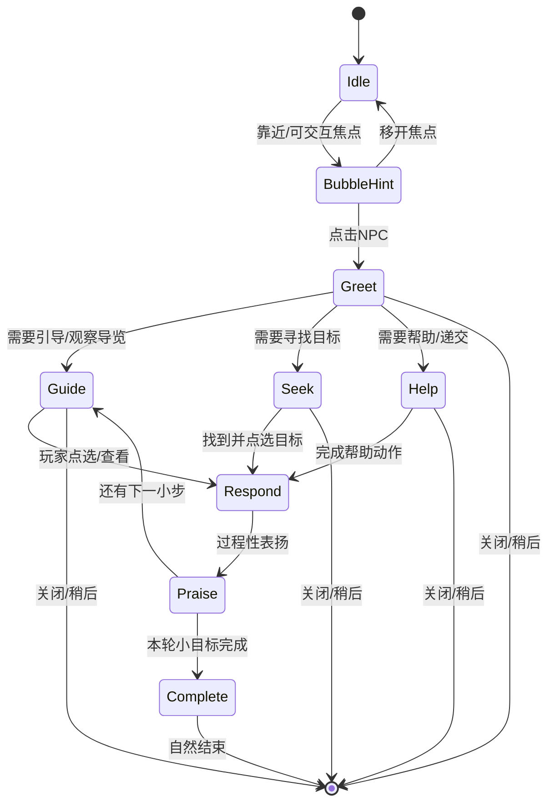

# 城镇 UI 分区 B 设计定稿：村民对话框与交互气泡/会话 UI

> 文档状态：**UI 设计定稿（分区 B，供 PO review / 后续 spec 与实现票引用）**  
> 产出日期：2026-11-12  
> 负责分区：**村民/NPC 交互时的对话框、气泡、回应面板、图标化选项、会话内表扬/完成反馈**  
> 对齐分区 A：[`docs/design/town-ui-entry-hud-spec.md`](town-ui-entry-hud-spec.md)（入口卡、全局 HUD、任务提示、右上小地图、全局交互提示位）  
> 事实与视觉输入：[`../town-villagers-design.md`](../town-villagers-design.md) · [`../design/town-villagers-visual-spec.md`](town-villagers-visual-spec.md) · [`../town-map-design.md`](../town-map-design.md) · [`../town-assets-requirements.md`](../town-assets-requirements.md)

---

## 1. 目的与范围

### 1.1 目的
为 Midport Village 城镇模式中“与村民/NPC/可交互对象发生对话与回应”的界面提供可直接落实现票的 UI 规格：让 6 岁玩家在**纯鼠标点选、图标+中文 TTS、无键盘/指针锁定、零惩罚/零倒计时**的前提下，清楚理解“谁在说话、可以做什么、刚才做得很好”。

### 1.2 覆盖范围（本分区 owner）
- **World Bubble（世界气泡）**：锚定角色头顶或交互点的轻量气泡，用于招呼、情绪、短提示、指向性回应。
- **Session Panel（会话面板）**：与 NPC 进入一轮会话时的屏幕内回应面板，承载角色身份、当前意图、图标化选项、继续/关闭与会话内反馈。
- **图标化选项与无压力操作**：选项按钮、继续、关闭/稍后再说、返回上一步（若有）的呈现与交互规则。
- **会话内表扬/完成反馈**：过程性表扬、阶段完成、找到/帮到后的正向反馈呈现（局部于会话/气泡语境）。
- **会话状态流转**：打招呼/引导/寻找-回应/帮助完成等典型回合状态与切换节奏。
- **TTS 与图标/短文案协同**：会话语境下“先看懂图、再听懂话”的播报与可重复收听原则。

### 1.3 不在范围（由分区 A 或其他文档负责）
- **入口卡与模式进入**：归属 [`town-ui-entry-hud-spec.md`](town-ui-entry-hud-spec.md)。
- **全局常驻 HUD、任务提示条、右上小地图、全局交互提示位**：归属分区 A（本分区仅定义与其衔接接口，不重复定义常驻位）。
- **建筑/场景/角色模型与贴图本体**：归属 `town-buildings-visual-spec.md`、`town-villagers-visual-spec.md`。
- **玩法数值、任务脚本内容、判定逻辑**：归属后续 spec/实现票；本文件只规定 UI 呈现与交互模式。
- **键盘导航、手柄焦点、指针锁定流程**：与 `MISSION.md` 约束冲突，**不纳入**。

### 1.4 体验基调（硬约束）
- **祥和无威胁、温暖热闹**：契合 Midport Village 友善村民与铁傀儡“阿稳”守护气质（`town-villagers-design.md`、`town-map-design.md` §5）。
- **过程性表扬、零惩罚、零倒计时压迫**：任何一步都可尝试、可离开、可再来；无失败红叉、无扣分、无限时条（`MISSION.md`）。
- **6 岁可读**：图标是主信息、短中文是辅助、TTS 是并行理解通道；界面“看一眼就知道能点什么”。

---

## 2. 与分区 A 的边界与接口

### 2.1 边界声明

| 主题 | 分区 B（本文件） | 分区 A（entry-hud-spec） |
|---|---|---|
| 入口/返回城镇入口 | 不负责 | Town 入口卡、入口 HUD（`§4, §5.1`） |
| 全局任务目标 | 不作为常驻主显示；仅在会话内“呼应当前一步” | 任务提示位主显示（`§5.3`） |
| 地图与方位 | 不显示小地图 | 右上小地图（`§5.4`） |
| “可交互”发现提示 | 角色头顶/近身 bubble 可作为局部提示；不占用全局常驻条 | 全局交互提示位 owner（`§5.5`） |
| 会话内对话与选项 | **owner**：bubble + session panel + 选项 + 会话反馈 | 接收会话状态并做 HUD 弱化/协调（`§6.4`） |
| 过程性表扬 | **会话内局部呈现 owner**（对话完成/回应/帮助成功当下） | 全局任务完成等常驻层反馈可由 A 统筹；语义需一致不冲突 |

### 2.2 接口点（供后续 spec/实现对齐）

| 接口 | 方向 | 说明 | 备注 |
|---|---|---|---|
| `town-ui/interact/focus` | A → B | 玩家点击/选中某 NPC 或可交互对象时，A 提供命中对象 id、世界锚点、可交互类型 | 复用 A 的点击命中与选中高亮语义（A `§6.2`），B 决定是否开 bubble/session |
| `town-ui/interact/affordance` | A ↔ B | 可交互高亮/描边（UI-03 语义）保持一致；角色近身 bubble 出现时不应与全局提示“抢戏打架” | 高亮状态色与轮廓语言统一，避免双重闪烁 |
| `town-ui/dialog/open` (`town:dialogue:opened`) | B → A | 会话打开：携带 `{npcId, anchor, sessionKind, taskRef?}` | A 据此弱化非必要 HUD 元素、暂停与会话冲突的全局提示（A `§6.4`） |
| `town-ui/dialog/update` | B → A | 会话状态变更：`{step, intent, canClose, hasPendingChoice}` | 供 A 判断是否保持 HUD 收敛态 |
| `town-ui/dialog/close` (`town:dialogue:closed`) | B → A | 会话结束/关闭：携带 `{result: continue|done|deferred, taskRef?}` | A 恢复 HUD；若 `done` 且关联任务推进，由 A 的任务提示位更新主状态（B 可同时播一次局部完成反馈） |
| `town-ui/task/context` | A → B | 当前任务上下文（图标/阶段/关联 NPC）只读输入 | B 在 panel 内可显示“当前这一小步”的呼应图标，但**不替代** A 的常驻任务条 |
| TTS 通道 | 共享 | `SpeechKit`/等价语音出口统一排队：会话播报优先级高于氛围闲聊，避免重叠抢话 | 具体仲裁策略由实现票定；B 负责声明“本句需播报/可重播”意图 |
| 资产语义 | 共享 | UI-02 气泡底板、UI-03 高亮、UI-04 表扬反馈、UI-05 道具图标（assets req §7） | B 规定使用方式与状态，不新增与 A 冲突的另一套基础控件风格 |

### 2.3 冲突裁决原则
- **同一时刻信息主次**：进入 Session Panel 时，玩家注意力归会话；A 保留最小必要 HUD（入口/安全返回能力由 A 定），其余让位。
- **任务完成的“宣布权”**：局部完成动画/夸奖可由 B 即时呈现；任务进度条目/常驻状态变更由 A 落地显示，避免两处各说各话。
- **提示不重复轰炸**：全局“点一点”提示与 NPC 头顶 bubble 不同时高强度出现；近身交互以 bubble/选中高亮为主，全局提示退后。

---

## 3. 设计原则（分区内）

1. **图标先行，文字辅助，语音并行**：每个选项/意图必须有可辨识图标；短文案 1-4 字（如“你好”“给你”“好的”）仅作辅助与 TTS 字幕感，不承载唯一信息。
2. **一屏一意**：Session Panel 同时只聚焦一个会话意图与一组可选动作（默认 ≤3 选项），降低选择负担。
3. **可预期、可撤退**：玩家永远能看到“关闭/稍后”或等价无压力出口；关闭不等于失败，TTS/文案用“下次再来也可以”等鼓励口吻。
4. **角色即语境**：bubble/panel 绑定说话者身份（头像/职业符号/名字色条），避免“谁在说话”混淆；与 villagers 角色识别符号一致。
5. **稳定布局**：固定尺寸槽位与数值容器思路用于选项与图标位；切换状态不引发布局跳动（对齐 threejs UI 稳定性原则）。
6. **克制动效**：入场/切换/表扬用短促柔和动效（150-220ms 级感知），尊重低刺激与舒缓节奏（≥1s 的行为/反馈节奏语境来自 villagers 群体表现）；无闪烁惊吓。

---

## 4. 视觉规格

### 4.1 视觉语言与色板（与城镇规范对齐）

| 元素 | 规格 | 依据/备注 |
|---|---|---|
| 面板/气泡底 | `Bread Cream #F4D9A6` 或 `Stone Light #D7D2C8` 为主底，90-96% 不透明；避免纯白刺眼 | 全局暖明基调（villagers spec §3.1, buildings 暖亮） |
| 描边/分隔 | `Outline Brown #5A4636` 1-2px（或等效体素描边），圆角 12-20px（逻辑像素） | 清晰轮廓、低威胁 |
| 强调/可交互 | `Sky Cloth #7EC8D8`（引导）、`Meadow Green #7FB069`（正向/继续）、`Market Red #D96B52` 仅作温暖点缀**不用作错误/警告** | 禁止红色惩罚语义 |
| 文字色 | 主文 `#5A4636`，辅文 `#6B4E3D`；置于浅底保证对比 | 6 岁可读 |
| 高亮/选中 | 外发柔和暖金/天蓝描边（与 UI-03 一致），不闪烁 | 选中态可见但不刺眼 |
| 铁傀儡/守护语境点缀 | 可少量使用 `Golem Vine #6F8F5B`/铁灰中性色作身份条，不引入压迫感 | G01 友好守护 |

### 4.2 构件类型与尺寸层级

> 尺寸为 **CSS 逻辑像素**建议基线，按参考分辨率统一缩放（与分区 A 同类策略一致）；实际实现需在 1280×720、1920×1080 及窄窗/平板宽高比下验证不裁切、不遮挡关键视线。

| 构件 | 用途 | 建议尺寸/形态 | 位置与锚定 |
|---|---|---|---|
| **Bubble-S（短气泡）** | 招呼、表情、1 个图标意图（如挥手/面包） | 宽自适应 72-160，高 56-72；内边距 10-12；尾尖指向角色 | 世界锚定角色头顶上方偏移，随镜头投影但做边界夹紧避免出屏；同屏优先 1 个主 bubble |
| **Bubble-M（内容气泡）** | 寻找提示/指认目标（图标+极短词） | 宽 160-240，高 72-96；可含 1 个目标图标+指向箭头 | 锚定对象或 NPC，尾尖/箭头指向目标方向 |
| **Session Panel（会话面板）** | 正式对话回合、选项选择、阶段完成反馈 | 宽 `min(720px, 92vw)`，高自适应 180-320（内容驱动但有上限）；圆角 20 | **底部居中**贴安全区上缘（距底 24-40），不遮挡 NPC 面部与玩家视线主路径；顶部保留世界可见区 |
| **Speaker Strip（说话者条）** | 显示当前 NPC 身份 | 高 48-56，含头像/职业符号+名字（短） | Panel 内顶部左侧 |
| **Option Chip（图标选项）** | 玩家可选回应/行动 | **主选项 64×64 图标触点**（含热区 ≥56×56），横排 2-3 个；图标 32-40，标签 12-14px 等效 1-3 字 | Panel 中部居中排列，间距 ≥16 |
| **Action Ghost（次操作）** | 关闭/稍后/再听一次 | 文字按钮高度 ≥44，图标+短词；视觉弱于主选项 | Panel 右上或底部角落，始终可见（无压力出口） |
| **Praise Toast-in-Panel（会话内表扬）** | 单步夸奖/完成瞬间 | 叠加于 Panel 上半区或 Bubble 旁，96-160 宽的徽章式反馈 | 1.2-2.0s 柔和出现后自然收敛，不阻塞继续 |

### 4.3 位置、锚定与安全区
- **世界气泡**：锚点 = NPC 头顶/手持物上方逻辑点（参考 villagers 头高 2.0 格、傀儡 2.7 格）；投影到屏幕后应用 **16px 屏幕边距夹紧**，避免被裁切；尾尖始终朝向锚点方向。
- **会话面板**：固定在屏幕底部居中安全区内，`margin-bottom` 计入安全边距；**不得覆盖**分区 A 右上小地图区域（若同时可见，panel 上沿需低于小地图下沿留出 ≥16px 间隙）与左上关键信息区。
- **无遮挡原则**：panel 默认半透明度与高度控制确保上半屏 ≥55% 可见世界（便于看 NPC 表情/指向目标）；需要强调目标时可短暂降低 panel 视觉权重而非加遮罩变暗世界。
- **多气泡裁决**：同一时刻仅 1 个“主会话气泡/panel”激活；背景 NPC 可有低优先级闲聊 bubble（可选、非本分区强制），但不得与当前会话竞争注意力。

### 4.4 图标、短文案与 TTS 协同原则
- **图标**：优先复用/对齐 UI-01 语义图标与角色手持/职业符号（面包、花束、卷轴、锤、麦束、钟、爱心/星等），线条简洁、暖亮高对比；同一语义全局同图。
- **短文案**：1-4 个汉字或极短词组（“你好”“找找”“给你”“谢谢”“再见”），字号等效 ≥18px（参考分辨率），加粗圆润；仅辅助，不出现长句说明。
- **TTS**：进入会话步骤、选项获得焦点/被点中、表扬与完成时可播报对应短句；遵循“图标先理解、语音跟上确认”节奏。提供**再听一次**（喇叭图标小按钮）而非自动重复轰炸；若系统静音/无语音能力，界面仅靠图标+短文案仍可完成（MISSION 零文字依赖倾向 = 不依赖大段文字，非禁止短词/语音缺失兜底）。
- **情绪一致**：TTS 文案与表情/动作一致（打招呼配挥手、完成配开心），语气温柔鼓励（process praise）。

### 4.5 儿童可读性与可点选性
- **点选热区**：所有可点选元素热区 ≥ 44×44 CSS px，推荐 56×56（选项）/64×64（主选项）；相邻选项间距 ≥ 12-16px 防误触。
- **状态清晰**：default / hover（桌面）/ pressed / selected / disabled-不可用但友好（极少用，仅表示“暂未解锁”且以灰阶中性+锁/睡眠图标表达，**不用红叉**）四态可辨；pressed 有轻微缩放 0.97 与亮度反馈（对齐设计工程手感，克制）。
- **无阅读负担**：不出现段落文本、数字倒计时、复杂进度百分比；数量/进度若必须表达，用 1-3 个实心/空心图符。
- **动效与舒适**：避免高频闪烁与大幅位移；表扬粒子小范围、暖色、短时。

---

## 5. 交互流程与会话状态

### 5.1 会话分层

| 层级 | 触发 | UI 形态 | 典型时长/节奏 |
|---|---|---|---|
| **L0 环境感知** | 玩家靠近可交互 NPC/对象 | 角色自然行为 +（可选）轻量 Bubble-S 身份/情绪，无强制打断 | 持续 |
| **L1 轻交互** | 点击 NPC（问候）或对象一次 | Bubble-S/M 或短 Panel 单步，1 次反馈即回 L0 | 1-3s |
| **L2 引导会话** | 进入任务性互动（观察导览/寻找/帮助） | Session Panel 主导，多 1-3 步回合 | 单步 30-90s 目标内可完成（map §6） |
| **L3 完成回执** | 一小步达成 | Panel/Bubble 内 Praise + 完成图符，随后可继续或自然结束 | 1.2-2.5s 反馈 + 玩家自选 |

### 5.2 典型状态机（与 villagers §7、map §6 对齐）

**状态语义说明：**
- **Idle**：无会话；世界照常。
- **BubbleHint**：局部可交互提示（挥手/名字气泡/小图标），邀请而非强迫。
- **Greet（打招呼）**：NPC 表情切到打招呼（微笑/眨眼友好），bubble 或 panel 首句欢迎；可直接结束或进入任务回合。
- **Guide（引导/观察导览）**：图标+短词指出“看这里/去那边”意图；可配合指向箭头气泡（Bubble-M）或镜头友好提示（提示表现仍由 A/B 接口协调，不强制镜头控制）。
- **Seek（寻找-回应）**：展示要找的目标图标（面包/花束等，呼应 UI-05/角色手持物）；玩家在世界中点选正确目标后进入 Respond。**未点中目标不产生惩罚反馈**，仅保持/温和重述提示。
- **Help（帮助完成）**：如递物、集合、安抚/关怀类友好互动（铁傀儡献花语境仅作氛围叙事，若进入交互也走同样正向流程）；以 1-2 步点选完成。
- **Respond（回应确认）**：系统确认玩家意图被接收（高亮/音效/小动画），为表扬前的桥接。
- **Praise（过程性表扬）**：即时正向反馈（见 §6），强调努力与参与。
- **Complete（完成）**：本轮小目标达成；给出“真棒/谢谢你/一起完成啦”类语义（图标+TTS），提供“继续看看”或自然关闭。

### 5.3 各典型场景映射

| 场景（map/villagers） | 进入 | 会话内呈现 | 反馈 |
|---|---|---|---|
| 观察导览（钟塔/樱花/店铺） | 点地标/NPC | Panel：说话者=导览者或地标拟人化气泡；1 张大图标+“看这里”选项 | 点后 Praise（“发现啦”）+ 可选 `dialog/close done` 通知 A 更新任务提示 |
| 寻找-回应（帮阿面找面包等） | 点 NPC 接任务 | Panel 顶部目标图标常驻于本回合；世界中目标可交互高亮；点对 Respond | Praise + 目标飞入/对勾徽章（克制）+ Complete |
| 帮助完成（递花/集合/照看氛围） | 点 NPC/交互点 | 1-2 个图标选项（给予/挥手/一起走） | NPC 开心表情联动（角色侧）+ Praise |
| 轻问候/社交 | 点任意村民/阿稳 | Bubble-S 或短 Panel 一句+表情 | 微笑/挥手反馈，可无 Complete 任务语义 |
| 铁傀儡关怀（裂纹/献花氛围，若启用） | 点 G01 或关联提示 | 温柔语气图标（爱心/花/绷带意象抽象） | 关怀即表扬，**不展示恐怖损伤**（villagers §7.2） |

### 5.4 状态切换与节奏
- **进入**：bubble 150-200ms 轻缩放+淡入；panel 自底部 180-220ms 上滑淡入（位移小，ease-out 感）。
- **步进**：选项点击后 80-120ms pressed 反馈 → 内容切换 150ms 内交叉淡化，避免“跳屏”。
- **表扬**：徽章弹入 180ms，停留 ≥800ms 供感知，可与 TTS 并行；不阻塞玩家点“继续/关闭”。
- **退出**：200ms 淡出；若任务未完成，语义为“稍后再来”（deferred），无负面提示。

---

## 6. 选项、按钮与操作规则

### 6.1 选项呈现
- **形式**：图标主导的 Option Chip，横排居中；每个 chip = 图标 + 1-3 字短标签（标签置于图标下或右，保持整齐）。
- **数量**：默认每步 **1-3 个**；0 个选项仅用于纯展示回合（此时突出“继续/好的”单主操作）。
- **排序**：推荐/最自然的下一步置于视觉起始位（左侧或首位），但所有可选项均为正向路径；**不设置“错误选项”惩罚**。若含“再想想/换一个”类分支，也以中性探索表达。
- **可用性**：不可用态极少出现；出现时用中性灰+“还没到”语义图标并可 TTS 温和说明，不用锁链惊吓/红色。

### 6.2 关闭/继续（无压力交互）
- **关闭/稍后**：Panel 常驻次操作（如右上角“×”图标+“稍后”或仅柔和关闭图标，热区 ≥44px）；点击即 `dialog/close` 且 `result=deferred`，不产生任何负面反馈。
- **继续/好的**：单步展示后的主操作，图标为对勾/笑脸/前进箭头等正向符号。
- **再听一次**：喇叭图标按钮，重播当前句 TTS；不改变状态。
- **无强制确认**：除非后续实现票明确需要（本分区默认不设），不弹“确定要离开吗？”二次打断；离开本身零代价。

### 6.3 禁止项
- **无倒计时条/数字读秒**、无“超时失败”。
- **无“错误/失败/再试一次(惩罚性)”文案与红叉图形**。
- **无键盘快捷键依赖、无拖拽/长按作为唯一通路**（点击/点选为唯一必要操作）。

---

## 7. 会话内表扬与完成反馈

### 7.1 反馈原则（对齐 MISSION）
- **夸过程不夸标签**：优先“你找到了！”“你愿意帮忙真好！”“再看一看也很棒！”等努力/参与导向语义（图标+TTS）。
- **即时且温柔**：动作被接收后 300ms 内给出可感知反馈；强度适中，不盖过世界。
- **可累积但不施压**：可在会话内显示 1-3 枚小徽章表示本轮已完成的小步，但**不做倒扣、不清零惩罚**。

### 7.2 视觉表现建议
| 场景 | 表现 | 资产语义 |
|---|---|---|
| 选中/递交正确回应 | 选项 chip 短暂高亮 + 轻微放大回弹 + 对勾/星闪 | UI-04 正向符号子集 |
| 单步 Praise | Panel 内徽章（星/花/笑脸）+ 暖色柔光扩散（小范围） | UI-04 |
| 回合 Complete | 徽章稍大一次 + NPC 开心表情联动（角色动画/贴图由角色侧负责）+ TTS 鼓励 | 角色表情见 villagers §7.1 |
| 继续探索 | “脚印/放大镜”类中性探索图标，无压力 | UI-01 探索语义 |

### 7.3 与分区 A 的反馈分工
- **B**：会话当下的局部反馈（bubble/panel 内），生命周期随会话。
- **A**：若该完成影响全局任务条/进度展示，由 A 更新常驻任务提示；B 在 `close(done)` 前可播一次局部完成但不长期占位。

---

## 8. 典型内容模板（示意，供实现/文案对齐）

> 下列为结构模板，最终文案与 TTS 录制/合成由后续票据与 PO 确认；图标 ID 需对齐 UI 资产索引。

| 模板 | Speaker Strip | 主体区 | 选项/操作 | TTS 意图 |
|---|---|---|---|---|
| 打招呼 | 阿面 + 面包符号 | Bubble/Panel：挥手图标 + “你好” | [挥手回应] [稍后] | “你好呀，欢迎来玩！” |
| 寻找-回应 | 阿面 | 目标图标“面包”+ “找找” | （世界点选目标）[再听一次] [稍后] | “可以帮我找找面包吗？” |
| 找到目标 | 系统/阿面 | 目标图标+对勾 | [给你] [稍后] | “找到了，送过去吧！” |
| 完成表扬 | 阿面开心 | 星/花徽章 + “谢谢” | [继续] [再见] | “谢谢你，你帮了大忙！” |
| 观察导览 | 钟叔/图图 | 地标图标（钟塔/广场）+ “看” | [知道啦] [稍后] | “这是广场的大钟，大家会在这里集合。” |

---

## 9. 与 villagers / map / assets 文档路标

| 来源 | 本 spec 采用点 |
|---|---|
| `docs/town-villagers-design.md` §2, §5, §7 | 祥和无威胁与 6 岁可读；各 NPC 识别符号/手持物/行为姿态（挥手、指路、递花、献花）作为说话者条与选项图标语义来源；表情切换（打招呼/开心/专注）驱动会话氛围；铁傀儡裂纹仅“关怀”语义不恐怖 |
| `docs/design/town-villagers-visual-spec.md` | 角色配色与头身比例用于 bubble 锚点预估与身份色条一致性（实现取实际模型包围盒） |
| `docs/town-map-design.md` §5, §6 | 固定明亮白天、舒缓节奏、无战斗/入侵；玩法锚点（观察导览、寻找-回应、帮助、集合、探索）映射为 §5.3 状态流；“可完成可跳过可重来”落实为关闭/稍后与无惩罚 |
| `docs/town-assets-requirements.md` §7, §8, §9 | UI-02 对话/提示气泡底板、UI-03 点选高亮、UI-04 过程性表扬反馈、UI-05 道具图标为本分区直接依赖；音效柔和短促（A-SFX-01/02）与 TTS 并行；动画舒缓 ≥1s 语境下 UI 动效取更短但不突兀的 150-220ms 微交互 |

---

## 10. 待 PO 确认点（含默认建议）

| # | 待确认点 | 默认建议（可直接推进） | 影响 |
|---|---|---|---|
| B1 | Session Panel 锚位（底部居中 vs 侧边） | **底部居中**，上半屏保留世界视野与 NPC 面部 | 布局与与 A 小地图/任务条避让关系 |
| B2 | 同屏是否允许背景 NPC 闲聊 bubble | **默认关闭**（首版仅当前会话相关 bubble），避免注意力分散 | Bubble 裁决与资源 |
| B3 | 选项上限与是否允许二级选择 | **每步 ≤3 个选项，无二级嵌套**；复杂任务拆为多步 | 信息密度与 6 岁认知负担 |
| B4 | TTS 自动播报策略 | **进入每步自动播报一次 + 提供“再听一次”**；遵循系统静音设置 | 语音通道与可达性 |
| B5 | 会话关闭文案/图标语义 | **“稍后”/挥手再见图标**，不出现“退出任务”压力词 | 情绪与 MISSION 对齐 |
| B6 | 寻找类目标在 panel 内是否常驻目标缩略图 | **常驻**（Seek 状态下 Speaker Strip 旁显示目标小图标） | 记忆负担与 UI 密度 |
| B7 | 铁傀儡关怀交互首版是否纳入可点选会话 | **默认纳入轻交互（问候/感谢）**；裂纹修复玩法若未实现则仅氛围不暴露“受伤数值” | 内容范围与角色状态依赖 |
| B8 | 会话内完成反馈与 A 任务完成反馈的视觉是否完全同款 | **语义同源、构件可复用（UI-04），尺寸/停留时长允许会话内更紧凑** | 资产复用与一致性 |

---

## 11. 实现落地备注（非绑定代码，仅约束意图）

- **状态单一数据源**：会话 UI 由会话状态机驱动（idle/bubble/greet/guide/seek/help/respond/praise/complete），UI 只派发意图（选择、关闭、重播）不直接改写世界/任务规则。
- **指针事件与目标尺寸**：按纯鼠标点选设计，热区与间距满足 §4.5；hover 态为桌面增强，不作为可用性前提。
- **投影与裁剪**：世界气泡需每帧/按需更新屏幕投影并做视口夹紧；panel 位于屏幕空间层，独立于 3D 气泡但共享样式 token。
- **可测试性建议（供票据）**：可为会话状态与选项可见性提供可观测钩子（如 data-state/事件），便于后续流程验收；具体方案由实现 spec 定。

---

**文档结束**
