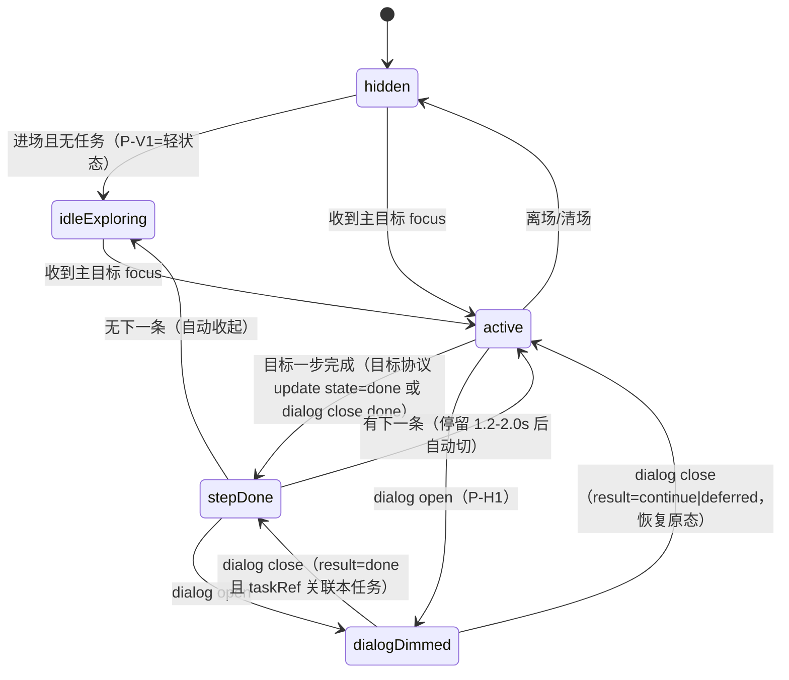

# 城镇内 HUD / 方位指引 / 交互高亮 预排细化（分区 A：T-UI-01/02/03）

> 文档状态：**预排版（分区 A 三票规格细化 + 资产占位预备；T-UI-01/02/03 最早可开工条件未满足——T-MAP-02/03/04 未完成——本文件让实现票解阻后即插即用）**
> 产出日期：2026-11-13
> 角色：ui-designer（town-design Phase C · 分区 A · 并区派单三票同源预排）
> 范围：**纯设计文档**（不改 `js/`、`test/`、`index.html`、`css/`；实现线照票施工）
> 设计权威（不得推翻）：[`town-ui-entry-hud-spec.md`](town-ui-entry-hud-spec.md) **§0.3、§4（4.1-4.6）、§5（5.1-5.3）、§6（6.1-6.5）、§8（U4-U8）**；token 体例与色盘延续 [`town-ui-entry-tokens.md`](town-ui-entry-tokens.md)（T-UI-00 先例）；会话边界对齐 [`town-ui-dialog-spec.md`](town-ui-dialog-spec.md) **§2**；架构与性能约束 [`../town-architecture-design.md`](../town-architecture-design.md) **§7.1-§7.2、§8、§4.2（`town-ui-core` 建议落点）**；资产语义 [`../town-assets-requirements.md`](../town-assets-requirements.md) **§7（UI-01~05）**  
> 使命约束：[`../../MISSION.md`](../../MISSION.md)（6 岁、纯鼠标点选、图标+中文 TTS、无键盘/指针锁定依赖、过程性表扬、零惩罚、零倒计时）
>
> **【2026-11-13 PO 变更·已核对】** 独立入口卡撤除、进入改「主路尽头白闪过场」（新缝权威 [`town-entry-transition-visual-spec.md`](town-entry-transition-visual-spec.md)）。本文件是**镇内 UI 预排，与入口缝正交**：§1-§7 规格（HUD 布局/指引/高亮/token 色板）全部不受影响，实现动工照常待解阻。两处引用面已逐处加注记（§1.1 命名体例行 / §2.4 U2 策略行）；引用权威中 entry-hud-spec **§3 入口卡章已废弃**，本文件 ui_refs（§0.3/§4/§5/§6/§8 U4-U8）均为存活章节，无需重发。变更溯源：`.scratch/town-seam-change/research-map-facts.md`。

---

## 0. 对齐与边界说明

- **本文件性质**：对 entry-hud-spec §4/§5/§6 的**预排细化与 token/参数面展开**——三张实现票（T-UI-01 HUD 布局与任务提示容器、T-UI-02 Landmark Pointer 方位指引、T-UI-03 可交互高亮/点选反馈）的施工输入。不新增产品策略、不推翻定稿默认值；定稿两可处按默认落细并登记（见 §9）。
- **冲突裁决**：若本文件与定稿内部矛盾，以定稿为准；矛盾点列入 §9「歧义/待需求线裁决」，不擅自裁决、不在施工端改视觉。
- **实现边界**：仅定义视觉/布局/状态机/参数/纯函数规格与资产占位；DOM/CSS/JS 接线归 T-UI-01/02/03 实现票（与 T-MAP 骨架的合并序由 engineer-manager 掌握）。
- **协议边界**：T-MAP-04（交互锚点与目标 id 协议）**未完成**。本文件 §2.6 给出 A 侧期望的接口形状**草案**与歧义清单，不虚构已定协议；实现票动工前须与 T-MAP-04 产出对齐。
- **并行纪律**：分区 B 预排文档 `town-ui-dialog-prebuild.md`（docs/design/ 下，另一实例产出中）由另一实例产出，本文件提及它时一律用纯文件名（不带 docs/ 路径前缀——死链守门对完整路径文本同权扫描，对方文件提交时可能尚不存在）。

---

## 1. 共享 Token 与布局基线（三票共用）

### 1.1 HUD 容器与命名空间（对齐 §4.2；落点建议，实现票可微调）

| 项目 | Token / 约定 | 说明 |
|---|---|---|
| 容器结构 | `#hud` 内挂 `#townHud` 子容器（随模式 chrome 显隐），内分四层槽：`.town-hud-card`（L1）/ `.town-hud-pointer`（L2）/ `.town-hud-praise`（L3）/ `.town-hud-sys`（L4） | 全局 `#hud` 是既有模式 HUD 挂点（`index.html` 现状）；town 子容器统一命名空间便于样式隔离与卸载。L2 槽位由 T-UI-01 预留、T-UI-02 填充内容 |
| CSS 落点 | 建议新增 `css/town.css`（沿用 focus/math/robot 各模式独立 css 先例）+ `index.html` link 接线 | 具体文件切分以实现票与 T-MAP-02 骨架合并序为准（合并权 engineer-manager） |
| 命名体例 | 类名 `town-hud-*`、CSS 变量 `--town-hud-*`，延续 T-UI-00 的 `--town-card-*` 层级语言 | 同一色盘/命名体例扩展，不另起炉灶。**【2026-11-13 PO 变更·核对】**「体例延续」指命名法与文档体例（存活，见 `town-ui-entry-tokens.md` 受损盘点章 §0′.1 末行）；`--town-card-*` 色值 token 本身已随入口卡撤除作废——本文件 §1.2 HUD 色板取色自 buildings §4 / dialog-spec，与入口卡 token 无依赖，不受影响 |

### 1.2 色彩 Token（HUD 侧扩展；色值来源逐项标注）

| Token | 色值 | 来源 | 用途 |
|---|---|---|---|
| `--town-hud-base` | `#F4D9A6` | buildings §4「奶油」；dialog-spec §4.1 Bread Cream 同值 | L1 提示卡底板（奶油暖底，90-96% 不透明）、L2 指引器底 |
| `--town-hud-ink` | `#5A4636` | buildings §4「Outline Brown」；dialog-spec §4.1 主文色 | L1 短标签文字、描边统一色（替代纯黑） |
| `--town-hud-gold` | `#E3B23C` | buildings §4「暖金」；hud-spec §6.2 默认态光点/描边主色 | L2 指引环、T-UI-03 默认态光点（与环境对比更佳时） |
| `--town-hud-gold-bright` | `#FFD89A` | buildings §4「灯火暖」；hud-spec §6.2 悬停「暖金高亮」 | T-UI-03 悬停描边/光圈；L3 表扬柔光点缀 |
| `--town-hud-sky` | `#7EC8E3` | buildings §4「布幔-天蓝」；hud-spec §6.2 默认态备选/选中环 | T-UI-03 默认态备选色、Active 选中环（冷静聚焦） |
| `--town-hud-done` | `#7FB069` | buildings §4「草绿」；hud-spec §6.2 完成色 | T-UI-03 完成态、L1「完成一步」图标色 |
| `--town-hud-soft-white` | `#FFF9EC` | UI 资产登记色（notes-ui §2「UI 柔白」） | L3 星光最亮点缀、内亮线（色盘内无同等亮度暖白） |
| `--town-hud-highlight` | `#F6C96B` | UI 资产登记色（notes-ui §2「UI 高亮金」= 暖金提亮 ~12%） | 与 `.scratch` SVG 资产现状一致的进行中/高亮金；与 `--town-hud-gold-bright` 的统一归 PO（歧义 A-02，§9） |

> 高亮金双色（`#FFD89A` vs `#F6C96B`）与完成绿双档（`#7FB069` vs 资产内麦绿勾 `#9BCF7A`）均为「设计权威文字值 vs 资产线已登记值」的并存，视觉同族不阻塞施工；统一裁决见 §9 歧义清单，PO 拍板前 CSS 侧按 hud-spec 值落、SVG 资产内部维持现状。

### 1.3 布局与安全区 Token（对齐 §4.2）

| Token | 默认值 | 说明 |
|---|---|---|
| `--town-hud-safe` | `clamp(16px, 1.6vw, 24px)` | 四边安全区内边距基线（spec §4.2「建议基线 16px，随视口 clamp 放大」） |
| L1 锚点 | 左上：`inset-inline-start: var(--town-hud-safe); inset-block-start: var(--town-hud-safe)` | 横向圆角卡片，图标在左、短标签在右 |
| L1 最大宽 | `min(320px, 40vw)` | 超长转图标序列/省略但 TTS 完整（spec §4.2） |
| L2 锚点 | 上中：`inset-inline: 0; margin: auto; inset-block-start: var(--town-hud-safe)` | 定稿两可（「上中或右上」）落细默认=上中，与 L4 右上避让（裁决记录见 §9 A-05） |
| L3 浮现位 | 水平居中、垂直 `20vh-28vh`（视线焦点上方、不遮挡准星、不与 L2 贴顶位重叠） | 短暂出现后淡出，不堆叠多条 |
| L4 锚点 | 右上角边缘：`inset-inline-end: var(--town-hud-safe); inset-block-start: var(--town-hud-safe)` | 与 L2 上中位错开；图标按钮 |
| 热区下限 | `44×44` CSS px 等效（`--town-hit-min: 44px`） | L1 TTS 重播钮、L4 系统钮等一切可点元素（§4.2/§6.4） |
| 回望通廊 | 屏幕上半部中央偏上不落常驻 HUD（L3 为瞬态） | 对齐 map 回望原则（spec §4.2 末段） |

### 1.4 动效 Token（对齐 §2 原则 5「动效舒缓」、§4.3、emil-design-eng 节制口径）

| Token | 默认值 | 用途 |
|---|---|---|
| `--town-hud-t-in` | `150-250ms ease-out`（淡入 + 8-12px 位移或 0.98→1 缩放） | L1 出现/切换（spec §4.3） |
| `--town-hud-t-out` | `150-250ms`（淡出） | L1 退出/L3 淡出 |
| `--town-hud-t-tap` | `100-120ms` 回弹 | 按下反馈（§4.6/§6.2） |
| `--town-hud-t-hover` | `120-160ms` | 悬停描边/放大过渡（§6.2） |
| `--town-hud-t-sway` | `≥1000ms` 周期、幅度极小 | 呼吸感（默认态光点、指引环弱脉动；不闪烁） |
| 减少动态偏好 | `prefers-reduced-motion` 时降级为纯淡入淡出、停呼吸 | spec §4.3 明示 |

### 1.5 图标与字号 Token（对齐 §4.3「6 岁可读」）

| Token | 默认值 | 用途 |
|---|---|---|
| 提示卡主图标 | 32×32 显示尺寸（源图 UI-01 marker 徽章/内芯） | L1 左位 |
| 短标签字号 | `≥18px` 等效、加粗圆润 | L1 辅助短词（1-6 字；TTS 才是完整句） |
| 数量暗示 | 1-3 个实心/空心图符（物品图标重复），不用数字强调 | 「找到 1 个」=单个物品图标（§4.3） |
| 固定宽数字槽 | 若必须显示数字，`font-variant-numeric: tabular-nums` 固定槽 | 防布局抖动（§2 原则 7） |

---

## 2. T-UI-01 章：HUD 布局与任务提示容器

### 2.1 L1-L4 布局锚点落细（对齐 §4.1/§4.2）

| 层级 | 默认显隐 | 容器与锚点（§1.3 token 引用） | 内容来源 |
|---|---|---|---|
| L1 主提示卡 | 情境显示；无任务收起为「探索中」轻状态（P-V1，§6.2） | `.town-hud-card` 左上安全区 | 玩法目标协议（T-MAP-04，§2.6 seam） |
| L2 方位指引 | 有目标显示；无目标回落钟塔弱提示（U5 默认）；会话中暂隐（P-H2） | `.town-hud-pointer` 上中（槽位本票预留，内容 T-UI-02 填充） | 同上 + 玩家位姿 |
| L3 正向反馈 | 事件触发，单次 1.2-2.0s 后淡出，同屏 1 条（U7 默认） | `.town-hud-praise` 中上 20-28vh | 玩法完成事件 + dialog close(done) |
| L4 系统轻入口 | 常驻（低干扰小图标） | `.town-hud-sys` 右上角边缘 | 默认仅「返回主菜单」图标钮；暂停/设置走全局 chrome（mkMode 既有语义，本票不另造） |

- 响应式：四槽全部锚点定位 + `clamp` 尺寸；窄窗/极端宽高比下 L1 最大宽收窄（§1.3）、L2 保持上中、L3 保持水平居中——实现票须在 1280×720、1920×1080 及窄窗验证不裁切、不进回望通廊。
- 中央主视野与下半部前进路径保持干净：四槽均不进入屏幕中心与下半部（§4.2 整体原则）。

### 2.2 §4.5 硬约束清单逐条落实表

| §4.5 条目 | 落实（T-UI-01 施工口径） | 验收面 |
|---|---|---|
| 不显示倒计时、沙漏、进度耗尽条 | L1-L4 组件清单不含任何时间敏感元素；L1 状态机无「剩余时间」输入位 | 组件面检查 + core 单测断言状态机无计时惩罚分支 |
| 不显示「失败/错误/再试一次（惩罚暗示）」 | L1 状态机**无失败态**（§2.3 状态全集不含 fail）；重试语义若需=「再找找/再玩一次」中性词由玩法 spec 供文案 | core 单测：任意事件序列不产生 fail 态 |
| 不使用高饱和警示红作为常态 UI 色 | 色板 Token（§1.2）无警示红；`#D96B52` 仅 B 侧温暖点缀语义（dialog-spec §4.1），A 侧 HUD 不用 | 色板审查 |
| 任务提示可关闭/收起（图标按钮），关闭无负面后果 | U6：默认支持 TTS 重播钮；「收起」为可选参数（默认自动随任务状态切换）；收起不影响任务进行、不产生任何反馈惩罚 | 交互走查 |

### 2.3 L1 提示卡容器状态机（对齐 §4.3「状态」）

容器状态全集（`hidden / idle-exploring / active / step-done / dialog-dimmed`）与转移：



- **无失败态**：任意事件序列均不产生 `fail` 类状态（§2.2 硬约束）。
- **step-done 视觉**：切换为正向完成图标（UI-01 marker done 角标语言 + 草绿 `--town-hud-done`）+ 短暂表扬后自动收起或切下一条（§4.3）；停留时长同 U7 节奏（1.2-2.0s）。
- **内容结构**（§4.3 四件套）：主图标（UI-01 语义）→ 辅助图标/数量暗示（可选，物品图标不数字）→ 短标签（1-6 字）→ TTS 重播小喇叭钮。
- **出现/切换动效**：§1.4 `--town-hud-t-in/out`；`prefers-reduced-motion` 降级纯淡入淡出。

### 2.4 TTS 重播入口（对齐 §4.3 第 4 条、§4.4、U6）

| 项目 | 规格 |
|---|---|
| 形态 | 卡片右端小喇叭图标按钮（自绘/UI-01 风格像素喇叭；首版可 emoji `🔊` 占位——同 U2 的 emoji 占位策略。**【2026-11-13 PO 变更·核对】** U2 已语境迁移（hud-spec §8 U2 行），但「emoji 占位先行、后续换 UI-01 风格像素图标」策略本身存活，本行照旧适用） |
| 热区 | ≥44×44 CSS px 等效（图标 20-24px + padding 补足；§4.2/§6.4） |
| 行为 | 点选即重播当前提示**完整友好句**一次（短标签只是辅助，TTS 才是完整句——§4.3）；不改变状态机状态；连点去抖（进行中则忽略新请求，避免重叠抢话） |
| 通道 | 经统一语音出口（`SpeechKit`/既有音频约定）排队；与 B 侧会话播报的仲裁遵循 dialog-spec §2.2「TTS 通道」行（会话播报优先级高于氛围/提示） |
| 自动播报 | 新主提示出现（`hidden/idle → active` 转移）自动朗读一次，可被全局静音设置约束（§4.4 原则）；重播钮为补充入口 |
| 显隐 | 仅 `active / step-done` 态可见；`dialog-dimmed` 态随卡暂隐；`idle-exploring` 轻状态下不显示（无提示句可播） |

### 2.5 与对话层级避让（消费 dialog-spec §2 接口点）

A 侧消费 B→A 事件（事件名与载荷语义对齐 dialog-spec §2.2；实现载体由实现票定）：

| 事件（B→A） | A 侧响应（默认） | 依据 |
|---|---|---|
| `town-ui/dialog/open`（`town:dialogue:opened`，`{npcId, anchor, sessionKind, taskRef?}`） | L1 → `dialog-dimmed`（默认**暂隐**，P-H1 可切弱化 40-50%）；L2 → 暂隐（P-H2）；L3 → 冻结（会话中不弹全局表扬，避免与 B 侧 panel 内表扬叠加成压迫感）；L4 → 保持（安全返回能力） | hud-spec §4.3 末段、§0.3「屏幕层级」；dialog-spec §2.3「进入 Session Panel 时注意力归会话，A 保留最小必要 HUD」 |
| `town-ui/dialog/update`（`{step, intent, canClose, hasPendingChoice}`） | 维持收敛态（无新视觉动作；供 A 判断会话仍在进行） | dialog-spec §2.2 |
| `town-ui/dialog/close`（`town:dialogue:closed`，`{result, taskRef?}`） | `continue/deferred` → 恢复 HUD 原态；`done` 且 `taskRef` 关联当前任务 → L1 切 `step-done`（任务进度的「宣布权」分工：B 播局部完成，A 落常驻状态——dialog-spec §2.3） | hud-spec §4.3、dialog-spec §2.2/§7.3 |

- A→B 只读输入：`town-ui/task/context`（当前任务图标/阶段/关联 NPC）——L1 当前态的快照，由实现票按 dialog-spec §2.2 行提供。
- 语义对齐：A 不绘制对话气泡内容（hud-spec §0.3 第 1 行）；会话中「可对话」标记的降噪归 T-UI-03（§4.4）。

### 2.6 T-MAP-04 目标 id 协议适配 seam（草案 + 歧义，协议未定不虚构）

hud-spec §0.3「指引目标」行规定 A 只消费「**目标类型 + 位置/锚点**」信号；T-MAP-04 尚未产出协议。A 侧期望的接口形状草案（供需求线并进 T-MAP-04 派单）：

```text
目标描述对象 townTarget（A 侧消费的最小面）：
{
  id: string,          // 目标 id，如 'belltower' | 'plaza' | 'lavachicken' | 'task:bread'
  kind: 'landmark' | 'npc' | 'prop' | 'task',   // 对齐 hud-spec §6.1 分类
  iconKey: string,     // UI-01 marker 语义键：belltower/plaza/lavachicken/farm/stash/windmill/find/help
  label: string,       // 短标签 1-6 字（如「去钟塔」「找面包」）
  anchor: {x, y, z},   // 世界锚点（指引投影与近距判定用；NPC 动态锚点见歧义 A-01-3）
  state: 'active' | 'done'
}

事件（建议命名，对齐 dialog-spec §2.2 的 town-ui/* 体例）：
- town-ui/target/focus    {target | null}   当前主目标切换（null = 无活动目标，触发 U5 回落）
- town-ui/target/update   {id, state}        目标状态更新（active→done 驱动 L1 step-done）
```

适配 seam（实现票接线点）：L1/L2/L3 不直接读玩法内部状态，只消费上述两个事件 + `townTarget` 形状；协议字段名/id 空间以 T-MAP-04 定稿为准，届时仅改适配层不改容器逻辑。

**歧义清单（随回执上抬需求线，A-01）**：
1. 事件载体未定：全局事件派发 vs 模式内直调 seam（dialog-spec §2.2 已用事件名语义，架构 §7.1 亦称「产出 UI 事件」——草案按事件语义写，载体归实现票）。
2. 目标 id 命名空间：地标 id 与任务 id（`task:*` 前缀草案）是否统一注册表、由谁持有清单权威（建议归 T-MAP-04 的锚点注册模块）。
3. NPC 动态锚点：村民有巡逻/行为（villagers 设计），`anchor` 是否随移动更新（事件频率/节流口径）；A 侧指引按低频插值设计（§3.4），协议侧需明确更新节奏或改 `anchorOf(id)` 取数器形态。
4. 「无活动目标」信号形态：`focus null` vs 显式 `town-ui/target/clear`（草案取前者，少一个事件）。
5. 与 B 侧 `taskRef` 的关联键：dialog close(done) 的 `taskRef` 与目标 `id` 是否同一 id 空间（A 需映射回 L1 任务；草案假定同一空间）。

---

## 3. T-UI-02 章：Landmark Pointer 方位指引

### 3.1 视觉规格落细（对齐 §5.2 形态；§5.3 小地图明确不做）

| 部件 | 规格（默认） | 说明 |
|---|---|---|
| 容器/形态 | 紧凑**圆形徽章**指引器，直径 64-80px（视口 clamp），锚定 L2 上中槽（§1.3） | spec §5.2「圆形/盾形」两可，默认取圆形（与 marker 徽章同形语言） |
| 中心图标 | 当前目标 UI-01 marker 16×16 内芯，以 32px 显示（2× 整数倍，像素画不糊） | 目标切换=中心图标交叉淡化 150ms |
| 方位指针 | 徽章外环上的**柔和扇形/水滴指示块**（暖金 `--town-hud-gold`，外环描边 `--town-hud-ink` 1-2px）；按 **4 方位离散**（前/左/右/后，每 90° 档）转动 | spec §5.2「大致方位」+「无剧烈旋转跳变」→ 离散档 + 档间 CSS transition 120-180ms 低频插值；「后」档=指示块转至徽章底部并轻微缩小 10%（弱化表现，不惊吓） |
| 「屏幕边缘指向」解读 | 指针指示**目标相对视野边缘的方位**（左/右=目标在屏外左/右侧；前=已在视野内；后=背后），**不做**贴边游走箭头形态 | 贴边游走动效大、认知负荷高，不合 6 岁低负荷原则；定稿形态即固定徽章+方位指针（§5.2 主文），此处为解读落细 |
| 距离表达 | **3 档定性**（远/近/就在附近），不显示数字/米：远=单细外环+图标常态；近=双环+图标 1.05×；附近=**指针淡出**仅留目标图标 + 柔光呼吸（「已在附近」态，鼓励观察世界而非盯 HUD） | spec §5.2「指针大小/填充/环数变化」+「切换为已在附近状态（指针弱化为光点或对勾）」；阈值 P-D1/P-D2 见 §6.3 |
| 弱提示态（U5 无目标回落） | 半透明 50% + 仅钟塔图标（belltower marker），无指针（无特定目标方位需求时指针隐藏，或指向钟塔方位——默认**指向钟塔方位**，保留「回家」语义） | spec §5.2「无目标时可收起或仅显示钟塔/广场锚点」；默认=钟塔弱提示（回家/集合锚点，P0-01 全局回望锚点） |
| 色彩 | 暖金/天蓝系，与钟塔暖金/天蓝区分但暖亮和谐；底板奶油 `--town-hud-base` 90% | spec §5.2 无障碍/舒适行；避开樱花大面/道路浅石作唯一轮廓色（§6.3 同则） |
| 交互性 | 首版**非交互**（无点选行为）；「设置中显示/隐藏方位指引」为 U5 可选扩展（开关落系统设置，不在 L2 本体） | spec §5.2「收起/展开由系统策略控制」；§6.4 热区是点选目标口径，L2 无点选故不适用 |

### 3.2 目标切换（钟塔/任务锚点）

- 切换源：`town-ui/target/focus`（§2.6 seam）——一次只有一个主目标（spec §5.2「首版默认单目标/单地标」）。
- 切换动效：中心图标交叉淡化 150ms + 外环轻微缩放 0.98→1；不旋转跳变、不闪烁。
- 目标优先序（无活动任务时）：主任务锚点 > 无（回落钟塔弱提示）。多目标策略（若未来玩法引入）归玩法 spec，A 侧容器不变。
- 会话中（`dialog open`）：L2 暂隐（P-H2 默认）；`close` 后按当前目标态恢复。

### 3.3 近距弱化/隐藏阈值（U4/U5 参数面；新增参数 P-D1/P-D2）

| 参数 | 默认值 | 判定口径 | 说明 |
|---|---|---|---|
| P-D1「附近」阈值 | ≤12 格（且目标在视野角内） | 玩家与目标锚点平面距离（格） | 进入附近档：指针淡出、图标柔光呼吸；离开则恢复指针 |
| P-D2「近/远」分界 | 40 格 | 同上 | 近=双环；远=单细环 |
| U4 指引形态 | Landmark Pointer（§5.2）；首版**不做**详细小地图（§5.3 明确不做，PO 核准前不启用） | — | 形态开关参数化落点：L2 渲染模式（landmark-pointer 唯一首版值） |
| U5 可见策略 | 有活动目标=常显；无目标=钟塔弱提示（50% 透明）；会话中=暂隐 | `townPointerTarget` 纯函数回落策略（§5 函数 3） | 可配置项：`'belltower-fallback'`（默认）| `'hidden'`（无目标全收起） |

> 阈值为**世界格距离**（taxicab 或欧氏由实现票定，纯函数入参口径见 §5）；相机距离校准与手感微调归实现票走查，默认值可直接排期。

### 3.4 事件驱动更新口径（对齐架构 §8「签名/脏标刷新，避免每帧重建 DOM」）

- **更新源（事件）**：`town-ui/target/focus|update`（目标/状态变化）+ 玩家位姿采样（相机位姿变化超过角度死区或位移死区才重算——低频，非每帧 DOM 写）。
- **签名（signature）**：`targetId | state | 方位档(4) | 距离档(3)`（§5 函数 6）。签名不变 → DOM 零操作；签名变化 → 仅 class/transform 切换（无 innerHTML 重建）。
- **插值**：方位档间转动用 CSS `transition: transform 120-180ms`（低频插值，spec §5.2「指针运动平滑」）；不做 JS 每帧旋转。
- **动效**：呼吸/柔光全 CSS animation（≥1s 周期）；`prefers-reduced-motion` 停呼吸。
- **无闪烁承诺**（验收口径）：任意签名变化序列下，单元素 1s 内可见属性变更 ≤ 档位数（4 方位×3 距离=12 档上限），无高频 class 抖动——由 core 单测锁签名稳定性（同位姿重复计算签名恒等）。

### 3.5 资产占位登记（详见 §7）

- L2 中心图标：复用 UI-01 marker 系列（8 个语义已覆盖钟塔/广场/Lava Chicken/农田/Secret Stash/风车/寻找/帮助），**零新增资产**。
- 徽章外环/扇形指针：CSS 绘制（圆环 border + 旋转指示块），**零新增资产**；若 PO 后续要像素贴图外环，走资产票线增补。

---

## 4. T-UI-03 章：可交互高亮/标记与点选反馈

### 4.1 四态视觉 Token 化落细（对齐 §6.2 状态表全量）

| 状态 | 视觉（token 化） | 资产/实现载体 | 参数 |
|---|---|---|---|
| **默认（可交互未聚焦）** | 低存在感提示：对象上方/旁侧小图标（UI-01 marker 20-28px 视口自适应）或微弱底座光点（暖金 `--town-hud-gold` 或天蓝 `--town-hud-sky`，择与环境对比更佳者）；可选呼吸（`--town-hud-t-sway` ≥2s 周期、幅度极小） | 世界侧：UI-03 `select_hover.svg` 的 idle 态（柔光圈：高亮金 45% 环 + 灯火暖 55% 芯）或 CSS/DOM 投影小图标 | 不闪烁、不抢主视线 |
| **悬停 Hover** | 轮廓柔和描边/外发光增强（`--town-hud-gold-bright` `#FFD89A` 或天蓝提亮）+ 光标切可点选态 + 图标放大 1.05-1.1× | 世界侧：UI-03 `select_hover.svg` hover 态（四角 L 形高亮金 + 边中段暖金 55% 细线）；光标=自绘友好光标（指向/放大镜/手形，与世界风格一致——§4.6） | 描边 2-3px 屏幕空间；过渡 `--town-hud-t-hover` 120-160ms |
| **按下 Pressed** | 轻微缩暗或缩放 0.97-0.99（亮度 -8%~-12% 瞬时） | CSS `filter: brightness()` 瞬时档 + 回弹 | `--town-hud-t-tap` 100-120ms 回弹（§4.6「按下即时确认系统听到了」） |
| **完成 Done** | 标记切换为完成图标（小花/星点/对勾友好变体，**避免考试对勾生硬感**）并淡化或消失 | HUD/图标侧：UI-01 marker done 角标（右下麦绿勾）语言；世界侧复用 marker done 态或图标淡化 | 完成色 `--town-hud-done` `#7FB069` + 暖金点缀；仅正向，无「未完成」惩罚标记 |
| 选中/会话中 Active（A→B 交接） | 保持柔和选中环（`--town-hud-sky` 天蓝），世界其余可交互提示降噪（§4.4） | UI-03 `select_active.svg`（双圈角框 + 中心 16% 柔铺光） | 会话态内部以 B 为准（dialog-spec） |
| 不可用/未到时机 | 默认**不显示**或显示为普通装饰（无交互）；若必须提示=中性「稍后再来」由 TTS 表达（策略归玩法 spec） | — | 避免锁头/禁止负面符号（§6.2 末行） |

### 4.2 色弱友好形状区分落实（对齐 §6.3「状态不只靠颜色」）

四通道形状语言（色 + 形双通道，任一通道可辨即区分）：

| 状态 | 色通道 | 形通道（形状/结构变化） |
|---|---|---|
| 默认 | 暖金/天蓝光点 | **圆形柔光圈**（无角、无方向） |
| 悬停 | 暖金提亮 | **四角 L 形角框**（角部结构出现） |
| 按下 | 亮度瞬时下调 | 角框**收缩/内缩**（尺寸变化，非仅色变） |
| 完成 | 草绿 | **勾形角标 + 淡出**（符号语义，非色块） |
| 选中（会话） | 天蓝 | **双圈角框**（嵌套结构） |

- 轮廓色避开樱花大面 `#F7C6D9` 与道路浅石 `#D9CDBE` 作唯一轮廓色（§6.3 第一段）；暖金/天蓝在暖木与石面上均可读（参照 buildings §4）。
- 资产现状已按此形状语言绘制（notes-ui §1 UI-03 行：idle=柔光圈、hover=四角 L、active=双圈角框），CSS/DOM 侧图标态沿用同语言。

### 4.3 点选反馈链路（对齐 §4.6、架构 §7.1「世界/交互态→UI 事件流」）

1. **悬停**（鼠标唯一发现通道）：raycast 命中可交互对象 → 高亮切 hover 态 + 光标切可点选态（100ms 内可感知）。
2. **点选**：`pointerdown` 即时按下反馈（pressed 档）→ `pointerup` 命中结算：
   - NPC/对话类 → 发 `town-ui/interact/focus`（A→B，载荷对齐 dialog-spec §2.2：命中对象 id、世界锚点、可交互类型），B 决定开 bubble/session；
   - 观察点/物品类 → 玩法侧锚点逻辑消费（T-MAP-04 协议），A 侧只看状态回流。
3. **不可交互区域**：不产生误导性高亮；装饰物保持静态（§4.6 末段）。
4. **反馈确认**：动作被接收后 300ms 内给出可感知反馈（选中环/音效/小动画——音效归 A-SFX-01 线，视觉归本票）。

### 4.4 命中/状态判定的签名/脏标刷新口径（对齐架构 §8）

- **签名**：`对象id | 状态类`（§5 函数 7/8）。raycast 每帧跑（既有输入管线），但 DOM/材质高亮只在**签名变化**时切换——同对象同态零操作。
- **降噪裁决**（纯函数）：会话中（`dialog open`）非选中对象降为「默认不显示」或最低存在感档（dialog-spec §2.3「近身交互以 bubble/选中高亮为主，全局提示退后」）；选中对象保持 Active 选中环。
- **世界侧 vs 屏幕侧**：世界内描边/光圈贴花与对象上方浮动小图标（DOM 投影或 sprite）由 town 模式装配层驱动（架构 §7.1）；本票定义状态类与视觉 token 的映射，投影/贴花实现归实现票。
- **热区**：可点选对象热区 ≥44×44 CSS px 等效（或世界投影后屏幕等效尺寸充足），相邻热点留间距防误点；按相机距离校准（§6.4）。

---

## 5. 纯逻辑函数面（拟下沉 `js/town-ui-core.js`；预排规格，不写实现）

> 对齐架构 §4.2：`town-ui-core.js`（应用层纯核心，零 THREE·零 DOM·零全局可变依赖·加载零副作用，**必有同名单测** `test/town-ui-core.test.js`）。THREE 向量一律拆裸数字入参；墙钟/定时归装配层，核心只算数。三票 brief 的 tdd 要求（partial：纯逻辑下沉 core 配单测）以此面为准。

| # | 函数（签名草案） | 输入 → 输出 | 可测断言面（同名单测） |
|---|---|---|---|
| 1 | `townHudCardState(current, event)` | 当前容器状态 + 事件（`target-focus/target-update/dialog-open/dialog-close/step-elapse` 等）→ 新状态 + 副作用意图列表（`tts-hint/praise-show/none`） | 状态全集恰为 §2.3 五态；任意事件序列不产生 fail 态（§2.2 硬约束）；`dialog-close done+taskRef` 唯一入口产生 step-done；step-done 停留后自动转移（elapse 事件由装配层喂） |
| 2 | `townHudDimming(taskState, dialogOpen)` | 任务卡状态 + 会话开关 → `{l1, l2, l3, l4}` 各层目标可见性档（`normal/dim/hidden`） | 会话开=L1 hidden（P-H1）+L2 hidden（P-H2）+L3 frozen+L4 normal；会话关=恢复；L4 恒 normal（安全返回不收敛） |
| 3 | `townPointerTarget(target, opts)` | 当前主目标（或 null）+ 回落策略（U5：`'belltower-fallback'`｜`'hidden'`）→ 指引器目标（`{iconKey, anchor, mode: 'target'|'fallback'|'off'}`） | null+默认策略=钟塔弱提示（mode=fallback）；null+hidden=off；有目标=原样 |
| 4 | `townPointerBand(dist, inView, bands?)` | 平面距离（格）+ 是否在视野角内 + 阈值表（P-D1/P-D2 可注入覆盖）→ `'far'|'near'|'nearby'` | 边界值（12/40 恰等）；inView=false 时 nearby 不可达（附近档需在视野内）；阈值注入生效 |
| 5 | `townPointerHeading(dx, dz, yaw)` | 目标相对位移（世界系 x/z）+ 玩家朝向角 → `'front'|'left'|'right'|'behind'` 4 方位离散 | 四正交向恰等边界归属明确（如恰在前方=front）；四方位全覆盖无间隙；朝向回绕（yaw±360°）正确 |
| 6 | `townPointerSig(targetId, state, band, heading)` | 四元组 → 签名字符串 | 同入参恒等签名（DOM 脏标稳定性，§3.4）；任一分量变化签名必变 |
| 7 | `townHlClass(hoveredId, pressedId, activeId, doneIds)` | 命中/按下/选中/已完成集合 → 对象状态类（`'default'|'hover'|'pressed'|'active'|'done'|'none'`） | 优先级序：done > active > pressed > hover > default（多标志并存取其一，序即断言）；空入参=none |
| 8 | `townHlDim(activeId, dialogOpen, hlClass)` | 选中对象 id + 会话开关 + 对象状态类 → 有效显示档（`'full'|'min'|'off'`） | 会话中：activeId 对象=full（选中环保持），其余可交互=min 或 off（降噪，§4.4）；非会话=full |
| 9 | `townHlSig(objectId, displayClass)` | 对象 id + 有效显示档 → 签名字符串 | 同入参恒等；分量变化必变（脏标口径） |
| 10 | 常量表 `TOWN_UI_PARAMS` | `{ P_D1: 12, P_D2: 40, PRAISE_MS: [1200, 2000], T_IN: [150, 250], ... }` | 值与 §6 参数总表一致（单测锁表防漂移）；全为纯数据 |

> 函数 1-2 服务 T-UI-01、3-6 服务 T-UI-02、7-9 服务 T-UI-03、10 三票共用；实现票可按票拆分合入（建议三票共用一份 core + 同名单测，架构 §4.2 落点不变）。

---

## 6. U4-U8 参数化总表（供 PO 最终验收批次）与新增参数登记

### 6.1 U4-U8（hud-spec §8 原项，默认值照权威落）

| # | 待确认点 | 默认值（已落本文件） | 参数化落点（实现替换点） | 影响范围 | 备注 |
|---|---|---|---|---|---|
| **U4** | 小地图/指引形态 | **Landmark Pointer**（§3.1）；首版不做详细小地图（§5.3 明确不做） | L2 渲染模式开关（首版唯一值 `landmark-pointer`）；§5 函数 3 | HUD 复杂度、资产、实现 | 最适配 6 岁与注意力训练（spec §8 原注） |
| **U5** | 方位指引默认可见策略 | 有活动目标=常显；无目标=**钟塔弱提示**（50% 透明、无任务指针语义保留回家指向）；会话中=暂隐 | §5 函数 3 回落策略参数（`belltower-fallback`｜`hidden`） | HUD 常驻干扰度 | spec 备注「需在玩法 spec 细化规则」——本预排已给默认，玩法 spec 可覆盖 |
| **U6** | 任务提示手动收起/重播 | **支持重播**（§2.4 喇叭钮）；收起为可选（默认自动随任务状态切换，无手动收起钮） | L1 按钮组配置（`replay: true` 默认；`manualDismiss: false` 默认） | 交互细节 | 收起不产生负面后果（§4.5） |
| **U7** | 表扬反馈强度与频率上限 | 单次 **1.2-2.0s**、同屏 **1 条**、事件触发不连续刷屏；队列策略 P-S1（当前播完后才显下一条、等待队列深 1、新事件顶替等待项） | L3 容器节奏参数 + 队列裁决（§5 函数 1 副作用意图） | 体验节奏 | 与玩法事件埋点协同（spec §8 原注）；会话中 L3 冻结（§2.5） |
| **U8** | 分区 B 产出时间与评审顺序 | **流程项，非视觉参数**（如实标注）：B 侧定稿 `town-ui-dialog-spec.md` 已在，本预排按其 §2 接口对齐；B 预排文档 `town-ui-dialog-prebuild.md`（docs/design/ 下，另一实例产出中）评审顺序归 PO/需求线 | 无实现落点；联调节奏归 T-UI-04 | 跨文档一致性 | 实现票 T-UI-01..04 同时引用 A/B 两份边界（spec §8 U8 原注） |

### 6.2 布局与收敛策略新增参数（本预排登记，P 前缀；均给默认可直接排期）

| # | 参数 | 默认值 | 落点 | 依据 |
|---|---|---|---|---|
| P-V1 | L1 无任务态 | 「探索中」轻状态（小图标+「随便逛逛」弱化 50%）；可切完全隐藏 | §5 函数 1 初始转移配置 | §4.1 L1「隐藏或收起为探索中轻状态」两可，默认取轻状态（位置稳定原则 §2 原则 5） |
| P-H1 | 会话中 L1 处理 | **暂隐**（可切弱化 40-50%） | §5 函数 2 | §4.3「可弱化或暂隐」两可；默认取暂隐（dialog-spec §2.3「注意力归会话」） |
| P-H2 | 会话中 L2 处理 | **暂隐**（可切弱化为仅图标） | §5 函数 2 | 同上；指引在会话中非必要 |
| P-S1 | L3 表扬队列策略 | 当前播完后显下一条；等待队列深 1；新事件顶替等待项 | §5 函数 1 副作用意图 + 装配层队列 | U7「同屏 1 条、不连续刷屏」的落细 |

### 6.3 指引阈值参数（本预排登记）

| # | 参数 | 默认值 | 落点 |
|---|---|---|---|
| P-D1 | 「就在附近」阈值 | ≤12 格且在视野角内 | §5 函数 4 `bands` 注入位 |
| P-D2 | 「近/远」分界 | 40 格 | 同上 |
| P-A1 | 方位档粒度 | 4 方位离散（90° 档） | §5 函数 5 输出域 |

### 6.4 待 PO 确认项汇总（随回执上抬）

1. U4-U8 七项（§6.1，默认已落可直接排期，PO 验收批次核对）。
2. 高亮金双色统一：`#FFD89A`（hud-spec §6.2 悬停高亮）vs `#F6C96B`（UI 资产登记「UI 高亮金」）——建议 PO 拍板单一值或明确语义分工（§9 A-02）。
3. 完成绿双档统一：`#7FB069`（hud-spec §6.2 草绿）vs `#9BCF7A`（资产内麦绿勾角标）（§9 A-03）。
4. P 前缀新增参数九项（§6.2/§6.3）确认或覆盖。

---

## 7. 资产占位清单（UI-01~03 主登记 + UI-04/05 附带消费）

> 现状核实（2026-11-13，本 worktree 目录实测）：`.scratch/town-design/assets/ui/` 共 24 张 SVG + 生成脚本 `tools/generate-ui-assets.mjs` + `notes-ui.md` + `preview.html`。**均未入库**（`.scratch` 不进 git）；入库与否归资产票线，本表只登记语义覆盖与缺口。

| 资产 ID（req §7） | 语义需求（规格下限） | `.scratch` 现状（核实结果） | 三票消费点 | 缺口/备注 |
|---|---|---|---|---|
| **UI-01** 地标/任务标记图标集 | 6-10 个；16×16/32×32 暖亮高对比；默认/高亮/完成 | **8 个齐备**：belltower/plaza/lavachicken/farm/stash/windmill/find/help，每张含 default/active/done 三态 + 16×16 内芯（notes-ui §1） | T-UI-01 L1 主图标（§2.3）；T-UI-02 指引器中心图标（§3.1）；T-UI-03 默认态浮动标记与 done 角标（§4.1） | **无缺口**（观察导览/寻找/帮助/集合/探索语义均有着落：集合=belltower/plaza active 星标，探索=stash/windmill）；入库归资产票线 |
| **UI-02** 对话/提示气泡底板 | 2-3 个；圆角体素感、奶油底+深描边 | **3 个**：bubble_talk_short（40×26）/ talk_mid（64×34）/ praise（56×40） | A 侧消费方式=**同风格底板语言**复用于 L1 提示卡（奶油暖底+Outline Brown 描边+内亮线 token，§1.2），**不直接贴气泡 SVG**（L1 是横向卡片非气泡形；hud-spec §6.5 UI-02 行） | 气泡形 SVG 归 B 侧会话消费；A 侧 CSS 底板走 token，零新增资产 |
| **UI-03** 鼠标点选高亮/可交互提示 | 1-2 个；柔和描边/光圈非闪烁，暖金/天蓝 | **2 个**：select_hover.svg（内含 idle+hover 双态）、select_active.svg（active 态） | T-UI-03 世界侧高亮贴花四态载体（§4.1） | pressed=CSS 瞬时滤镜（无资产需求）；世界侧 done 态默认复用 UI-01 done 角标语言（无独立资产）；「不可用」默认不显示（无资产需求） |
| **UI-04** 过程性表扬反馈图标（附带） | 3-5 个；1-2 级强度；正向无惩罚 | **3 款 × 2 档**：praise_star/flower/confetti（轻量/热烈） | T-UI-01 L3 浮现位（§2.1） | 无缺口；语义分工已登记（star=寻找观察、flower=帮助关爱、confetti=大完成，notes-ui §1） |
| **UI-05** 手持/交互小道具图标（附带） | 5-8 个；与角色附件一一对应 | **8 个**：bread/wheat/bouquet/scroll/tray/bell/feedbag/hammer（各含图标框版+无框本体） | T-UI-01 L1 辅助图标/数量暗示（§1.5、§2.3 第 2 件套） | V05 铁匠钳子未单列（以 hammer 代表工具类，notes-ui §5-1 观察项，非阻塞） |

**占位策略汇总**：三票首版可**零新增位图资产**开工——UI-01~05 语义全由 `.scratch` 既有 SVG + CSS（L2 外环指针、L1 卡片底板、pressed 滤镜、done 角标组合）覆盖；TTS 喇叭钮首版 emoji `🔊` 占位（同 U2 emoji 占位策略，后续换 UI-01 风格像素图标）。资产入库（含生成脚本入仓与命名对齐 `town_ui_*`）归资产票线，不阻塞 UI 三票解阻后施工。

---

## 8. 与设计权威逐小节对齐说明

| 定稿小节（entry-hud-spec） | 本文件落地位置 | 对齐要点 |
|---|---|---|
| **§4.1** HUD 信息层级（L1-L4+禁止项） | §2.1 | L1-L4 显隐/锚点/内容来源逐层落细；禁止项落实表 §2.2；L3 节奏 U7 |
| **§4.2** 屏幕布局与锚点 | §1.3、§2.1 | 四槽锚点+安全区 clamp 16-24px；中央主视野与下半部干净；回望通廊不落常驻 HUD；L2「上中或右上」两可落上中（A-05） |
| **§4.3** 任务/导览提示位规格 | §2.3、§2.4 | 四件套内容结构（图标/数量暗示/短标签/重播）；五态状态机（无失败态）；动效 150-250ms + reduced-motion 降级；会话衔接暂隐（P-H1） |
| **§4.4** 图标+TTS 与过程性表扬 | §2.4、§2.1（L3） | 自动朗读一次+重播钮；表扬 1.2-2.0s/同屏 1 条/不刷屏（U7+P-S1）；禁止催促语与红叉 |
| **§4.5** 无倒计时/无惩罚硬约束 | §2.2 | 四条逐条落实表 + core 单测断言面（§5 函数 1） |
| **§4.6** 鼠标点选可发现性 | §4.3 | 光标反馈/按下即时确认/不可交互不误导——归 T-UI-03 章承接 |
| **§5.1** 方案比较 | §3.1（承接结论） | 不重复论证；按 §5.1 结论 B（Landmark Pointer）落细 |
| **§5.2** 推荐默认 Landmark Pointer | §3.1-§3.4 | 圆形徽章+4 方位扇形指针+3 档定性距离+附近态指针淡出+无目标钟塔弱提示；平滑低频插值无跳变；目标对齐 map 锚点（钟塔 P0-01 回望锚点） |
| **§5.3** 未来小地图备选 | §3.3（U4 行） | **明确不做**（PO 核准前不启用），仅登记参数位 |
| **§6.1** 可交互对象分类 | §4.1（状态载体）、§2.6（kind 枚举） | NPC/任务物品/地标导览点/出口四类的标记/高亮需求映射到状态类与资产 |
| **§6.2** 高亮与标记状态机 | §4.1 | 六态全量 token 化（色值/尺寸/时延落表）；Active 交接态对齐 B |
| **§6.3** 色彩与可读性 | §1.2、§4.2 | 避开樱花粉/道路浅石作唯一轮廓色；色弱友好「色+形」双通道五档落表 |
| **§6.4** 触控与热区前瞻 | §1.3（`--town-hit-min`）、§4.4 | ≥44px 等效热区与间距；按相机距离校准归实现票 |
| **§6.5** 与资产清单对齐 | §7 | UI-01~05 逐项语义/现状/消费点/缺口登记 |
| **§8 U4-U8** | §6.1 | 默认值照权威落 + 参数化落点显式 + U8 如实标注流程项 |
| **dialog-spec §2.1-§2.3** | §2.5、§4.3、§4.4 | 事件名/载荷语义逐行对齐（open/update/close、interact/focus、task/context、TTS 通道）；注意力归会话与最小必要 HUD；完成宣布权分工；提示不重复轰炸（降噪裁决） |

---

## 9. 歧义 / 待需求线裁决

| # | 歧义 | 影响 | 本文件处理（不阻塞施工） |
|---|---|---|---|
| A-01 | **T-MAP-04 目标 id 协议未定**（事件载体/id 命名空间/NPC 动态锚点/无目标信号形态/taskRef 关联键，共 5 子项——详 §2.6） | T-UI-01/02/03 的目标消费适配层 | 给出期望接口形状草案（§2.6）+ 适配 seam（仅改适配层不改容器）；子项随回执上抬需求线并进 T-MAP-04 派单 |
| A-02 | 悬停高亮金双色：hud-spec §6.2 `#FFD89A`（灯火暖，称「暖金高亮」）vs UI 资产登记 `#F6C96B`（暖金提亮 12%，称「UI 高亮金」） | token 统一性与资产/CSS 一致观感 | CSS 侧按设计权威 `#FFD89A` 落（§1.2 两个 token 并列登记）；SVG 资产内部维持 `#F6C96B` 现状；两者视觉同族不阻塞；PO 拍板统一或明确语义分工（光晕 vs 描边） |
| A-03 | 完成绿双档：hud-spec §6.2 草绿 `#7FB069` vs 资产内麦绿勾 `#9BCF7A`（notes-ui「不新造完成绿」口径取自村民盘） | done 态观感统一 | 同 A-02 处理：CSS 按权威 `#7FB069`，资产维持现状，PO 统一 |
| A-04 | dialog-spec §2.1 边界表引用 entry-hud-spec 节号错位（表内写 §5.3/§5.4/§5.5/§6.4，实际对应 §4.3/§5.2/§6.1/§4.3 末段-§0.3） | 跨文档检索准确性（语义可对上，无实质冲突） | 本文件按实际语义对齐（§8 末行）；建议 B 侧维护时修编号，A 侧不改他人文档 |
| A-05 | L2「上中或右上」与 L4「右上角边缘」同居右上的布局两可（§4.2 原文两处均未定死） | L2/L4 槽位冲突 | 预排默认裁决：L2=上中、L4=右上（§1.3）；属规格落细非推翻定稿，登记供 PO 知悉 |
| A-06 | L2 常驻口径两处并读：§4.1「L2 常驻或在有目标/迷路风险时显示」vs §5.2「无活动目标时可收起或仅显示钟塔锚点」 | U5 落定前的默认行为 | 已合并为 U5 默认（无目标=钟塔弱提示，§3.3）；两处原文语义相容，无需裁决，仅登记并读来源 |

---

## 10. 引用

- [`town-ui-entry-hud-spec.md`](town-ui-entry-hud-spec.md)（§0.3、§4、§5、§6、§8——设计权威）
- [`town-ui-entry-tokens.md`](town-ui-entry-tokens.md)（T-UI-00 先例：token 体例/色盘/命名延续。**【2026-11-13 PO 变更·核对】** 延续面=命名体例/文档体例（存活）；其 §1 入口卡 token 与 §2 旧过渡参数已作废/平移（见该文件顶部受损盘点章），本文件 §1.2 色板取色自 buildings §4 不受影响）
- [`town-ui-dialog-spec.md`](town-ui-dialog-spec.md)（§2 接口边界、§4.1 色板、§7.3 反馈分工）
- [`../town-architecture-design.md`](../town-architecture-design.md)（§4.2 `town-ui-core` 落点、§7 UI 接线架构、§8 性能约束、§11 票据）
- [`../town-assets-requirements.md`](../town-assets-requirements.md)（§7 UI-01~05、§2 版权与像素基线）
- [`../town-map-design.md`](../town-map-design.md)（§4.3 回望原则、§6.2 玩法锚点）
- [`../design/town-buildings-visual-spec.md`](town-buildings-visual-spec.md)（§4 城镇总色盘取色来源）
- [`../../MISSION.md`](../../MISSION.md)
- `GLOSSARY.md`、`docs/conventions.md`（`-core` 后缀语义/单测要求）
- 资产现状（未入库，本 worktree）：`.scratch/town-design/assets/ui/`（24 SVG + `tools/generate-ui-assets.mjs` + `notes-ui.md` + `preview.html`）
- 分区 B 预排（并行产出中，以裸文件名提及防死链）：`town-ui-dialog-prebuild.md`（docs/design/ 下）

---

**文档结束**
