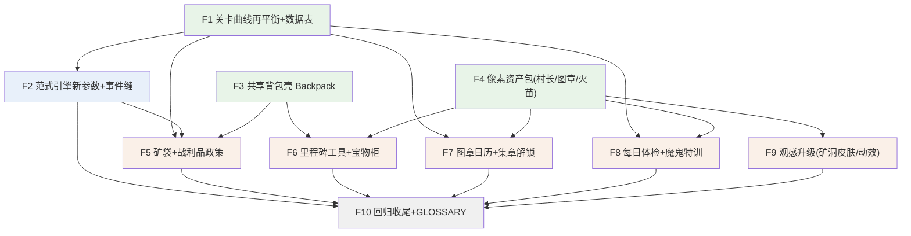

# 专注训练营 2.0 · 一期工单（本地 issue tracker 代理）

> 状态标记：`[ ]` 待认领 · `[~]` 进行中（子代理已派）· `[x]` 已并入 `feature/focus-revamp`
> **triage：ready-for-agent 已打**（本地 tracker 无标签系统，以本注记 + `[ ]` 状态等效）。
> 本文件是 implement-spec 流程的 tracker 代理：工单完成 = 分支并入集成分支 + 勾选状态。
>
> **上下文指针（实现者必读，勿复述）**
> - Spec（合同）：`docs/focus-revamp-plan.md`——Implementation Decisions 19 条 + Testing Decisions（测试缝已与用户确认）
> - 实现设计与全部数值：`docs/focus-revamp-design.md`（§2 难度曲线 D1~D5 · §3 战利品 L1~L6 · §4 观感清单 · §8 结构层 B1~B8）
> - 决策记录：`docs/adr/0002-focus-loot-integration.md`（共享背包推翻 D1 口径）
> - 工程规范：`AGENTS.md` 硬规则 + `docs/conventions.md`（§1.7 模块头 `====` 五要素；`-core` 必配同名单测）
>
> **通用纪律（每单生效）**
> 1. worktree 基于 `feature/focus-revamp`（集成者建），开工前核对基点，不符则 `reset --hard` 回集成分支顶端。
> 2. 开发用 Skill 工具加载 `tdd` 技能（红绿重构）；加载失败则手动 TDD——新逻辑先写测试。
> 3. 中文注释；文件名 kebab-case；顶层默认 `const`，会被外部写的用 `let`。
> 4. **不改 `index.html`**：需要加载行时在报告/提交信息里声明「应在 index.html 哪一行之后加什么 script」，由集成者统一添加（boot 冒烟按 index.html 顺序执行，单一写入者防冲突）。
> 5. `npm test`（= `node --test`，无需 node_modules）在 worktree 全绿才算完；lint 由集成者合并时在主仓库统一跑。
> 6. 范围只限本单；发现的跨单问题写进报告，不顺手做。
> 7. 报告格式：分支名 / 提交哈希 / 测试结果 / index.html 加载声明 / 给后续工单的备注。不自行并入集成分支。

---

## 任务图

---

## 第一波（frontier·可并行）

### F1 关卡曲线再平衡 + 数据表 `[ ]`
- 依赖：无。
- 交付：关卡参数表的 paramsFor 五维新曲线与全部新参数（伪装率 disguiseRate / 长度混编 lenMix / 反组块 antiChunk / 中立行 neutralRate / 混生物 mobMix / 双价 bivalent / 切换抖动 switchJitter / 选项数 choices / 宝石轮换 gem）+ FOCUS_LOOT 五维掉落表与稀有池 + FOCUS_MILESTONES 里程碑工具表 + FOCUS_CHECK_PARAMS 体检短参数 + 纯函数 focusFlame(acc, baseline)（火苗三档）与 devilStep(level, acc)（鬼等级双阈进退）+ 图章/集章里程碑数据。数值全部照抄设计稿 §2 D1~D5、§3 L3/L4、§8 B3/B8，不自创。
- 测试（范式引擎 vm 缝扩展）：**渐进无断层断言族**——每个 qualitative 参数在引入档必须 0<值<1、单调不降至封顶（"qualitative 跳变必须混编"由此锁死）；档位边界（corsi len≤6 且 grid16 仅 tier≥14；flanker len≤9 且 len9 仅 tier≥18、congruentRate≥0.35、window≥1500；switch rules≤3、choices∈{4,5}）；掉落表概率和=1 且全部 id 在 ITEMS 注册（交叉断言，先例：物品系统掉落表测试）且 stackMax>0；里程碑 6 条且 isTool 全真；focusFlame 边界（85/70）；devilStep 边界（85↑/66 保持/65↓、等级 1 不下探、10 不上溢）；体检参数时长上界（试次数×时长封顶）；既有测试（门槛/编排/三星/自适应）必须原样全绿。
- 备注：gonogo 规则文案随 disguiseRate 改为「钻石快挖！别的矿和 TNT 都不要碰。」；focusTip 同步微调。

### F3 共享背包壳（Backpack）`[ ]`
- 依赖：无。
- 决策已审定：ADR 0002——全游戏唯一拥有共享背包存档键的模块，未来消费方（探险/建造/下界）一律经此壳；专注只产出不消耗（不接配方/耐久/挖掘/放置）。
- 交付：新应用层壳模块——`load()→inv / add(id,n)→余量 / count(id) / total() / onChange(fn) / renderGrid(doc?)→宝物柜 HTML`；内部走背包核心纯函数（add 并堆→空位→满拒收）与云同步存档槽（defaults=空背包序列化，损坏回落空包）；头注释五要素 + CommonJS 导出守卫。
- 测试：`test/backpack.test.js`（**本特性唯一新缝**）——vm 加载 items-core + inventory-core + 本模块，stub 存储槽：默认空包 / 增删往返 / 堆叠与拒收（未注册 id） / onChange 触发 / 损坏档回落。先例：存档槽与模式工具箱的壳层 vm 测试。
- 声明加载位置：背包核心（inventory-core）之后、训练营模式层（modes/focus.js）之前。

### F4 像素资产包 `[ ]`
- 依赖：无。
- 交付：训练营像素图标库扩充——训练师村长三表情（微笑/喝彩/打盹，白胡子+矿工帽+头灯，16×16→96px 既有管线）+ 鬼化变体（矿工帽加鬼角+坏笑）；图章组（⛏️💎🧨 三图案 + 大图章 + 金图章 + 鬼图章）；火苗三态（小/中/大，做摇曳帧基础图）。中立头像（猪/羊）**仅当 F2 报告声明怪物库头像接口不合用时**补画。
- 测试：像素图标库无直测惯例——boot 冒烟兜底；函数形状沿用既有缓存模式（同键只画一次）。

---

## 第二波

### F2 范式引擎新参数 + 逐试次事件缝 `[ ]`
- 依赖：F1（paramsFor 形状）。
- 交付：①判别引擎：No-Go 逐试次按 disguiseRate 掷骰伪装（绿宝石/TNT）、noSet 扩充 coal/iron_ore；②Corsi：lenMix 过渡档混出上一档长度、antiChunk 序列展示前按概率打乱格位（打乱后格子互异、序列仍可解）、gem 轮换；③Flanker：len9 小尺寸档、neutralRate 中立行、mobMix 行内混入非苦力怕生物；④Switch：tier≥10 五选项、bivalent 无关维度匹配（颜色规则下干扰项与目标同大小 / 大小规则下干扰项用目标同族图标）、switchJitter 随机切换间隔；⑤handler 契约新增**可选** `onTrial({ok, streak, dim})`——不传零影响，引擎不知道奖励存在（分层红线）。
- 测试（vm 缝行为断言）：disguiseRate=0 时整局无伪装出现；lenMix 过渡档确实产出两种长度；antiChunk 打乱不产生重复格位；onTrial 每试次恰一次且字段正确（教学演示不计）；既有全绿。
- 备注：**开工第一件事验证怪物库头像接口形状**（Mobs.face 返回 HTML 片段 or URL）；中立行优先复用它，不合用则报告声明、由 F4 补画接管。

---

## 第三波（可并行）

### F5 矿袋 + 战利品政策 `[ ]`
- 依赖：F1（掉落表）、F2（事件缝）、F3（Backpack）。
- 交付：训练营模式层接 onTrial→按 FOCUS_LOOT 掷骰（正确 p=0.45 / 3 连对保底稀有池 / 教学关豁免 / 通关 torch|apple 二选一 / 三星追加 1 钻石）→ Backpack.add → 矿袋 HUD 槽位飞入动画（贝塞尔弧线，复刻掉落物真空吸附观感）+ 落袋音；结算页战利品列队回顾；满包静默忽略 + 每关至多一次 toast「背包满啦」。
- 测试：掷骰政策抽成种子可注入的顶层纯函数进 vm 缝（概率边界/保底触发/豁免分支/满包余量）；DOM 动画不直测。
- 数值：设计稿 §3 L3 + §4。

### F6 里程碑工具 + 宝物柜 `[ ]`
- 依赖：F3、F4。
- 交付：unlocked 首次越线 → 全屏授予仪式（像素工具大图 + level 琶音 + TTS「你获得了铁镐！」）；**存量档按当前 unlocked 一次性补授、不重授**；今日页 🎒 宝物柜：分组网格（材料/矿物/食物/工具/方块）+ 数量角标 + 点击 TTS 读物品名 + 村长导览台词。
- 测试：补授幂等纯函数进 vm 缝（对既有档计算应授集合=里程碑表与已授的差集）。

### F7 图章日历 + 集章解锁 `[ ]`
- 依赖：F1、F4。
- 交付：今日页本月日历条——当日完成 ≥1 关得像素图章、满 3 关大图章、漏签**无任何负面标记**；stamps 记录滚动 90 天；集章里程碑（3/7/14/30…章）授予观感奖励（自选图章图案/矿袋皮肤/宝物柜烟花/金图章）+ 村长仪式。**红线：永不解锁关卡/范式/难度**。
- 测试：落账（当日计数 1~6 钳制）/ 裁剪 / 集章计数纯函数进 vm 缝。

### F8 每日体检 + 魔鬼特训 `[ ]`
- 依赖：F1（体检参数/火苗/鬼等级阶梯）、F4（鬼化村长）。
- 交付：①体检——今日页「🔥 今日体检」每日一次约 90 秒，复用大师关五维连跑机制（sections 短参数），产出三档探险家火苗（≥85 大/≥70 中/其余小，小火苗配中性温暖文案）；只与自己近 7 天均值比、只显示变亮；计入时长**不占**关数额度；当日做完入口消失。②魔鬼特训——「👹 魔鬼特训」每日一次 **5 分钟硬顶**（到点当前小节打完强制结束、当日锁定）；计 2 关额度 + 计入时长；维度按日轮换（天数%5）；参数取当前档+2（封顶 19），mkAdapt 与挫败阀照常生效（失败无扣损/重置）；每维度鬼等级 1~10 按双阈进退，降级文案中性（鬼村长坏笑「下次再来！」）；通关得鬼图章。checks/devil 记录滚动 90 天。
- 测试：入口锁定与计费决策、时长上界、轮换维度选择纯函数进 vm 缝。
- 数值：设计稿 §8 B3/B8；不搬 n-back（合同 Out of Scope）。

### F9 观感升级 `[ ]`
- 依赖：F4。
- 交付：训练场矿洞皮肤（贴图图集 makeCanvas→dataURL→CSS 雪碧，石头带/圆石带/顶缘泥土/四角火把贴片闪烁）；MC 立体按钮（亮暗边 bevel+按压位移）；进度条分段刻度+⛏️游标；连对⛏️×N 弹跳+琶音；三星爆星粒子；今日页/星屏像素云缓移。
- 测试：不直测——boot 冒烟 + 手工验收（node server.js 起 8080 逐屏走查）；可与逻辑工单分提交降低回归压力。

---

## 第四波

### F10 回归收尾 + GLOSSARY `[ ]`
- 依赖：全部。
- 交付：index.html 加载声明核对（仅背包壳一行，位置见 F3）；GLOSSARY 词条（共享背包 Backpack/矿袋/宝物柜/图章日历/魔鬼特训/训练师村长，含 _Avoid_ 别名）；核对 item-crafting-design 变更记录与 ADR 0002 交叉引用；npm test + npm run lint 全绿汇总。
- 手工验收剧本（设计稿 §6）：造档 L37/L49 体验伪装渐入与长度混编的坡道感；矿袋飞行/3 连保底/结算回顾/宝物柜计数/满包 toast 一次性；unlocked=50 存量档首入补授铁镐；顶格关（tier 18/19）len9 行宽与双价干扰可读性；家长面板 CSV 列与免责声明不变。
- 首周观察项：魔鬼特训鬼等级分布——某维度连续降级占多数则该维度挑战档回退 +1（设计稿 §8 风险条款）。
