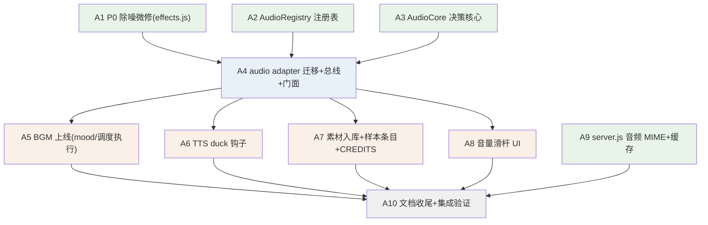

# 游戏音频系统重建 · 工单（本地 issue tracker 代理）

> 状态标记：`[ ]` 待认领 · `[~]` 进行中（子代理已派）· `[x]` 已并入 `feature/game-audio`
> 本文件是 implement-spec 流程的 tracker 代理：工单完成 = 分支并入集成分支 + 勾选状态。
>
> **上下文指针（实现者必读，勿复述）**
> - Spec（合同）：`docs/game-audio-spec.md`——Implementation Decisions 全部条目与 Testing Decisions 是硬约束
> - 方案：`docs/game-audio-plan.md`（四阶段/音频图/BGM 调度参数表）
> - 调研依据：`docs/game-audio-research.md`（杂音根因 A.1~A.8 / 素材许可 B.1~B.5，所有参数的出处）
> - 工程规范：`AGENTS.md` 硬规则 + `docs/conventions.md`（§1.7 模块头 `====` 五要素；`-core`/`-registry` 必配同名单测；§1.9 adapter 经 boot 冒烟）
> - 现状基线：feature/item-crafting @ b258ab5（TNT 已下线、六模式：arena/focus/build/tank/nether/adventure）
>
> **通用纪律（每单生效，同 item-crafting-tickets.md 先例）**
> 1. worktree 基于 `feature/game-audio`，开工前核对基点，不符则 `reset --hard` 回集成分支顶端。
> 2. TDD（红绿重构）：`-core`/`-registry` 先写同名单测；adapter 改动以现有套件全绿 + 最小化 diff 为准。
> 3. 中文注释；文件名 kebab-case；顶层默认 `const`，会被外部写的用 `let`。
> 4. **不改 `index.html`**：需要加载行/DOM 时在报告里声明「应在 index.html 哪一行之后加什么」，由集成者统一添加（boot 冒烟按 index.html 顺序执行，单一写入者防冲突）。
> 5. `node --test`（无需 node_modules）在 worktree 全绿才算完；lint 由集成者合并时统一跑。
> 6. 范围只限本单；发现的跨单问题写进报告，不顺手做。
> 7. 报告格式：分支名 / 提交哈希 / 测试结果 / index.html 声明 / 给后续工单的备注。不自行并入集成分支。

---

## 任务图

---

## 第一波（frontier·可并行）

### A1 P0 除噪微修（effects.js）`[x]`（并入 `7846b16`）
- 依赖：无。
- 交付（四处微修，全在 js/effects.js，参数出处见 research A.8）：
  ① **节点纪律**：sfx 的全部一次性音源（振荡器/白噪 BufferSource/win 双振荡器）播完 `onended` 摘除断连（Bug 222098 官方 workaround）；
  ② **触屏高通**：IS_TOUCH 时 master 链前插 BiquadFilter highpass ~160Hz（喇叭发不出的低频不占 headroom）；
  ③ **压限器回调保险丝定位**：threshold -12→-18 · knee 20→24 · ratio 12→8，master 0.9→0.8；
  ④ **engineHum 频段重设计**：基频 52~98Hz 上移至 120~250Hz（lowpass 260→bandpass 或等效），加轻微幅度调制补体积感；保留 IS_TOUCH 增益减半与 8 级量化。
- 测试：`node --test` 现有套件全绿（adapter 无直测，boot 冒烟覆盖）；无新增测试文件。
- 备注：iPad 真机验证由需求方事后执行（内放/耳机 × 10 分钟 × 100v100），报告里注明「待真机验收」。

### A2 AudioRegistry（audio-registry.js + 同名单测）`[x]`（并入 `56f00bf`）
- 依赖：无。
- 交付：`js/audio-registry.js`（`-registry` 后缀语义：清单唯一权威，纯数据+纯函数，Node 直载，CommonJS 导出守卫）：
  - `SFX_KINDS`：只收**活着的** kind（扫 js/** 的 `sfx('…')` 字面量：zap/boom/pick/click/death/hit/hurt/shoot/level/win/roar/breath；TNT 遗留死键 fss/door/splash **不迁**）。每条 `{synth|file, g, gTouch, prio, coolMs}`——synth 定义从 effects.js 的 SFX_DEFS 原样迁入（win 双振荡器特例内联注释）；prio 参考 spec（仪式>受击>爆炸>打击）；file 字段本单留空（A7 填）。
  - `MUSIC_TRACKS`：空表（结构 `{file, mood, g}`，A7 填）。
  - `MOODS`：modeId→mood 映射（menu/build=calm · arena/tank=battle · nether/adventure=dark · focus=none），模式 id 以 js/mode-registry.js 为准。
- 测试：`test/audio-registry.test.js`（-registry 消费端断言先例 mode-registry.test.js）：① 扫 js/** 源码 `sfx('…')` 字面量 ⊆ SFX_KINDS 键（漏登记即红）；② 条目形状防错网（四字段齐全 + synth/file 二选一）；③ MOODS 的键 ⊆ mode-registry 模式 id + 'menu'，值 ⊆ 合法 mood 集；④ file 条目（若有）在 assets/audio/ 存在且 CREDITS.md 记载（本单空转过，A7 起生效）。
- 配平备注（转记 A3/A7 用）：
  - prio 四档工程推定：4=win/level · 3=hurt/death · 2=boom/zap/roar/breath · 1=hit/shoot/pick/click；
  - g/gTouch 中性 1 起步——合成路径响度已在 synth 内配平，迁移期听感不变；
  - coolMs 沿用 60ms 同类窗、win 豁免 0；
  - VoiceGate 抢占为严格大于（相等不抢）；
  - 过渡期守卫测试⑤（synth 与 SFX_DEFS 一致性）在 A4 删 SFX_DEFS 后退场；
  - A7 的 file 存在性/CREDITS 断言从空转转咬合、曲目 mood 不含 none。

### A3 AudioCore（audio-core.js + 同名单测）`[x]`（并入 `8a15df3`）
- 依赖：无。
- 交付：`js/audio-core.js`（`-core` 后缀语义：零 THREE·零 DOM，工厂接口走 quality-core 的 mk/step 先例，时间与随机注入可测）：
  - `mkVoiceGate({max})` → `{admit(kind, prio, coolMs): 'play'|'steal'|'ignore', release(kind), activeN()}`：同类冷却窗内 ignore；活跃数 < max 放行；满员时新声 prio 严格大于最老活跃声才抢占（steal 返回被抢 kind 供适配层停声），否则 ignore。max 由调用方按 IS_TOUCH 给 8/12。
  - `mkMusicDirector({rand})` → `{tick(dtMs): events[], setMood(m), unlock(), duck(on), snapshot()}`：状态机 idle/waiting/playing；解锁后 5~30s 起曲（menu 口径）；一曲播完随机 60~180s 静默再选；setMood 换情绪→fade-out 1.2s→15~45s 后新曲，同 mood 续播不打断；duck(on) 目标增益 0.08、ramp 0.25s、释放 0.8s 回升；events 为 `{type:'start'|'stop'|'gain', ...}` 纯数据。曲目列表注入（空表时恒 idle 出 gain 事件，结构先立）。
  - `AUDIO_MIX`：响度常数表（musicBus 0.30/0.25 触屏 · sfxBus 0.9/0.8 · duck 0.08 · 淡入淡出时长）。
- 测试：`test/audio-core.test.js`（先例 quality-core.test.js）：VoiceGate 边界（未满放行/满员低让高抢/冷却窗/抢占恰停最老）；MusicDirector 注入确定性 rand 序列，tick 推进断言事件序列与增益轨迹（起曲延迟区间/静默区间/换 mood 交叉淡出时序/duck 压低回升）。

### A9 server.js 音频 MIME + 缓存豁免 `[x]`（并入 `e2b35f0`，合并 `e32f01b`）
- 依赖：无。
- 交付：server.js 两处：① MIME 表补 `.m4a audio/mp4 · .mp3 audio/mpeg · .ogg audio/ogg · .wav audio/wav · .flac audio/flac`；② 音频扩展名豁免 `no-store`（走既有 ETag/304 协商缓存——每次刷新省 ~20MB 局域网重拉；代码文件维持 no-store 版本一致性政策不动，注释写明理由）。音频不入 GZIPABLE（现表已不含，注释确认）。
- 测试：server.js 无单测先例，不加；报告里附一条本地验证（node server.js 起 + PowerShell Invoke-WebRequest 拉 .m4a 断言 Content-Type 与二次请求 304）。
- 约束：零依赖静态服务器定位不动，只加数据与一行分支。

---

## 第二波

### A4 audio adapter 迁移与总线接线 `[x]`（并入 `8c962b4`）
- 依赖：A1 A2 A3。
- 交付：新 `js/audio.js`（引擎层 adapter，头注释五要素），effects.js 瘦身为 Fx+toast：
  - 迁入并整合：unlockAudio（+`state==='interrupted'` 与 visibilitychange 恢复；挂起不排队纪律保持）、A1 的全部除噪修补（onended 断连/触屏高通/压限器参数/引擎嗡鸣重设计）、A2 的 synth 解释器（SFX_DEFS 播放路径原样迁）。
  - 总线图照 plan §3.2：sfxBus(+触屏高通) 与 musicBus → master(0.8) → compressor(-18/24/8) → destination；一切 gain 变化 setTargetAtTime。
  - 样本路径（为 A7 备好）：懒加载 fetch→decodeAudioData（callback 包装防 Safari reject null，缓存于 Map），样本播放器统一 5ms 线性淡入 + onended 断连 + VoiceGate 接线（admit/steal/release 驱动真实节点启停）；条目无 file 或加载失败→自动落 synth 路径（降级链）。
  - 门面 `AudioMixer`：`{sfx, engineHum, setMood, setMusicVol, setSfxVol, duck, tick, preload}`——全局 sfx/engineHum 函数签名不变（60+ 调用点零改动，定义挪到本文件）；setMood/setMusicVol/setSfxVol/duck 本单可为薄壳（A5/A6/A8 消费），tick 驱动 mkMusicDirector 实例。
  - **index.html 只声明**：报告里给出「在 js/effects.js 行之前插 js/audio-registry.js / js/audio-core.js / js/audio.js 三行 defer script」。
- 测试：`node --test` 全绿（boot 冒烟在集成者挂上 script 行后覆盖新文件加载序）；无 adapter 直测。
- 集成校正（A1 报告转记）：
  - 迁移清单含 A1 新增的 dropOnEnd 助手与 humFilt/humLfo/humDepth 顶层绑定；
  - sfx() 早退路径留孤儿 gain 节点——A4 改为先查表再建 gain 根治；
  - A1 的触屏高通现挂 master 与压限器之间（单总线等效实现），A4 拆 sfxBus/musicBus 时必须挪到 sfxBus 专属前置（音乐低频是内容，spec 总线图明确高通只挂音效总线）。
- 接口备注（转记 A3 报告）：
  - ① admit 返回结构化对象 `{act:'play'|'steal'|'ignore', victim}`，steal 时执行器 stop(victim)；抢占语义=victim 恒为进入时刻最老活跃声、且新声 prio 严格大于它；
  - ② 曲目条目契约含 durMs（核心判曲毕唯一依据），A7 填曲须补（A4 亦可用 AudioBuffer.duration 预填）；
  - ③ duck/setMood 只改状态、事件从下一次 tick 的 pending 流出，同拍 gain 事件先于 start/stop；
  - ④ 事件形态 `{type:'start',track,gain,fadeInMs}`/`{type:'stop'}`/`{type:'gain',target,rampMs}`；start 的 gain 已按 duck 算好、淡入 1200ms 与淡出对称；
  - ⑤ 音乐总线基线增益按 IS_TOUCH 传 AUDIO_MIX.music(0.30)/musicTouch(0.25)，duck 深度 0.08 绝对值；
  - ⑥ 同 mood 选曲避重复上一首（池≥2 排除上首，单首池允许重复，测试已钉死）；
  - ⑦ mkVoiceGate 的 max 由 A4 按 IS_TOUCH 给 8/12，now 生产默认 Date.now；
  - ⑧ duck 释放时若正在淡出/无曲，回升目标自动 0，执行器无需特判。
- 门面签名（转记 A4 报告，A5~A8 消费）：
  | 签名 | 口径 |
  | --- | --- |
  | `setMood(m)` | m ∈ calm/battle/dark/none，同 mood 续播不打断；BGM 计时不需要 A5 操心——unlock 首次走通自动按 menu 口径 5~30s 起步，director 只在 context running 时推进 |
  | `tick(dtMs)` | **毫秒**（A5 主循环传 dt\*1000） |
  | `duck(on)` | A6 说话起 true、说完 false |
  | `setMusicVol(v)` / `setSfxVol(v)` | 0..1 钳制（A8 接滑杆） |
  | `preload()` | A7 消费，手势后预热 SFX file 条目 |
  | `sfx` / `engineHum` | 全局函数签名不变（60+ 调用点零改动） |
- 跨单备注（A4 转记）：
  - A7 填 file 后首播仍走合成（样本异步就绪；要首播即样本可在手势后 `preload()`）；
  - playTrack 解码延迟使曲毕判定略早（≈解码时长，1.2s 淡出掩盖，A5 可选自测补偿）。

---

## 第三波

### A5 BGM 上线 `[x]`（并入 `4e8aab0`）
- 依赖：A4。
- 交付：mode-registry.js 各行加可选 `mood` 字段（数据级，值与 A2 的 MOODS 对齐）；main.js：switchMode 里调 `AudioMixer.setMood(...)`、showPage('main') 时 menu mood、主循环 `AudioMixer.tick(dt)` 一行；MusicDirector 执行器（audio.js 内部）：起曲=解码一次性播放（不循环，播完丢引用）、gain 事件映射 musicBus setTargetAtTime；focus=none 恒静默；空曲表时结构就绪不出声（A7 填曲后自然生效）。
- 测试：mode-registry.test.js 扩展断言 mood 值 ⊆ 合法集；audio-core 既有测试覆盖调度；boot 全绿。
- 验收提示（转记 A10）：
  - ① 验收前须先并 A7——当前 MUSIC_TRACKS 空曲表，听不到 BGM 是预期（结构就绪不出声，A7 填曲后自然生效）；
  - ② 行为验收点清单：主菜单 5~30s 起 calm · battle 模式（arena/tank）15~45s 换曲 · 同 mood 进出不打断（续播）· 回主菜单才切 menu 口径 · focus 恒静默；
  - ③ 超时页 playTime 不切情绪保持原口径（不触发 switchMode/showPage，BGM 情绪维持当前模式）——若应收成 menu/none 是一行改动，A10 拍板。

### A6 TTS duck 钩子 `[x]`（并入 `4548e12`）
- 依赖：A4。
- 交付：speech.js 的 mkSpeech 增加可选说话起止钩子（接口形态自选：第三参 hooks 或实例 onSpeak 注册器；默认空操作，现有调用方与测试零破坏）；utterance 的 onstart/onend 触发钩子；接线侧把钩子指向 `AudioMixer.duck(true/false)`（接线处可在 speech.js 底部创建处或 main.js 组合根，报告说明取舍）。
- 测试：speech.test.js 扩展——fake speechSynthesis 断言说话起→钩子 start、说完→钩子 end（含 cancel 路径的 end 兜底）；boot 全绿。
- 备注：duck 经 director 事件化执行，A5 接上主循环 tick 后才真正出声（A5 并入前钩子只改状态，属预期）。

### A7 素材入库 + 样本条目 + CREDITS `[x]`（并入 `adc924d`）
- 依赖：A4（结构与加载器就绪）。
- 工具链预案（本机已探明无 ffmpeg/curl）：转码优先序 ① PATH 里有 ffmpeg 直接用；② `npm i -D ffmpeg-static`（package.json 只装开发期工具链的既有定位内，运行时零依赖不破）并用其二进制；③ 都不行则 OGA 的 mp3 直接入库（iPad Safari 解码 MP3 无碍，m4a 决策降级为 mp3 并在 CREDITS 与 ADR 记录原因）。下载用 PowerShell Invoke-WebRequest，源文件（zip/wav/flac）放仓库外临时目录不入库。
- 交付：assets/audio/ 目录 + m4a（或降级 mp3）+ CREDITS.md（曲目/作者/来源 URL/许可/下载日期逐条）；清单：Kenney music-jingles 全包（反馈类）+ impact-sounds / rpg-audio 两包各挑（打击爆炸类，均 CC0 OGG 需转码）+ OGA「Crickets」与「Ambience of a Fallen Age」挑 2~3 首（BGM）；转码参数：mono 44.1k，BGM 96k / 短曲 128k（loudnorm 可选）；A2 注册表填 file 条目与 MUSIC_TRACKS（mood 对齐），死键不复活。
- 测试：A2 的资产存在性/CREDITS 覆盖断言此时咬合；`node --test` 全绿。
- 红线：只取 CC0；不下载 Minecraft/C418 原声；总体积 ≤25MB。
- 收尾备注（转记 A10）：
  - ① 条目形状演进——file 条目必带 synth 回退（A2 的「二选一」口径作废，测试已改为互锁「永不哑」）；
  - ② ADR-0002 补记 ffmpeg-static 的 TLS workaround（NODE_TLS_REJECT_UNAUTHORIZED=0 重装）与「响度未过 loudnorm、由 g/gTouch+AUDIO_MIX 分工」现状；
  - ③ mood 映射为听感推断（crickets→calm · the-abyss→dark · volcano→battle）待 A10 复核；Fallen Age 另两首在临时目录 `C:\Users\user\AppData\Local\Temp\opencode\a7-sources\` 备用可增补；
  - ④ level/win 保持纯合成（琶音/和弦比打击样本贴仪式感）。

### A8 音量滑杆 UI `[x]`（并入 `b695f66`）
- 依赖：A4。
- 交付：主菜单 🎵 按钮展开 音乐/音效 两滑杆（触屏儿童友好大控件；CSS 入 css/touch.css 或 style.css 按端归属）；audio-core 加 `mkVolState`（默认值按 IS_TOUCH 取 AUDIO_MIX、0..1 钳制、localStorage 序列化）+ 同名单测扩展；接线 `AudioMixer.setMusicVol/setSfxVol`；**index.html 只声明**（按钮与面板 DOM 位置）。
- 测试：audio-core.test.js 扩展（默认/钳制/持久化往返）；boot 全绿。
- 备注：滑杆手感与 muted 变暗待 iPad 真机验收（同 A1 口径）；试听嘟声为后续增强未做。

---

## 第四波

### A10 文档收尾 + 集成验证 `[ ]`
- 依赖：A5 A6 A7 A8 A9。
- 交付：GLOSSARY 收词（AudioRegistry / AudioCore(VoiceGate·MusicDirector) / AudioMixer，_Avoid_ 标注 effects.js 音效段历史归属）；conventions.md §1.1 目录宪法补 assets/ 行（若 A7 用了 ffmpeg-static，§工具链表同步登记 devDependency 理由）；`docs/adr/0003-audio-assets-in-repo.md`（音频入库 + 单格式 + CC0-only + 体积预算的不可逆决策；编号自 0002 顺延——基线里 0002 已被 focus-loot-integration 占用）；index.html 版本行声明（集成者改）；CREDITS 复核；集成分支全量 `node --test` + `npm run lint` 绿。
- 收尾拍板（A10，承接 A5 验收提示③ / A7 收尾备注③④）：
  - ① **超时页 playTime 保持模式情绪口径，不改**——`playTimeUp` 只 `showPage('playTime')`，不触发 switchMode/showPage('main')，BGM 情绪维持当前模式；A5 设计如此（超时收摊不另做音乐情绪提示）。若产品口径日后要收成 menu/none，是在 `playTimeUp`/`showPlayTimeoutPage`（main.js）补一行 `AudioMixer.setMood(...)` 的事，本单不做。
  - ② **mood 映射维持听感推断**（crickets→calm · the-abyss→dark · volcano→battle，即 MUSIC_TRACKS 现值），iPad 真机验收后可调；Fallen Age 备用两首（A Forgotten World / Ruins of an Ancient Culture）在仓库外临时目录 `C:\Users\user\AppData\Local\Temp\opencode\a7-sources\`，换曲/增补时入库并同步 CREDITS 与 MUSIC_TRACKS。
  - ③ **level/win 保持纯合成**——琶音/和弦比打击样本更贴仪式感（A7④），不样本化。
