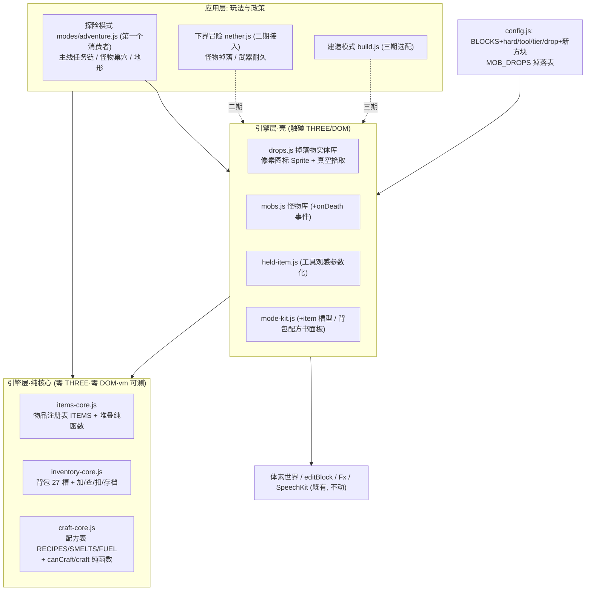

# 物品与合成系统 · 实现设计

> 需求：结合我的世界与当前游戏实际，设计**物品系统**（自然矿物 / 怪物掉落 / 采集物 / 合成物品），丰富游戏。
> 我的世界数值依据：`docs/minecraft-item-crafting-research.md`（后台研究代理对照 Minecraft Wiki 第一手来源逐条摘录，下文引用写作「研究稿 §n」）。
> 用户拍板（2026-10-22）：
> 1. **系统形态**：做成引擎层**基础系统**——像怪物库（Mobs）那样，所有模式想要都能接入；不绑定单一玩法。
> 2. **合成交互**：**点选配方书**（图标卡片、材料够点亮、点一下即合成 + TTS 表扬），不做网格拖拽。
> 3. **工具耐久**：**有耐久 + 语音安抚**（坏了 TTS 安抚不惩罚，数值比 MC 加倍宽容）。
> 4. **站点解锁**：**MC 式放置解锁**——工作台/熔炉要放进世界、走近 4 格内才能用高级配方/烧炼。

> **实施状态注记（2026-10-23）**：物品与合成一期（工单 T1~T16）已全部落地于 `feature/item-crafting` 分支——三纯核心+单测、掉落物实体库、像素图标、贴图图集、背包 UI、探险模式与任务链、三份存档全量交付（基线 397 测试全绿，lint 三工具零错）。环境变化：外部提交 c69177c 已下线 TNT 密室模式（现存游玩模式：竞技场/建造/坦克演习场/下界冒险/探险）。两项实施口径：持镐拆炉**不做**（走近开面板时左键误拆的惊吓成本 > 挪炉收益，更安全入口留二期）；QUESTS 任务计数口径（只增不减、只认玩家亲手做——TNT 掀掉的不算）见 `js/modes/adventure.js` 的 QUESTS 表注释。下文正文数值为一期定稿，未随本注记改动。

---

## 0. 现状盘点与硬约束

### 已有的地基（全部复用，不重造）

| 现有资产 | 位置 | 与本设计的关系 |
| --- | --- | --- |
| 方块注册表 `BLOCKS` | config.js | 35 个 id，纯色数据；本设计给它加 **hard/tool/tier/drop** 四个字段 + 新方块；既有方块按「直接采集 / 合成烧炼 / 创造专属」三分类逐块定归属，并按原版补一批方块与物品（黏土-红砖链、石砖、剪刀、箱子、金苹果），见 **§3.5** |
| 怪物数值表 `MOB_TYPES` | config.js | 37 怪无数值化掉落；本设计加 `MOB_DROPS` 掉落表 |
| 手持物注册表 `HeldItems` | held-item.js | 纯观感 defs（hoe/sword/bow）；扩展为**材质参数化**（木/石/铁/钻同构换色） |
| hotbar `mkHotbar` | mode-kit.js | 两种槽型（block 型 / icon+cnt 型）；扩展**item 槽型**（图标+数量+耐久条） |
| 怪物库 `Mobs` | mobs.js | 击杀碎块 `debrisColor` 已有；加 **onDeath 击杀事件**钩子 |
| 场景工具 `SceneKit` | scene-kit.js | fill/tree/rand 确定性散布；矿脉/树/草丛生成直接用它 |
| 存档槽 `mkSaveSlot` | save-slot.js | version/migrate/损坏回落 defaults；背包与探险世界存档直接套 |
| 云同步 `SyncDB` | sync.js | `build_world_save` 先例；镜像出 `inventory_save` / `adventure_world_save` |
| 特效 `Fx` | effects.js | `debrisBurst` 碎块（击杀已用）；挖碎方块复用同款（方块色） |
| 语音 `SpeechKit` / `showToast` | speech.js / main.js | 零文字依赖的引导/表扬/安抚通道 |
| vm 单测惯例 | test/*.test.js | 零 THREE 纯核心直测（镜像 held-item.test.js 加载器） |

### 硬约束（设计绕着走的地方）

- **世界是 `Uint8Array`，无方块元数据**（voxel.js：`worldCells`）：方块只能存 id → 生长阶段=换 id；树苗/作物计时用模式层 `Map<key, 到期>`，不进体素数据。
- **世界 48 层高是一期口径，不是天花板**（`WORLD_H=48`，地表场景在 y≈20~26）：一期矿物分布压缩映射（见 D5）；**扩容可行性已论证**——距离环渲染 GPU 对象按环面积封顶（扩图不加帧成本）、体素数据常驻内存且只线性增长（0.75MB→2.3MB，可忽略）、网格构建 Worker+渐进入队进场成本不变，**扩到 64 高 / 192 宽不影响性能**；代价是存量场景绝对坐标与存档要回归一遍（见 D14）。
- **目标用户 6 岁**：点选、图标 + 中文 TTS、零拖拽零摆位；「徒手挖石头 7.5 秒」这类 MC 惩罚保留但**封顶**（见 D4）。
- **引擎/应用分层**：引擎不知道「表扬」「任务」；掉什么、怎么引导归模式层。
- **无构建步骤**：新文件 = index.html 加一行 `<script defer>`；纯核心零 THREE 零 DOM。
- **现有五模式回归不受影响**（MISSION 约束）：物品系统是**选配接入**，不接的模式一行代码不用改。

---

## 1. 目标架构一张图



一句话：**三个纯核心（物品/背包/配方）+ 两个壳（掉落物实体/怪物击杀事件），数据全在注册表，政策全在模式层**——任何模式想要物品，接上就能用。

---

## 2. 与我的世界的对照总表（保留什么、改什么、为什么）

| 机制 | 我的世界（研究稿） | 本游戏 | 理由 |
| --- | --- | --- | --- |
| 堆叠 | 64 / 16 / 1，工具不可堆叠 | **64 / 1 两档**，工具 1 | 16 档留给雪球/珍珠等一期不做的东西 |
| 背包 | 4 盔甲 + 27 主格 + 9 快捷栏 | **18 主格 + 9 快捷栏**（无盔甲） | 6 岁管理成本减半；盔甲三期再说 |
| 合成 | 2×2/3×3 网格，有序/无序 | **点选配方书**（用户拍板②） | 零拖拽零摆位；配方形态用卡片小图示意 |
| 工作台 | 放置 + 打开 3×3 | **放置 + 走近 4 格解锁 table 级配方**（拍板④） | 保留「造出实体站点」的生存感，去掉开 UI 找格子的复杂度 |
| 熔炉 | 10 秒/件，3 槽 | **2.5 秒/件**，3 槽自动放料 | 儿童等待耐心；燃料热值照搬（煤 8 件） |
| 耐久 | 木 59/石 131/铁 250/钻 1561 | **木 120/石 260/铁 500/钻 1500**（约 ×2） | 拍板③：加倍宽容 + 语音安抚 |
| 徒手挖石 | 7.5 秒且不掉落 | 同规则但**封顶 8 秒**；不掉落保留 | 保住「先做镐」的因果教学，去掉绝望感 |
| 矿物分布 | Y -64~320 分层 | **压缩到 y0~22 四条深度带**（D5） | 世界只有 48 层；深浅序保留 |
| 怪物掉落 | 66% 掉 0-2（可能空手） | **保底 1，50% 概率 +1** | 打怪零掉落对 6 岁是挫败 |
| 树叶掉落 | 树苗 5%、苹果 0.5%、木棍 2% | **树苗 12%、苹果 4%、木棍 8%**（约 ×2~8） | 种树/食物链要能自然发生 |
| 小麦 | 8 阶段 | **4 阶段**（4 个方块 id） | 无元数据世界只能换 id；20 秒/阶段 |
| 死亡掉落 | 掉一地（keepInventory 可关） | **永不掉落**（回家重生，血量回满） | 零惩罚哲学；下界冒险已有同款先例 |
| 物品 ID | `minecraft:iron_ingot` 命名空间 | **snake_case 键**（`iron_ingot`），与 MOB_TYPES/HeldItems 键同惯例 | 单文件全局词法环境无命名空间需求 |
| 掉落物实体 | 世界里躺 5 分钟，走过去吸 | **落地弹跳 + 2.5 格真空吸附飞向玩家** | 不要求走位精度；3 分钟消失 |

---

## D1 · 系统形态：引擎层基础系统（用户拍板①）

| 方案 | 说法 | 取舍 |
| --- | --- | --- |
| **A. 引擎层基础系统 + 模式选配接入**（定稿） | 三纯核心 + 掉落物实体 + 怪物击杀事件，全部坐在引擎层；模式声明式接入 | 与 Mobs/Tank 同构：竞技场和坦克演习场共享怪物的先例 |
| B. 绑进某个模式的私有实现 | 快，但第二个模式要用就得抽 | 用户明确否掉 |

**接入面**（谁接入谁受益，不接的零改动）：

| 模式 | 接入 | 时段 |
| --- | --- | --- |
| **探险模式（新）** | 全量：背包/挖掘/矿物/采集/掉落/配方/任务 | 二期（首个**消耗侧**消费者；背包的首个产出侧消费者是专注训练营，见上） |
| **专注训练营** | **战利品产出**：掉落/收集柜/里程碑工具（只产出不消耗——不接配方/耐久/挖掘） | 一期（第一个消费者，[adr/0002](adr/0002-focus-loot-integration.md)，2026-10-23 推翻原"不接入"口径；设计见 [focus-revamp-design](focus-revamp-design.md) §3） |
| 下界冒险 | 怪物掉落（`MOB_DROPS` 下界条目）+ 击杀表扬升级为掉落拾取 | 二期 |
| 建造模式 | 选配「生存建造」开关：方块从背包拿 | 三期 |
| 竞技场 / TNT 密室 / 坦克 | **不接入**（创造/解谜口径不动） | — |

---

## D2 · 模块结构：三纯核心 + 两壳 + 三处扩展

完全跟随 tank-core/tank、mob-core/mobs 的「纯核心 + 壳」双子惯例：

| 新文件 | 层 | 职责 | 测试缝 |
| --- | --- | --- | --- |
| `js/items-core.js` | 纯核心 | `ITEMS` 注册表（纯数据）+ `stackMax/mkStack/isTool` 纯函数 | vm 直测（镜像 held-item.test.js） |
| `js/inventory-core.js` | 纯核心 | 背包 27 槽模型：`add/count/canAfford/take/damage/serialize` | vm 直测 |
| `js/craft-core.js` | 纯核心 | `RECIPES/SMELTS/FUEL` 表 + `canCraft/craft/fuelUnits/smeltOf` | vm 直测 |
| `js/drops.js` | 引擎壳 | 掉落物实体库（像素图标 canvas Sprite、浮动动画、真空拾取） | 拾取距离判定提纯进 items-core 或本文件顶层纯函数段直测；渲染不测 |
| `js/modes/adventure.js` | 应用层 | 探险模式：地形/任务链/巢穴/政策 | 模式级集成测试镜像 nether-mode.test.js |

**三处既有文件扩展**（不新造概念）：

1. `config.js`：`BLOCKS` 条目加 `hard/tool/tier/drop` 字段 + 新方块 id 36~50（附录 A）；新增 `MOB_DROPS` 表。
2. `mobs.js`：加 `onDeath(cb)`——引擎在 `hit` 判定死亡**瞬间**回调一次（现成 `r.dead` 时点），只报事件不解释死因。
3. `held-item.js`：加 `mkToolDef(kind, tier)`——镐/斧/剑/锹的部件表同构（柄 + 头），材质色板参数化（木 `0x8a5a2b`/石 `0x8a8f98`/铁 `0xd8dde4`/钻 `0x4ee1d2`），剑 def 由此生成；`defs` 保留手工条目兼容 hoe/sword/bow。

**index.html 加载序**：`items-core → inventory-core → craft-core` 插在 `held-item.js` 之后、`mode-kit.js` 之前；`drops.js` 插在 `mobs.js` 旁。

---

## D3 · 数据模型（三张注册表 + 一组方块新字段）

### 3.1 ITEMS 注册表（`items-core.js`，一期全量 ~36 条）

条目形状（参数表驱动，加物品 = 加一行纯数据）：

```js
// 材料(可堆叠64) · 工具(耐久,堆叠1) · 食物(回血) · 放置型(带 block 字段)
// icon 字段为占位: 正式图标 = icons.js 像素工坊自绘 16×16 + 方块贴图图集管线(见 D13, 用户批注③)
log:        { name:'原木',  icon:'🪵', block:5,  fuel:1.5 },
planks:     { name:'木板',  icon:'🟫', block:6,  fuel:1.5 },
stick:      { name:'木棍',  icon:'🥢',           fuel:0.5 },
coal:       { name:'煤炭',  icon:'⚫',           fuel:8 },
charcoal:   { name:'木炭',  icon:'🌑',           fuel:8 },
iron_ore:   { name:'铁矿石', icon:'🟠' },                    // 粗矿口径: 需熔炼(研究稿 §2.2)
iron_ingot: { name:'铁锭',  icon:'⬜' },
gold_ore:   { name:'金矿石', icon:'🟡' },
gold_ingot: { name:'金锭',  icon:'🟨' },
diamond:    { name:'钻石',  icon:'💎' },
gunpowder:  { name:'火药',  icon:'⚪' },
bone:       { name:'骨头',  icon:'🦴' },
bone_meal:  { name:'骨粉',  icon:'✨' },
string:     { name:'线',    icon:'🧵' },
slimeball:  { name:'粘液球', icon:'🟢' },
wheat:      { name:'小麦',  icon:'🌾' },
wheat_seeds:{ name:'小麦种子', icon:'🌱' },
apple:      { name:'苹果',  icon:'🍎', food:4 },
bread:      { name:'面包',  icon:'🍞', food:8 },
rotten_flesh:{ name:'腐肉', icon:'🥓', food:2 },             // 儿童版无饥饿debuff, 回2血
torch:      { name:'火把',  icon:'🔥', block:B_TORCH },
craft_table:{ name:'工作台', icon:'🛠️', block:B_CRAFT },
furnace:    { name:'熔炉',  icon:'♨️', block:B_FURNACE },
tnt:        { name:'TNT',   icon:'🧨', block:B_TNT },
sapling:    { name:'树苗',  icon:'🌿', block:B_SAPLING },
dirt:       { name:'泥土',  icon:'🟫', block:2 },             // 放置型方块物品(挖掘获得)
sand:       { name:'沙子',  icon:'🟨', block:8 },
cobble:     { name:'圆石',  icon:'🪨', block:4 },
stone:      { name:'石头',  icon:'⬜', block:3 },             // 烧炼圆石得(研究稿 §5.3)
glass:      { name:'玻璃',  icon:'🔷', block:18 },
// 工具 16 条 = 4 阶 × 4 种, mkToolDef 生成观感, 数值在此:
pick_wood:  { name:'木镐', icon:'⛏️', tool:{ kind:'pick', tier:1, dmg:3, dur:120, speed:2 } },
pick_stone: { name:'石镐', icon:'⛏️', tool:{ kind:'pick', tier:2, dmg:4, dur:260, speed:4 } },
pick_iron:  { name:'铁镐', icon:'⛏️', tool:{ kind:'pick', tier:3, dmg:6, dur:500, speed:6 } },
pick_diamond:{ name:'钻石镐', icon:'⛏️', tool:{ kind:'pick', tier:4, dmg:8, dur:1500, speed:8 } },
// axe_*/sword_*/shovel_* 同构: axe 斧(砍树加速) sword 剑(战斗) shovel 锹(挖土沙加速)
```

- icon 字段为开发期占位；**一期正式图标 = `icons.js` 像素工坊 16×16 手绘**（tankIcon 先例：emoji 各平台渲染不可控），方块贴图同步上图集管线——见 D13。
- 工具耐久 = MC ×2 取整（拍板③；MC 木 59/石 131/铁 250/钻 1561 → 研究稿 §1.5）。
- 工具 `dmg` 对齐本游戏「hp≈原版×1.5 / dmg≈原版×1.6」折算惯例（config.js MOB_TYPES 头注释）：剑 木 7/石 9/铁 11/钻 13（MC 4/5/6/7），镐 木 3/石 4/铁 6/钻 8（MC 2/3/4/5），空手 3。
- `speed` 照搬 MC 挖掘效率：木 2/石 4/铁 6/钻 8（研究稿 §1.5）。
- `tier`（挖掘等级）：手 0 / 木 1 / 石 2 / 铁 3 / 钻 4——即 MC 的 0-3 平移 +1，徒手也是一档（研究稿 §1.5）。
- 燃料热值照搬 MC（煤炭 8 件、木质 1.5 件、木棍 0.5 件——研究稿 §1.6）。

### 3.2 RECIPES / SMELTS / FUEL（`craft-core.js`）

```js
/* cost 值为数组 = 任选其一(如 [coal, charcoal]) · station: 'hand' 随时 / 'table' 需工作台 */
const RECIPES = [
  { id:'planks',  out:{item:'planks', n:4}, cost:{ log:1 }, station:'hand' },        // 研究稿 §4.2
  { id:'stick',   out:{item:'stick',  n:4}, cost:{ planks:2 }, station:'hand' },
  { id:'table',   out:{item:'craft_table',n:1}, cost:{ planks:4 }, station:'hand' }, // §5.5
  { id:'torch',   out:{item:'torch',  n:4}, cost:{ fuel:[['coal','charcoal'],1], stick:1 }, station:'hand' }, // §5.2
  { id:'pick_wood', out:{item:'pick_wood',n:1}, cost:{ planks:3, stick:2 }, station:'table' },   // 镐=3材+2棍 §5.4
  // … axe_*(3+2) sword_*(2+1) shovel_*(1+2) × 木/石(cobble)/铁(iron_ingot)/钻(diamond) 共16条
  { id:'furnace', out:{item:'furnace',n:1}, cost:{ cobble:8 }, station:'table' },    // 8圆石, 无需煤 §5.5
  { id:'bread',   out:{item:'bread', n:1}, cost:{ wheat:3 }, station:'table' },      // §5.5
  { id:'bone_meal', out:{item:'bone_meal',n:3}, cost:{ bone:1 }, station:'table' },
  { id:'tnt',     out:{item:'tnt',   n:1}, cost:{ gunpowder:5, sand:4 }, station:'table' },  // MC 口径
  { id:'bow_item',out:{item:'bow_item',n:1}, cost:{ stick:3, string:3 }, station:'table' }, // 二期启用(§5.4)
];
const SMELTS = { iron_ore:'iron_ingot', gold_ore:'gold_ingot', log:'charcoal',
                 cobble:'stone', sand:'glass' };                                     // §5.3
```

- 配方形态（哪格放哪）不做——配方卡片上用**小示意图**（3 材+2 棍的镐形小格子）满足「学原版」的观察趣味（用户拍板②的配方书口径）。
- `canCraft(inv, recipe, nearStation)` 返回 `{ok, missing}`——missing 驱动「缺什么」的灰显图标（零文字）。

### 3.3 MOB_DROPS 掉落表（config.js，儿童配平：保底 1，50% +1）

```js
/* [itemId, min, extraMax] — 击杀必得 min, 再以 50% 掷 extraMax 次(替代 MC 66%×0-2 的空手可能) */
const MOB_DROPS = {
  zombie:   { rolls:[['rotten_flesh',1,1]], rare:[['iron_ingot',0.05]] },  // MC 稀有铁锭 0.83%→5%(§3.1)
  skeleton: { rolls:[['bone',1,1]] },                                      // 箭二期(弓物品化)
  creeper:  { rolls:[['gunpowder',1,1]] },
  spider:   { rolls:[['string',1,1]] },
  slime:    { rolls:[['slimeball',1,1]] },                                 // MC 需玩家击杀口径(§3.2): 本游戏击杀者只有玩家, 天然满足
  /* 二期·下界: wither_skeleton bone / blaze blaze_rod(燃料12件) / ghast gunpowder / magma_cube slimeball */
  /* 三期·动物: cow→皮革+牛肉, sheep→羊毛+羊肉, chicken→生鸡+羽毛, pig→生猪排(§3.3) — 熟食走 SMELTS */
};
```

### 3.4 BLOCKS 新字段（config.js，挖掘规则的单一数据源）

```js
/* hard = MC 硬度原值(研究稿 §1.5/§2.3) · tool = 加速工具 · tier = 掉落所需镐等级 · drop = 掉落表 */
BLOCKS[3]  = { name:'石头', all:[...], hard:1.5, tool:'pick', tier:1, drop:[['cobble',1,0]] };   // 徒手挖不动→教做镐
BLOCKS[5]  = { name:'木头', all:[...], hard:2.0, tool:'axe',  tier:0, drop:[['log',1,0]] };
BLOCKS[7]  = { name:'树叶', all:[...], hard:0.2, tool:null,   tier:0, drop:[['sapling',1,0.12],['apple',1,0.04],['stick',1,0.08]] }; // 概率掉落
BLOCKS[1]  = { name:'草地', top:[...], hard:0.6, tool:'shovel',tier:0, drop:[['dirt',1,0]] };     // MC: 草掉泥土
/* drop 条目 [itemId, 保底, 概率] — 保底=破坏必得数量, 概率=额外再得 1 个的几率(树叶专用) */
```

**破坏时间公式**（craft-core 或 items-core 纯函数 `breakTime(blockDef, toolDef)`）：

```
t = hard × ( 无工具要求或工具匹配 ? 1.5 / toolSpeed : 5 )      // MC 同款系数(§0 现状: 石头徒手 7.5s 的来源)
封顶: t ≤ 8 秒; 下限: t ≥ 0.15 秒
tier 不足 → 可挖(慢, 同上) 但 drop 不触发, TTS 提示「需要更硬的镐子哦」+ 图标闪烁
```

### 3.5 既有方块三分类 + 原版补给包（用户批注补章）

既有 19 个基础方块不是全都能「挖到」——逐块定归属（探险模式口径；建造模式仍是创造全给）：

| 分类 | 方块 | 获取途径 |
| --- | --- | --- |
| **直接采集** | 草地(掉泥土)、泥土、沙子、石头(掉圆石)、木头(掉原木)、树叶(掉落表 D7)、圆石、**苔石**(由装饰转为矿洞/遗迹自然生成) | 挖掘掉落（D4） |
| **合成 / 烧炼** | 木板、石头(烧圆石)、玻璃(烧沙子)、**石砖**(4 石→4)、**红砖块**(黏土链)、火把、工作台、熔炉、TNT | 配方书 / 熔炉（D8） |
| **创造专属**（仅建造模式，探险不可得） | 装甲、履带、金属、蓝/红羊毛（三期羊掉毛后转入采集）、石英（二期下界石英矿开采后转入）、灯块 | 建造调色板 |

**原版补给包**（按真实我的世界补一批方块与物品，全部接入既有链路）：

- **黏土-红砖链**（MC 原味整链）：新方块 `B_CLAY(49)` 湖底/水边浅层生成 → 掉 4×黏土球 → 烧炼成红砖 → 4 红砖合成红砖块——现有装饰方块红砖(9)从此有了真实来路，湖也有了用处。
- **石砖链**：4 石头 → 4 石砖（MC 口径），现有石砖(13)转入合成可得。
- **剪刀**：2 铁锭合成；剪树叶直接得树叶方块（放置型，MC 口径），三期剪羊得羊毛。
- **箱子**：8 木板合成（MC 口径），放置打开 = 背包扩容仓库（27→27+27 每箱），二期落地。
- **金苹果**：8 金锭 + 1 苹果合成，回满血——给金矿一个仪式感出口（MC 原味）。
- **下界石英**（二期）：下界石英矿开采 → 石英 → 石英块，下界多一条采集理由。

---

## D4 · 挖掘机制（模式层蓄力状态机）

- **按住蓄力**：准星指住方块按住 → 进度环（准星圈填充）+ Avatar 持续挥动手持物（`HeldItems.swingPose` 已是纯函数，循环喂 p 即可）+ 方块轻微抖动；中途换目标/松手 → 进度清零。到点 → `Fx.debrisBurst`（方块色）→ `editBlock(x,y,z,0)` → 查 `drop` 表 → `Drops.spawn`。
- 与现有模式共存：建造/TNT 密室仍是即点即碎（各自 `onMouse` 政策不变）；蓄力只是探险模式的政策。
- 耐久扣减：破坏方块成功 −1（工具 matching 与否都扣，MC 口径）；命中怪物 −1；扣到 0 → 工具消失 + `SpeechKit.speak('镐子累了！我们再做一个更棒的！')` + 任务链自动指路（零惩罚哲学）。
- 放置：快捷栏选中放置型物品（`block` 字段）→ 点击准星面 → `editBlock(...,blockId)` + 背包 −1；工作台/熔炉**必须**这样放出来才解锁站点（拍板④）。
- 特例：TNT 放置后再点一下 → 点燃（复用 TNT 模式引信/爆炸口径，`Fx` 爆炸），炸掉的方块 **70% 掉落**（MC 30% → 儿童加倍）——给火药一个「挖矿神器」的出口。

---

## D5 · 自然矿物（四条深度带 + 确定性矿脉）

世界压缩映射（地表 y24 草 / 21-23 泥土 / 0-20 石头；深浅序与「越深越稀有」保留——研究稿 §2.1）：

| 矿物 | 本游戏 Y 带 | 矿簇大小 | 相对丰度 | 掉镐等级 | 掉落 |
| --- | --- | --- | --- | --- | --- |
| 煤矿 B_COAL_ORE(36) | y12~20 | 4~8 | 常见 | 木镐 tier1 | 煤炭×1 |
| 铁矿 B_IRON_ORE(37) | y6~16 | 3~5 | 中等 | 石镐 tier2 | 铁矿石×1（→熔炼，MC 粗矿口径） |
| 金矿 B_GOLD_ORE(38) | y2~10 | 2~3 | 少 | 铁镐 tier3 | 金矿石×1（→熔炼） |
| 钻石矿 B_DIAMOND_ORE(39) | y0~5 | 1~2 | 稀有（守住仪式感） | 铁镐 tier3 | 钻石×1 |

- 等级门槛照搬 MC 标签口径（石镐挖铁、铁镐挖钻石金——研究稿 §1.5）。
- **生成算法**：`SceneKit.rand(x,z,salt)` 确定性散布（与种树同款）——种子点 + 随机游走小矿脉（3-6 步、每步 60% 继续），同地图重进完全复现；玩家挖走的记录在 `adventure_world_save` 的 edits Map（build 模式同款架构）。
- **可见性教学**：地图上挖 2 个露天矿坑（阶梯式漏斗坑，坑壁裸露煤/铁矿）+ 1 条山洞隧道通向深处——孩子不用自己「猜地下有矿」。
- 深板岩/铜/红石/青金石/绿宝石：**不做**（无对应玩法；48 层世界养不起这么多带）。

---

## D6 · 怪物掉落（击杀事件 → 掉落表 → 掉落物实体）

- `Mobs.onDeath(cb)`：引擎在 `hit()` 判定死亡的瞬间回调（下界冒险 `killCount++` 的同一时点，nether.js:237）——引擎只报事件。
- 模式层（或 Drops 壳的便捷函数 `Drops.rollFor(type)`）读 `MOB_DROPS` 掷骰 → `Drops.spawn(itemId, n, x, y+0.8, z)`。
- 击杀碎块特效照旧（`debrisColor`），掉落物从碎块中「蹦出来」——视觉因果连贯。
- **掉落物实体 `drops.js`**（引擎壳，接口镜像 Mobs 的窄面）：

| 方法 | 职责 |
| --- | --- |
| `Drops.spawn(itemId, n, x, y, z)` | 掉落物实体：像素图标 canvas Sprite（`itemIcon`，D13），落地弹跳一次，浮动+缓旋 |
| `Drops.update(dt)` / `render` / `clear()` | 真空拾取：离玩家 <2.5 格加速飞向玩家，<0.6 格收集；3 分钟消失 |
| `Drops.onCollect(cb)` | 收集回调 `(itemId, n) → 模式层给 TTS 表扬 + 入背包` |
| `Drops.list()` | 只读视图（HUD/测试用） |

- 收集反馈：`SpeechKit.speak('捡到 2 个煤炭！')`（计数累计 3 秒合并播报，防刷屏）+ hotbar 数量跳动。
- 背包满：掉落物不再吸附（停在地上），toast「🎒 背包满啦」。

---

## D7 · 采集物（树 / 草丛 / 农田三条链）

### 树链（一期）
砍原木掉 `log`（放置型物品，可再种回去）；树叶概率掉 树苗 12% / 苹果 4% / 木棍 8%（MC 5%/0.5%/2% 儿童加倍——研究稿 §4.2）。树苗放草地/泥土上 → 模式层 `Map<key, 到期>` 20 秒后 `SceneKit.tree(x,y,z)` 长成（确定性外观不变）。

### 草丛链（一期）
新方块 `B_GRASS_TUFT(40)`（thin 贴地、solid:false，像引线的薄块口径）：草原上 `SceneKit.rand` 散布；破坏掉 `wheat_seeds`（概率 50%，MC 打草丛 12.5%——研究稿 §4.1）。

### 农田链（二期）
锄头（**现有默认手持物 hoe 正好派上用场**）点草地/泥土 → `B_FARMLAND(41)`；种子种上 → `B_WHEAT_0..3(42-45)` 4 阶段（MC 8 阶段压缩，换 id 推进），20 秒/阶段；成熟收获 → 小麦×1 + 种子×1-2（MC 1+1-4 口径）；骨粉即时 +1 阶段（MC 随机 2-5 阶段——研究稿 §4.1，儿童版确定性更可教）。小麦 → 面包（3:1，MC 口径）。

### 不做（一期）
甘蔗/竹子/蘑菇/花/浆果（研究稿 §4.3 有数据，玩法没挂点，三期随「生存建造」再评估）。

---

## D8 · 合成与烧炼（点选配方书 + 放置解锁站点）

### 配方书面板（mode-kit.js 新组件 `mkCraftPanel`）

- 入口：🎒 背包按钮（触屏常驻）/ `Tab` 键（桌面）；面板 = 背包网格（上）+ 配方书（下）+ 当前任务卡（右）。
- 配方卡：产物大图标 + 材料小图标×数量 + 站点徽标（🛠️=需工作台 / ♨️=需熔炉）；**材料齐且站点满足 → 亮，缺什么灰什么**；点击 → 扣料 → 产物飞入背包动画 + `SpeechKit.speak('木板做好啦！你真会想办法！')`（过程性表扬口径：夸努力不夸聪明）；长按 0.4 秒连续合成（每 0.3 秒一发）。
- 分类页签：全部 / 工具 / 食物 / 方块——图标页签零文字。
- 手搓级配方（planks/stick/table/torch）随时可开；**table 级**卡片在工作台 4 格内才亮（`Mobs.near` 同款距离判定；拍板④）。

### 熔炉面板（`mkFurnacePanel`）

- 走近熔炉（4 格）点击 → 面板三槽：上入矿石 / 下燃料 / 右产出。「放入」按钮自动从背包填（矿石全放 + 最省燃料排序：煤→木炭→原木→木板→木棍）；2.5 秒/件进度条（MC 10 秒——研究稿 §1.6，儿童缩短）；`SpeechKit` 完成播报。烧炼中可关面板走人（状态挂在模式层，不进存档——重进世界熔炉清空、材料退回背包，儿童无损失口径）。

---

## D9 · 工具数值与耐久（全表）

| 阶 | 耐久(≈MC×2) | 速度 | 剑dmg | 镐dmg | 斧dmg | 锹dmg |
| --- | --- | --- | --- | --- | --- | --- |
| 木 | 120 | 2 | 7 | 3 | 5 | 2 |
| 石 | 260 | 4 | 9 | 4 | 6 | 3 |
| 铁 | 500 | 6 | 11 | 6 | 8 | 4 |
| 钻 | 1500 | 8 | 13 | 8 | 10 | 5 |

- 空手 dmg 3；锄头 10（下界先例）不进耐久系统（出生自带的亲和工具，管开农田）。
- 耐久 UI：item 槽底部彩条（绿→黄→红）；<25% 时 TTS 提醒一次（每工具每命一次，不唠叨）；归零消失 + 安抚话术（D4）。
- 怪物血量对齐口径（hp≈MC×1.5）：木剑两刀蜘蛛(24)、石剑两刀僵尸(30)、铁剑三刀猪灵蛮兵(75)——梯度可感。

---

## D10 · 背包与 UI

- **27 槽 = 9 快捷栏（hotbar 直显）+ 18 主格（背包面板 3×6）**；堆叠 64，工具 1；`invAdd` 优先并入已有堆 → 首个空位，满则拒收。
- **item 槽型**（`mkHotbar` 第三种槽型 `{item:id}`）：像素图标（`itemIcon`）+ 右上数量 + 底部耐久条 + 数字键/滚轮/点选全自动（现有 digit/wheel 管线直通）。选中放置型物品 → 点击世界放置；选中食物 → 点击吃（回血 + TTS「咔嚓咔嚓真好吃」+ 头顶血条动画）；选中工具 → `Avatar.setItem` 换观感（`mkToolDef(kind,tier)` 生成）。
- 整理按钮（🧹）：一键同项合并排序（6 岁不练整理术）。
- 存档：`inventory_save`（mkSaveSlot，version 1）`{slots:[{id,n,dur}|null ×27]}`——**全局唯一背包**，跨模式共享；探险与下界读写同一份，不接入的模式不读。

---

## D11 · 第一个消费者：探险模式（`modes/adventure.js`）

- **主菜单卡片**：ModeRegistry 一行注册（id `adventure`，命名断言由 mode-registry.test.js 自动覆盖），**计入儿童时限 play 预算**（不新增账本）。
- **地图**（128×128，SceneKit 确定性生成；二期随 D14 扩容到 192×192/64 高）：草原 + 树林（~40 棵）+ 湖（**湖底黏土层**——§3.5 黏土-红砖链的源头）+ 2 露天矿坑 + 1 山洞 + 出生小屋（工作台/熔炉**不送**——任务链要做出来才有仪式感）+ 3 个怪物巢穴（土丘洞穴，定点限量刷僵尸/骷髅/蜘蛛/苦力怕，每巢 2-3 只，清空 60 秒后再刷——儿童可控不恐怖）。
- **主线任务链**（数据表 QUESTS 12 步，每步 = 目标谓词 + TTS 引导 + 图标 toast + 完成表扬）：
  1. 🪵 砍树收集 3 原木 → 2. 🟫 合成 4 木板 → 3. 🛠️ 合成并放置工作台 → 4. ⛏️ 合成木镐 → 5. 🪨 挖 8 圆石 → 6. ⛏️ 合成石镐 → 7. ⚫ 挖 5 煤 → 8. 🔥 合成 4 火把 → 9. 🟠 挖 5 铁矿 → 10. ♨️ 放熔炉烧 3 铁锭 → 11. ⛏️ 合成铁镐 → 12. 💎 挖到 3 颗钻石 → 终章：合成钻石剑，「小小探险家」称号 + 烟花（Fx）。
- **循环出口**：火药→TNT 炸矿、种树、打怪刷材料——任务链走完即自由玩；进度存 `adventure_quest_save`。
- 死亡：回出生小屋，血量回满，**背包保留**（§2 对照表）。

---

## D12 · 存档与同步

| 键 | 内容 | 槽 |
| --- | --- | --- |
| `inventory_save` | 27 槽 `{id,n,dur}` + `_v` | mkSaveSlot v1（损坏回落空包） |
| `adventure_world_save` | 玩家方块改动 Map（镜像 `build_world_save` 架构：场景函数确定性重建 + edits 重放） | SyncDB |
| `adventure_quest_save` | 任务步 index + 已完成列表 | mkSaveSlot |

矿脉/树/草丛全部确定性生成（SceneKit.rand），**只存差异**——存档永远小。

---

## D13 · 方块贴图与物品图标（用户批注：不能只是纯色+emoji）

- **方块贴图＝图集管线**：现状是每面纯色（`faceColor`），但引擎已有贴图先例——TNT 贴图图集（world.js 画布 → CanvasTexture → MeshCore UV，`TNT_TILES` 单一来源）。新建 `js/texture-atlas.js`：**程序化生成 16×16 像素画风图集**——草顶绿色斑点、石材颗粒噪点、矿石嵌矿斑、原木年轮/树皮纹、木板板条缝、树叶孔洞透隙、工作台网格面、熔炉炉口……每方块每面一格，参考我的世界的观感语言逐块手调。
- **物品图标＝像素工坊扩展**：`icons.js` 已有 tankIcon 先例（16×16 手绘 → 64×64 dataURL）。扩展 `itemIcon(itemId)`：镐/斧/剑/锹四阶配色、锭/粉/球/工具/食物全量手绘像素图标，直接喂 hotbar 槽、配方书卡片、掉落物 Sprite——**一期即替换全部 emoji 占位**。
- **版权口径**：风格参考我的世界，但贴图与图标**全部程序自绘**，不内嵌/抓取 Mojang 官方素材文件（版权风险 + 保持零外部资产、无构建约束）。
- **分期**：一期＝新方块（矿物/工作台/熔炉/火把/黏土/农田/麦）贴图 + 全量物品像素图标；二期＝存量基础方块从纯色迁移到图集（MeshCore 三通道扩展第四通道，LOD 降采样与既有单测回归）。

## D14 · 世界扩容（用户批注：懒加载下能否扩大世界）

- **结论：能，且不伤帧预算。**三笔账：① 距离环（近实远虚）GPU 对象数按环面积封顶，地图从 128→192 只是 LOD 环真正吃满（GLOSSARY「距离环」：地图调大后环自动生效）；② 体素数据 `Uint8Array` 常驻内存只线性增长：128×128×48=0.75MB → 192×192×64=2.3MB，可忽略；③ 网格构建走 Worker + pumpRemesh 渐进入队，进场「先见脚下、远景数帧铺满」的成本曲线不变。
- **提案（二期落地）**：`WORLD_H` 48→64（地表抬到 y≈32，矿带整体加深——钻石带 y0~10、山洞更深更探险）+ 地图 128→192（`NCX/NCZ` 8→12）。探险模式直接按新尺寸设计；D5 矿物深度表随扩容换算。
- **需要回归的代价**：存量场景全部是绝对坐标（建造两景 / TNT 十关 / 下界门户），世界变大后仍落原位、只是四周变宽——逐模式过一遍 + 存档 edits 重放验证；`groundTop` 缓存与射线按列扫描天然兼容。
- **一期不动 48/128**：先闭环工具链；扩容是独立低风险变更，不与物品系统耦合上线。

---

## 分期实施

| 期 | 内容 | 验收 |
| --- | --- | --- |
| **一期·工具链闭环** | 三纯核心+单测 / drops 壳 / Mobs.onDeath / held-item 参数化 / BLOCKS 新字段+新方块 / 挖掘蓄力 / 4 矿物+矿坑地形 / 树+草丛采集 / 配方书(hand+table)+熔炉 / **§3.5 补给包一期件：黏土-红砖链、石砖链、剪刀** / **D13 观感：全量像素图标 + 新方块贴图图集** / 背包 UI / 探险模式+任务 12 步+巢穴掉落 / 三份存档 | 空手进图 → 20 分钟内被任务链带到钻石剑；现有五模式回归全绿 |
| **二期·农场·下界·扩容** | 农田四链 / 弓物品化(下界武器栏接物品) / 下界 MOB_DROPS+下界石英 / 骨粉催熟 / 箱子+金苹果 / **D14 世界扩容 64 高·192 宽** / **存量方块贴图迁移图集** | 下界打怪有掉落，死亡不掉背包；扩容后全模式回归 + 帧预算不变 |
| **三期·创造与生态** | 建造模式「生存建造」开关 / 被动生物+羊毛+熟食 / 末影珍珠等奇物 | — |

---

## 测试计划（node --test，零依赖）

| 测试文件 | 覆盖 |
| --- | --- |
| `test/items-core.test.js` | 注册表形状断言（每条目 name/icon/类别字段齐全——镜像 held-item.test.js 防错网）；堆叠/工具判定纯函数 |
| `test/inventory-core.test.js` | add 并堆/满拒/跨槽、canAfford/take 扣料边界（同物品多堆）、damage 耐久归零、serialize→deserialize 往返 |
| `test/craft-core.test.js` | canCraft missing 计算、craft 扣料+产物、任选材料([coal,charcoal])、fuelUnits/smeltOf、breakTime 公式（徒手石头 7.5s 封顶 8s、tier 门槛） |
| `test/drops.test.js` | 掷骰纯函数 rollDrops（保底+概率种子化）、MOB_DROPS 表形状（引用的 itemId 必须在 ITEMS 注册——**防改表漏改注册**） |
| `test/adventure-mode.test.js` | 任务链谓词纯函数（12 步触发条件）、模式注册断言（镜像 nether-mode.test.js） |
| 既有测试 | 全量回归：boot/mode-registry/… 不动即绿（物品系统零侵入不接入模式） |

---

## 附录 A · 新方块 id 表（config.js，36~50）

| id | 常量 | 名 | 渲染口径 | 掉落/用途 |
| --- | --- | --- | --- | --- |
| 36 | B_COAL_ORE | 煤矿 | 石头底色+黑矿斑（贴图图集绘制，D13） | 煤炭 |
| 37 | B_IRON_ORE | 铁矿 | +赭斑 | 铁矿石（熔炼） |
| 38 | B_GOLD_ORE | 金矿 | +金斑 | 金矿石（熔炼） |
| 39 | B_DIAMOND_ORE | 钻石矿 | +青斑 | 钻石 |
| 40 | B_GRASS_TUFT | 草丛 | thin 0.35、solid:false（引线同款） | 种子 50% |
| 41 | B_FARMLAND | 耕地 | 深褐（二期） | 种植基面 |
| 42-45 | B_WHEAT_0..3 | 麦苗→小麦 | thin 0.3→0.7 渐高、绿→金黄（二期） | 收获小麦+种子 |
| 46 | B_CRAFT | 工作台 | 木板色+顶面深格纹近似 | 站点：table 级配方 |
| 47 | B_FURNACE | 熔炉 | 深灰+橙顶 | 站点：烧炼 |
| 48 | B_TORCH | 火把 | thin 0.5 暖色 | 装饰（无光照系统） |
| 50 | B_SAPLING | 树苗 | thin 0.4 绿 | 20s 长成树 |
| 49 | B_CLAY | 黏土 | 灰蓝紫纹理（贴图图集，D13） | 掉 4×黏土球（§3.5 红砖链源头）；湖底/水边浅层生成 |

> 薄块全部 `solid:false`（不挡人，与 B_FUSE 同口径）；LOD 注意：**勿用 thin 做传送门那类远观物**（GLOSSARY「下界传送门」教训——LOD 降采样跳过 thin）。既有装饰方块转型（§3.5）：苔石(14)＝矿洞/遗迹直接采集；石砖(13)＝合成；红砖(9)＝黏土链合成。

## 附录 B · 与研究稿的数值差异清单（改动即有意为之）

| 项 | MC | 本游戏 | 出处 |
| --- | --- | --- | --- |
| 耐久 | 59/131/250/1561 | 120/260/500/1500 | 拍板③ ×2 宽容 |
| 熔炉速度 | 10s/件 | 2.5s/件 | 儿童耐心 |
| 徒手挖需镐方块 | 无上限(矿石徒手 15s) | 封顶 8s | 去绝望感 |
| 怪物掉落 | 66% × 0-2 | 保底 1 + 50% +1 | 空手挫败 |
| 树叶 | 5%/0.5%/2% | 12%/4%/8% | 采集链要能自然发生 |
| 打草丛得种子 | 12.5% | 50% | 同上 |
| 小麦 | 8 阶段 | 4 阶段×20s | 无元数据世界+耐心 |
| 骨粉 | 随机 2-5 阶段 | 确定 +1 阶段 | 可教性 |
| TNT 掉落率 | 30% | 70% | 火药出口 |
| 玻璃破坏 | 无掉落 | 掉自身 | 零惩罚哲学（T2 决策） |
| 死亡 | 掉一地 | 保留背包 | 零惩罚哲学 |
| 矿物 Y | -64~320 | y0~22 四带 | 世界 48 层 |
