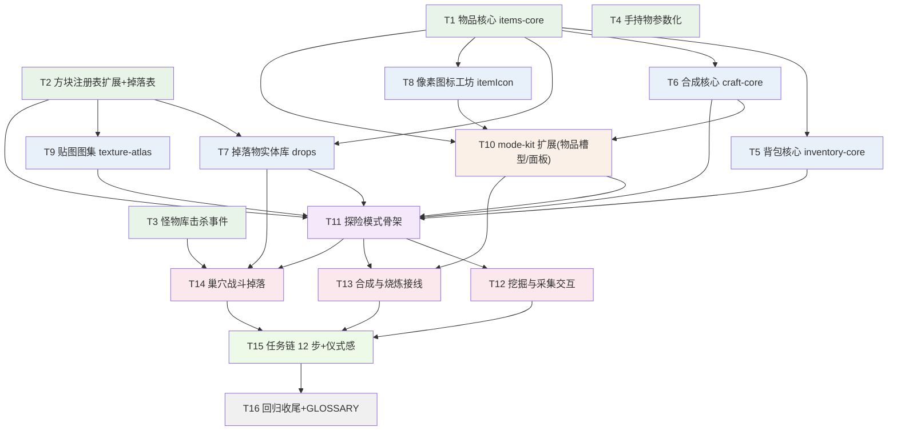

# 物品与合成系统 · 一期工单（本地 issue tracker 代理）

> 状态标记：`[ ]` 待认领 · `[~]` 进行中（子代理已派）· `[x]` 已并入 `feature/item-crafting`
> 本文件是 implement-spec 流程的 tracker 代理：工单完成 = 分支并入集成分支 + 勾选状态。
>
> **上下文指针（实现者必读，勿复述）**
> - Spec（合同）：`docs/item-crafting-plan.md`，重点是 Implementation Decisions 24 条与 Testing Decisions
> - 实现设计与全部数值：`docs/item-crafting-design.md`（§3 数据模型 · §D1~D14 决策 · 附录 A 新方块表 · 附录 B 与 MC 差异清单）
> - MC 数值出处：`docs/minecraft-item-crafting-research.md`
> - 工程规范：`AGENTS.md` 硬规则 + `docs/conventions.md`（§1.7 模块头 `====` 五要素；`-core` 必配同名单测）
>
> **通用纪律（每单生效）**
> 1. worktree 基于 `feature/item-crafting`，开工前核对基点，不符则 `reset --hard` 回集成分支顶端。
> 2. 开发用 Skill 工具加载 `tdd` 技能（红绿重构）；加载失败则手动 TDD——新核心先写测试。
> 3. 中文注释；文件名 kebab-case；顶层默认 `const`，会被外部写的用 `let`。
> 4. **不改 `index.html`**：需要加载行时在报告/提交信息里声明「应在 index.html 哪一行之后加什么 script」，由集成者统一添加（boot 冒烟按 index.html 顺序执行，单一写入者防冲突）。
> 5. `npm test`（= `node --test`，无需 node_modules）在 worktree 全绿才算完；lint 由集成者合并时在主仓库统一跑。
> 6. 范围只限本单；发现的跨单问题写进报告，不顺手做。
> 7. 报告格式：分支名 / 提交哈希 / 测试结果 / index.html 加载声明 / 给后续工单的备注。不自行并入集成分支。

---

## 任务图

---

## 第一波（frontier·可并行）

### T1 物品核心（items-core）`[ ]`
- 依赖：无。
- 交付：新纯核心 `js/items-core.js`——`ITEMS` 注册表（设计稿 §3.1 全量：材料/食物/放置型 ~26 条 + 工具 16 条 = 4 阶×镐斧剑锹；icon 暂用设计稿 emoji 占位）+ 纯函数 `stackMax / mkStack / isTool / toolOf`。零 THREE 零 DOM，不依赖 config.js（放置型的 block 字段只存数字，测试做号段范围断言）。
- 测试：`test/items-core.test.js`（vm 加载同 held-item.test.js 惯例）——注册表形状防错网（name/icon 必备；工具必有 tool{kind,tier,dmg,dur,speed}；食物必有 food>0）+ 纯函数行为（堆叠 64/工具 1）。
- 数值：耐久 120/260/500/1500；速度 2/4/6/8；剑伤 7/9/11/13、镐 3/4/6/8、斧 5/6/8/10、锹 2/3/4/5；tier 木1石2铁3钻4；燃料热值照设计稿 §3.1。

### T2 方块注册表扩展 + 怪物掉落表 `[ ]`
- 依赖：无。
- 交付：`config.js` 修改——① 存量方块中「探险地形会出现/可采集」的（草地1 泥土2 石头3 圆石4 木头5 木板6 树叶7 沙子8 红砖9 石砖13 苔石14 玻璃18）补 `hard/tool/tier/drop` 字段（数值见设计稿 §3.4；创造专属方块 10/11/12/15/16/17/19 不动）；② 新方块 id 36~49（附录 A 表：四矿/草丛/耕地/麦四阶段/工作台/熔炉/火把/树苗/黏土，thin 块 `solid:false`）；③ 新增 `MOB_DROPS` 一期四怪（§3.3：保底 1 + 50% 加成 1；僵尸 5% 稀有铁锭）。
- 测试：`test/blocks-fields.test.js`（vm 加载 config.js）——新 id 齐全、thin 块 solid:false、采集类字段齐全、drop 物品名非空、tool 取值合法。
- 约束：只增不改既有键的既有字段；方块定义仍纯色（贴图归 T9）。

### T3 怪物库击杀事件（onDeath）`[x]`（并入 `6cc76bd`）
- 依赖：无。
- 交付：`mobs.js` 加 `onDeath(cb)`——在 `hit()` 判定存活→死亡的瞬间回调恰好一次（传怪物实体 m）；引擎只报事件不解释死因。接口表头注释同步。
- 测试：`test/mobs.test.js` 扩展（沿用其现有加载器与桩）——致死一击回调恰一次、非致死不回调。
- 先读：`js/mobs.js` 的 `hit()` 与 `test/mobs.test.js` 惯例。

### T4 手持物参数化（mkToolDef）`[x]`（并入 `2cbd510`）
- 依赖：无。
- 备注：工具键名契约 `{pick|axe|sword|shovel}_{wood|stone|iron|diamond}`；mkToolDef 收字符串 tier（items-core 的 tool.tier 是数字 1-4，接线侧做映射）；「钻石镐」不带石字。
- 交付：`held-item.js` 加 `mkToolDef(kind, tier)`——四阶色板（木 0x8a5a2b / 石 0x8a8f98 / 铁 0xd8dde4 / 钻 0x4ee1d2）× 四种（pick/axe/sword/shovel）同构部件（柄+头），grip/swing 参数参照现有 sword 手感分档；16 个工具 def 以 `pick_wood … shovel_diamond` 命名注册进 `defs`（键名须与 T1 的 ITEMS 工具 id 一致，供 Avatar.setItem 直用）。现有 hoe/sword/bow 保留不动。
- 测试：`test/held-item.test.js` 扩展——16 键存在、形状断言（现有防错网自动覆盖）、四阶色板断言。

---

## 第二波

### T5 背包核心（inventory-core）`[ ]`
- 依赖：T1。
- 交付：`js/inventory-core.js`——27 槽模型（9 快捷+18 主格）+ 纯函数 `add/count/canAfford/take/remove/damageTool/serialize/deserialize`（add 优先并堆→首个空位，满则拒收返回余量；canAfford 支持任选材料数组扣料边界）。
- 测试：`test/inventory-core.test.js`——并堆/满拒/跨槽扣料/耐久归零/序列化往返。
- 先例：`test/tank-core.test.js` 的 vm 加载（需连 items-core 一起 load）。

### T6 合成核心（craft-core）`[ ]`
- 依赖：T1。
- 交付：`js/craft-core.js`——`RECIPES`（设计稿 §3.2 一期全表：手搓 4 条 + 工作台级 20 条左右 + 补给包石砖/红砖/剪刀 + TNT；面包/骨粉注册但不点亮说明写注释）+ `SMELTS` + `FUEL` + 纯函数 `canCraft(inv, recipe, unlocked)→{ok,missing} / craft / fuelUnits / smeltOf / breakTime(blockDef, toolDef)`（公式与封顶见设计稿 §3.4）。
- 测试：`test/craft-core.test.js`——缺失清单、扣料产物、任选材料（煤/木炭）、热值、烧炼映射、破坏时间（徒手石头 7.5s、封顶 8s、下限 0.15s、tier 门槛）。

### T7 掉落物实体库（drops）`[ ]`
- 依赖：T1、T2。
- 交付：`js/drops.js` 引擎壳——顶层纯函数段：`rollDrops(type)`（读 MOB_DROPS 掷骰，种子可注入）+ `rollBlockDrop(blockDef)`（保底+概率）+ 拾取距离判定；壳段：`spawn/update/render/clear/list/onCollect`（像素图标 Sprite 一期可用 emoji canvas 过渡——图标函数签名按 `iconOf(itemId)` 收口，T8 接管后自动换脸；落地弹跳、2.5 格真空吸附、3 分钟消失）。
- 测试：`test/drops.test.js`——掷骰种子化断言（保底必得/概率边界）、**交叉断言：MOB_DROPS 与 BLOCKS.drop 引用的物品 id 必须全部在 ITEMS 注册**（防改表漏改注册）。
- 声明加载位置：mobs.js 之后。

### T8 像素图标工坊扩展（itemIcon）`[ ]`
- 依赖：T1。
- 交付：`icons.js` 扩展 `itemIcon(itemId)`——16×16 手绘像素图标 → 64×64 dataURL（tankIcon 先例、MC 风格自绘不复制素材）；一期覆盖 ITEMS 全量（镐斧剑锹四阶配色、锭/矿/粉/球/骨/线/食物/站点件/放置型方块）；`iconOf(itemId)` 统一出口（emoji 兜底）。
- 测试：`test/icons.test.js`（doc/canvas 桩注入——mode-kit.test.js 先例）——全 ITEMS 键有图标、dataURL 形状。

### T9 贴图图集（texture-atlas）`[ ]`
- 依赖：T2。
- 交付：`js/texture-atlas.js`——程序化 16×16 像素画风图集（草顶斑点/石材颗粒/矿石嵌斑/木纹/板缝/树叶孔洞/工作台面/熔炉口/黏土纹理），覆盖全部新方块（36~49）+ 树叶/木头/木板/石头系升级款；接入 MeshCore/world.js 渲染（TNT 贴图图集同款管线：画布→CanvasTexture→UV）；纯色 `faceColor` 仍为存量方块兜底。
- 测试：`test/texture-atlas.test.js`——图集生成纯函数段（画布桩注入）：每新方块 id 有格子、UV 映射不越界；MeshCore 回归（test/mesh-core.test.js 全绿）。
- 报告须声明：world.js/mesh-core.js 的接入改动点与 index.html 加载位置。

---

## 第三波

### T10 mode-kit 扩展（item 槽型 + 面板）`[ ]`
- 依赖：T1、T6、T8。
- 交付：`mode-kit.js`——① `mkHotbar` 第三种槽型 `{item:id}`（像素图标+数量+耐久条，digit/wheel/点选自动）；② `mkCraftPanel`（背包网格 3×6 + 配方书卡片列表 + 分类页签 + 任务卡占位容器；卡片亮灰由 `canCraft` 驱动，单击合成、长按连做，缺料图标灰显）；③ `mkFurnacePanel`（三槽+进度条+自动放料）。CSS 配套（hotbar 既有皮肤体系）。DOM 挂点新增元素由面板自建（不依赖 index.html 改动）。
- 测试：`test/mode-kit.test.js` 扩展（doc 注入桩）——item 槽渲染形状、亮灰切换回调、连做节流。

---

## 第四波

### T11 探险模式骨架 `[ ]`
- 依赖：T2、T5、T6、T7、T9、T10。
- 交付：`js/modes/adventure.js` + 模式注册表行 + index.html 卡/页/script（本单唯一允许改 index.html 的工单——引擎 script 行按此前各单的声明一并加上，加完 boot 冒烟必须绿）。地形确定性生成（SceneKit：草原/树林~40/湖+湖底黏土/2 露天矿坑/1 山洞/出生小屋/3 巢穴位标记）、出生与死亡政策（死亡：背包保留+回出生点满血）、三份存档接线（inventory/adventure_world/adventure_quest，mkSaveSlot+SyncDB）、儿童时限共享预算。本单只交付「能进能玩地形+背包 UI 出来」，交互在后三单。
- 测试：`test/adventure-mode.test.js`（nether-mode.test.js 先例）——模式注册断言、地形生成纯函数段、存档往返。

---

## 第五波（三单并行）

### T12 挖掘与采集交互 `[ ]`
- 依赖：T11。
- 交付：探险模式内——按住蓄力状态机（进度环+挥动循环+换目标清零；breakTime 驱动）、破坏→碎块→掉落拾取、放置（放置型物品）、树叶掉树苗/苹果/木棍、树苗 20s 生长（计时 Map）、草丛掉种子、食物点击吃、快捷栏 item 槽接线。

### T13 合成与烧炼接线 `[ ]`
- 依赖：T10、T11。
- 交付：探险模式内——配方书面板开关（🎒/Tab）、工作台/熔炉放置与 4 格解锁判定、熔炉烧炼（2.5s/件、自动燃料、关面板进度保留、退世界材料退回）、合成成功 TTS 表扬、TNT 合成→放置→点击点燃→爆炸 70% 掉落。

### T14 巢穴战斗掉落 `[ ]`
- 依赖：T3、T7、T11。
- 交付：探险模式内——3 巢穴限量刷怪（每巢 2-3 只僵尸/骷髅/蜘蛛/苦力怕，清空 60s 再刷）、击杀事件→rollDrops→掉落物、收集 TTS 合并播报（3s 节流）、玩家战斗（工具伤害、受伤反馈沿用 Avatar.flash/血条先例）、死亡政策联通。

---

## 第六波

### T15 任务链 12 步 + 仪式感 `[ ]`
- 依赖：T12、T13、T14。
- 交付：QUESTS 数据表（12 步：谓词+语音+图标+表扬；谓词为模式文件顶层纯函数）+ 任务卡 UI 联动 + 钻石首获仪式反馈 + 通关「小小探险家」称号+烟花（Fx）+ 进度存档。
- 测试：`test/adventure-mode.test.js` 扩展——12 步谓词逐条触发/不越级。

---

## 第七波（收尾）

### T16 回归收尾 + GLOSSARY 合入 `[ ]`
- 依赖：T15。
- 交付：全量 `npm test` + `npm run lint` 零错误；五模式回归确认；GLOSSARY 新术语（物品核心/背包核心/合成核心/掉落物实体库/探险模式/像素图标工坊）词条合入；设计稿与本工单状态对齐勾选。
- 完成后由主会话跑 code-review 技能评审集成分支。
