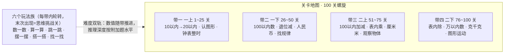

# 数学冒险岛 · 需求规划

> 生命周期：已完工 — 施工期工件，仅作历史依据；行为权威见 [math-mode-design.md](math-mode-design.md)

> 需求原话：
> - "如果我想锻炼一个一年级小朋友的数学思维，结合当前项目有什么好的方式呢？"
> - "能不能把国内教材里教的内容变成游戏放进来呢，或者有更好的方式"
> - "按 1~2 年级去规划，关卡要多种多样"
> - **修订（2026-10-24）**："整体难度偏低，要按带上扩展题和附加题的难度去设计，重点有助于培养数学思维。"——难度定位从"基础熟练"升级为"教材带 × 扩展/附加题水平"，六族各增思维挑战变体，新增数学思维目标框架（§4）。
>
> 研究支撑：`docs/math-thinking-research.md`（下引 § 号均指它，事实出处与证据强度标注都在那边）。
> 状态：**✅ 已定稿（2026-10-24）**：D1~D9 全部按推荐方案拍板（用户："全部同意"）。实现设计见 `docs/math-mode-design.md`。

---

## 1. 需求理解

- **范围**：第一学段（1~2 年级）整段——数学主线从 10 以内数一直爬到表内乘除、万以内数，横跨人民币、钟表、测量、分类与找规律。
- **难度定位（修订后）**：每条学期带内，题型难度按**教材扩展题 / 带\*思考题 / 附加题**的水平设计，不按基础例题水平。一年级附加题的本质是"**数字不超纲、思维上探**"——算式谜、等量代换、间隔问题用的都是已学的 10 以内数。所以本方案的难度原则是：**数字跟着教材走，思维跳到附加题**。数值范围不超前（防认知负荷失控），推理深度上探（这是"培养数学思维"的落点）。
- **关卡多样性是硬需求**：多个玩法族混编，每族常规范型 + 思维挑战变体，孩子每玩两三关换一种"题型"。
- **方法基调**（research §0）：教材定"练什么、按什么顺序练"，游戏定"怎么练得快乐"；每个知识点找到"玩法本身就是数学"的体素原生形态，不做穿游戏皮的题海。

## 2. 现状盘点：能复用什么

| 资产 | 位置 | 对数学模式的含义 |
| --- | --- | --- |
| 成关框架 | 专注训练营（`js/modes/focus.js` + `js/focus-levels.js`） | 三星评价、每日预算、TTS 零文字、过程性表扬、参数表驱动关卡、螺旋混编+复习交错——整体照搬骨架 |
| 关卡参数表模式 | `focus-levels.js`（FOCUS_DIMS / FOCUS_META / paramsFor / 100 关编排，零 THREE 零 DOM 有单测） | 数学关卡同款：`math-levels.js` 数据+纯函数，难度曲线可测 |
| 合成系统 | 合成核心（CraftCore：RECIPES/canCraft 缺失清单）、背包核心、掉落物实体库 | "配方=算术"的现成载体：缺什么、差多少，天然是减法；多材料组合天然是"多解题" |
| 靶场与怪物 | 坦克演习场的靶排/环靶/靶墙、怪物库（spawn/意图 API） | 感数点数与"线索排队"推理的呈现素材 |
| 建造与体素 | 建造模式与存档、体素模型、场景搭建工具 | 对称补全、按图搭建、空间计数的交互与出题底座 |
| 行走与跟随 | 玩家形象（Avatar）走路、相机装置（CameraRig） | 数字线跳格子的走子表现（间隔问题的具身载体） |
| 分类先例 | 怪物谱系 families() 分组面板 | 分箱玩法与"多角度分类"的数据源 |
| 政策 | 每日预算（DailyBudget）、家长加时（play_extra_save 机制） | 独立限额账本与家长加时通道可复用机制 |

## 3. 研究速览：四条改变设计的结论

1. **线性数板是因果证据最硬的游戏形态**（research §2.3）：Ramani & Siegler 2008/2009 RCT——线性数板全面提升低龄儿童数感，**环形无效**。数字线玩法必须做成线性方块路；间隔问题（从第 3 格到第 9 格）天然长在它上面。
2. **空间训练对数学有正迁移**（§2.4）：Gilligan 2020 RCT + Hawes 2022 元分析，LEGO 搭建↔数学相关（McDougal 2023）。体素建造=类 LEGO 活动，与数学目标**显式绑定**（对称/镜像/按图/空间计数）。
3. **一次 ≤4 个组块 + 指令走语音通道**（§2.6）：6-7 岁工作记忆低位（Cowan 4±1；Adams & Hitch 1997 心算占语音回路）。**难度上探只能加"推理深度"，不能加"呈现数量"**——附加题式关卡恰好符合：数字小、线索少（2~3 条）、但要倒着想或多想一步。
4. **宣称只说练习**（§3.4、§5）：泛游戏化效应仅 d≈0.13 且异质；思维训练的远迁移证据同样有限。安全口径："在方块世界里练习数数、加减、找规律、推理和空间构造"，不提奥数/竞赛/成绩提升。

## 4. 数学思维目标框架（本模式的"练什么"）

课标第一学段的素养落点是数感、量感、运算能力、几何直观、空间观念、推理意识、模型意识、应用意识（research §1.2~1.3）。本模式把它们收拢为**六条可练的思维方法**，每条对应经典的一二年级附加题题型族，并落到玩法载体：

| # | 思维方法 | 经典附加题题型 | 玩法载体（族） |
| --- | --- | --- | --- |
| T1 | 一一对应与比较 | 比多少、**移多补少**（怎么移两堆一样多） | A 数一数 |
| T2 | 逆向与代换 | **算式谜**（□+3=8、□○=10 多解）、**等量代换**（2 僵尸=4 苦力怕）、差不不变 | B 算一算 |
| T3 | 模式与周期 | 数列规律（2、5、8、…）、**周期问题**（红红蓝循环，第 15 个是什么） | F 找一找、C 跳一跳 |
| T4 | 空间想象与计数 | **数方块（含隐藏块）**、露在外面的面、拼组（七巧板式）、对称轴计数 | D 摆一摆、E 搭一搭 |
| T5 | 有序思考 | **有序枚举**（用 3 种颜色能摆几种旗）、付钱有几种方式、分类讨论 | B/F 情境关 |
| T6 | 推理与排序 | 线索排队（三怪物按"谁比谁高"排序）、双视角推断 | E 搭一搭、怪物素材 |

设计纪律：**一关一个思维点**（Davidson 2006"每关只动一个维度"的思维版）；每关线索数 ≤3 条（组块约束）；常规范型练"方法入口"，挑战变体练"方法深处的那个转折"（逆向、多解、隐藏、循环）。

## 5. 方案总览

新模式 **数学冒险岛**（id `math`）：训练营类模式（同专注训练营——接管全屏 UI、独立每日预算、不吃儿童时限），主菜单一张新卡。内部是**一张 100 关的关卡地图**：六个玩法族 × 四条学期内容带，螺旋混编；难度骑在"扩展题/附加题"水平线上。

- **内容主轴**（练什么、什么顺序）：四个学期带对齐教材进度（research §1.3 内容地图 + §1.4 教材目录；二年级细目为课标二手归纳，方向可靠）。
- **难度双轨**：数值范围严格跟带（一上带只出现 10 以内/20 以内的数），题型难度按该带附加题水平起步、逐档上探（单步 → 两步 → 逆向 → 多解/隐藏）。
- **玩法横轴**（怎么练）：六个玩法族，每族 **3 种常规范型 + 1 种思维挑战变体**，共 **24 种关卡形态**，另加情境皮肤（商店/钟表/测距）与带末综合挑战关。

## 6. 六个玩法族（关卡设计草案）

> 每族：常规范型（★）×3 + 思维挑战变体（★★，附加题级）· 难度轴 · 课标/思维条目 · 证据（research §）。名称与皮肤细节到设计稿定。

### 族 A · 数一数（感数与计数 → 对应与比较）

- **★ 怪物快照**：闪现一群怪物点选数量（≤4 靠感数，>4 靠逐个数，后期怪物乱跑=顺序无关）。
- **★ 按数取物**："给我 7 个方块"，点选/搬运进箱。
- **★ 比多少**：两堆谁多、多几个（减法萌芽）。
- **★★ 移多补少**：两堆不一样多，**从多的一堆搬几个过去才一样多**（T1；一年级经典思考题——答案=差的一半，孩子可以搬着试，试对后语音点破"移 1 个差就变 2"）。进阶：按群计数关（2 个 2 个、5 个 5 个数——乘法与有序思考的前置）。
- **难度轴**：数量 3→10→20；呈现时长渐短；相似干扰物混入；★★关堆间移动可撤销（鼓励试错）。
- **课标/思维**：20 以内数的认识；数感；计数五原则；T1。**证据**：现象强、迁移弱（§2.2、§4.1）——宣称只写"练数数与估数"。

### 族 B · 算一算（配方算术 → 逆向与代换）

- **★ 材料够不够**：背包点数 vs 配方需求（点数+比较）。
- **★ 还差几个**：缺口即减法。
- **★ 合成订单**："2 把木镐要几块木板"（乘法萌芽→表内乘法）。
- **★★ 魔法空格（算式谜）**：配方里挖空——"木板+?=木镐""?+3=8"；进阶**多解题**："哪两个数合成 10"（全部找齐才满星，T5 有序枚举）；**怪物天平（等量代换）**：2 僵尸=4 苦力怕，1 僵尸=?（T2）。
- **难度轴**：10 以内→20 以内（含进位）→100 以内（位值：10 根木棍=1 捆）；★关步数 1→2，★★关从"填空"升到"多解穷举"与"代换链"。
- **课标/思维**：20 以内加减→100 以内→表内乘除；位值；T2、T5。**证据**：CPA 中等（§2.5）；方块堆+数字双表征同屏（C↔A 切换），算式谜把"A 层"变成谜面本身。

### 族 C · 跳一跳（数字线跳格子 → 数序、间隔与数列规律）

- **★ 掷骰前进**：0-10/0-20/0-100 **线性**方块路走子（对标 Ramani & Siegler 数板；必须线性，环形无效）。
- **★ 跳格子任务**："从 14 跳到 18，跳几格"（相差多少）。
- **★ 站位比大小**：两个数字谁站得远、谁大。
- **★★ 间隔问题**："从第 3 格走到第 9 格，**中间**经过几格"（两端都不算——一年级植树/爬楼思考题的具身版，孩子走一遍就看见"跳过"和"踩上"的区别）；**规律跳**：每次多跳 1 格（2、4、6、8…第 5 次落哪，等差数列萌芽，T3）。
- **难度轴**：0-10 → 0-20 → 0-100（十格一档标位值）；★关问"跳了几格"，★★关问"中间隔几格 / 按规律第 N 次落哪"。
- **课标/思维**：100 以内数的认识与顺序；20 以内加减；数量关系；T3。**证据**：全篇最硬（形态级 RCT，§2.3）。

### 族 D · 摆一摆（对称建造 → 空间想象与拼组）

- **★ 魔法镜补全**：半边已建好，补全镜像另一半（轴对称：左右→前后）。
- **★ 平移复制**：把图案平移 N 格重摆。
- **★ 旋转对称**：中心对称图案补全（二年级提高）。
- **★★ 拼组与省料**：给定一组积木块**恰好拼出**目标图形（七巧板式，多角度尝试）；**最省块数**：搭一座同样能通行的桥，谁用的块少（T4+T5：试→比→优化）。**对称轴计数**：这个图案能找到几条对称线（多解思维）。
- **难度轴**：2D 平面图案 → 3D 单层 → 多层；图案复杂度；★★关从"补全"升到"构造与优化"。
- **课标/思维**：图形的认识；空间观念；图形的位置与运动；T4。**证据**：相关强 + 训练迁移中强（§2.4）。

### 族 E · 搭一搭（按图搭建 → 空间计数与视角推理）

- **★ 看图施工**：给俯视图/像素图纸，3D 里搭出对应结构。
- **★ 反向选图**：从建筑选出正确的俯视图。
- **★ 隐藏块推理**：看不见的位置放什么（推理意识）。
- **★★ 数方块**：这座塔**一共**几个方块——含被挡住的隐藏块（空间计数经典题：露出的少、藏着的多，T4）；**露面计数**：涂色的外面有几个面；**双视角推理**：正面看是"山"、侧面看是"墙"，是哪座建筑（T6）。
- **难度轴**：单层平铺 → 多层 → 含隐藏块；★★关从"搭对"升到"数清与推断"。
- **课标/思维**：几何直观；观察物体；推理意识；T4、T6。**证据**：空间训练迁移中强（§2.4）；"三视图→成绩"直接证据未找到，属合理推断。

### 族 F · 找一找（接龙与分类 → 模式、周期与推理）

- **★ 花纹接龙**：颜色/方块序列"红红蓝·红红蓝·？"，下一个是什么。
- **★ 分装箱**：混堆方块/怪物按颜色、形状或种族分箱；进阶**多角度分类**：同一堆换个标准再分一次（分类讨论萌芽）。
- **★ 找异类**：哪个不属于这组。
- **★★ 周期问题**："红红蓝一直循环，**第 15 个**是什么"——不许摆完，靠规律推（T3；一二年级周期题的标志就是"数大得摆不完"）；**数列规律**：2、5、8、11、？；**线索排队**：三条线索给三个怪物排高矮/轻重（T6，怪物库素材现成）。
- **难度轴**：单元长度 2→4；单属性→双属性；★★关从"接着摆"升到"不用摆完也能推"与"按线索排"。
- **课标/思维**：找规律（人教一下第 7 单元）；数据分类；推理意识；T3、T6。**证据**：课标/教材一手；迁移未核实（§4.6）。

### 情境挂载（不独立成族，同样按附加题水平出题）

- **人民币商店**：族 B 皮肤——买材料找零；进阶**"付钱有几种付法"**（有序枚举，T5）。
- **钟表时刻**：地图界面常驻昼夜钟 + 专项关（认整时/半时）；进阶**时间推算**（"过一刻钟是几点"）。
- **测距步数**：族 A/C 情境变体——"到那棵树几格"；进阶**来回/往返距离**（×2 萌芽）。

### 带末综合挑战关（每带 1 关，共 4 关）

一关内串 3 个族的★★级小任务（如"数出隐藏的 8 个南瓜 → 算式谜合成 2 个派 → 按规律跳到第 12 格的营地"），像小镇集市的综合任务；作为带内容的混合复习与思维综合运用（交错练习，focus 编排先例）。

## 7. 编排：100 关螺旋

- **总量**：100 关（与专注训练营同量级），关 2-3 分钟（MISSION 约束）。
- **每关归属** = 一个玩法族 × 该族难度档（tier）。族内 tier 沿学期带爬坡；定性跳变一律概率渐进混入（台阶变坡道，focus-levels 先例）。
- **难度双轨**（修订核心）：tier 曲线有两条轴——**数值轴**随带推进（10 以内→万以内），**推理轴**按附加题水平起步并逐档上探（单步 → 两步 → 逆向 → 多解/隐藏/周期）。三星门槛挂钩推理轴：拿第三星必须通过该族在带内的**思维挑战变体（★★）关**。
- **带内节奏**（以带一 25 关为例）：1-2 关带首复习（回访上一带核心内容，一年级首带改为教学关）→ 约 22 关六族轮转（A→B→C→D→E→F 循环，每族出现 3~4 次、tier 递增，**末次出现=★★挑战关**）→ 带末 1 关综合挑战。
- **族配重**：数与运算是教材主线，族 B/C 配重略高（各 20 关），A/D/E/F 各 15 关。
- **进度与解锁**：线性解锁 + 可回放已通关节（三星刷新）；和专注训练营同款"过关星、里程碑"结构。

## 8. 政策与复用

- **每日预算**：独立账本（不吃儿童时限、不与专注训练营共享），默认 6 关/20 分钟，量级同专注训练营（K-CPT 低龄任务时长证据，research §3.3）；家长加时复用 play_extra_save 机制（通道细节设计稿定）。
- **入口**：主菜单新卡"数学冒险岛"，全屏接管（mode-registry `page:false` + `gated:false`，三重命名有测试断言）。
- **激励**：三星评价 + 过程性表扬话术（夸努力不夸聪明，Mueller & Dweck 1998，focus 话术表先例）；战利品掉落进同一背包（rollFocusLoot 先例），图章独立一本。
- **家长面板**：按"六族 × 学期带"双维度记录正确率与趋势（★★挑战关单列"思维挑战通过率"），CSV 导出；只报过程指标，不做能力诊断（research §5 口径）。
- **预计触点**（设计稿细化）：新文件 `js/math-levels.js`（数据+纯函数+单测）与 `js/modes/math.js`；index.html 加卡/script；mode-registry.js 加一行。引擎层零改动预期（全部复用现有 seam）。

## 9. 拍板项

| # | 决策 | 推荐 |
| --- | --- | --- |
| D1 | 模式定位：训练营类（独立每日预算、全屏接管、不计儿童时限），主菜单新卡"数学冒险岛" | ✅ 同专注训练营先例 |
| D2 | 内容范围：第一学段四条内容线全铺，难度主轴对齐教材四学期带（一上→二下） | ✅ |
| D3 | **难度定位（修订）**：数值严格跟带不超前，题型按**扩展题/附加题水平**设计；六族各 3 常规+1 思维挑战变体，共 24 形态 + 情境皮肤 + 综合挑战关 | ✅ "数字跟着教材走，思维跳到附加题" |
| D4 | **思维目标（修订）**：以 §4 六条思维方法（对应/代换/周期/空间计数/有序枚举/推理排序）为"练什么"的纲；一关一个思维点、线索 ≤3 条 | ✅ 三星门槛挂钩挑战关 |
| D5 | 总量与编排：100 关螺旋混编（六族轮转×学期带×带首复习/带末挑战），每关 2-3 分钟 | ✅ |
| D6 | 每日预算：独立账本，默认 6 关/20 分钟，家长加时复用既有机制 | ✅ |
| D7 | 家长面板：六族×学期带双维度过程指标 + CSV，思维挑战通过率单列 | ✅ |
| D8 | 激励互通：战利品进同一背包、图章独立一本；三星+过程性表扬 | ✅ 战利品互通（世界连贯性） |
| D9 | 宣称口径："在方块世界里练习数数、加减、找规律、推理和空间构造"；不提奥数/竞赛/成绩提升 | ✅ 遵循 MISSION 与 research §5 |

拍板后进入 `docs/math-mode-design.md`：六族的引擎接线（loadScene 装场、判别引擎复用程度）、难度双轨数值表、UI 与话术清单、实施切票。
