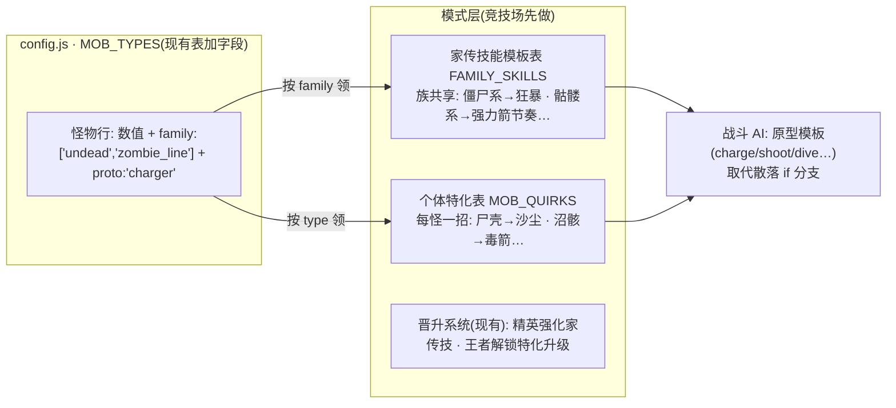

# 怪物谱系 · 需求定稿

> 需求原话："当前项目下我们的怪物是没有关系的，我希望你研究下怪物谱系相关知识，为我的世界怪物建立怪物体系，这样我们就可以扩展怪物种类，丰富怪物系统，这样的话怪物技能也好设计，现在新增的很多怪物就没技能，建立谱系就比较好去做系统的扩展。"
> 研究支撑：`docs/monster-taxonomy-research.md`（下引 § 号均指它，事实出处都在那边）。
> **✅ 已定稿（2026-10-22）**：D1~D8 全部按推荐方案拍板（用户："全部同意"）。实现设计见 `docs/monster-taxonomy-design.md`。
> **修订（2026-10-22 实施后用户反馈）**：族改**按物种**分，不按地域/机制——"下界帮"（地域）与"不倒翁家族"（机制）撤销，新增疣猪兽一家；面板 UI 改内联簇式分组。详见实现设计定稿的修订记录。
> **修订（2026-10-22 三审定稿）**：**种族=长相接近的血统组**（守卫组是唯一职责组例外）：疣猪兽并入猪猪一家（全族家传蛮冲）、新增鬼一族（恶魂/幻翼/烈焰人/凋灵/末影人/恼鬼，家传阴风）、守卫者系并入守卫组（与铁傀儡/监守者同组，家传磐石；蓄力激光降为守卫者系个体特化）、末影一家解散（末影人进鬼一族领个体特化颤栗瞬移，末影龙进独行侠）。
> **修订（2026-10-22 四审定稿）**：末影龙单独立**龙族**、潜影贝归**海族**（均单员族）；**独行侠兜底族撤销**——苦力怕+嘎枝合并**草木族**，每怪必归种族，共 11 族。

---

## 1. 需求原话与我的理解

- 现状：37 种怪物彼此**没有关系**——`MOB_TYPES` 是一张扁平数值表，行为只由 4 个旗标（ranged/boom/fly/boss）决定。
- 痛点：**新增的 32 怪没有技能**（只有初代僵尸/苦力怕/铁傀儡/末影龙 4 怪在竞技场有专属技能分支，骷髅的"强力箭"其实是全体远程怪共享的节奏强化）。
- 期望：建立"怪物谱系"（族/血统体系），让技能可以**按族系统化设计**（族内共享模板 + 个体特化），新增怪物有章可循，不再每加一怪写一串 `if (m.type==='xxx')`。

## 2. 现状盘点：没有"族"的世界

| 位置 | 现状 | 离"族"差什么 |
| --- | --- | --- |
| `config.js` `MOB_TYPES` | 37 行数值 + 4 旗标；**注释里**有松散分组（五怪/杂兵/下界/海洋末地/灾厄/Boss） | 分组不进数据，代码消费不了 |
| `mobs.js` `MOB_RIG` | 骨架注册表已有隐式"外观族"：`hum()` 人形 / `quad()` 四足参数化生成器，还有"同骨架换色"变体（蠹虫↔末影螨、史莱姆↔岩浆怪） | 外观族存在但无行为含义 |
| `modes/arena.js` | 专属技能 = `m.type==='zombie'/'creeper'/'golem'/'dragon'` 硬编码分支 + 晋升系统（2 级精英=强化现有技能，3 级王者=解锁新技能） | 每加一怪加一串 if，无法复用 |
| `modes/nether.js` | 自己另写了一份简化战斗 AI（只看 fly/ranged 旗标，无技能）；`NETHER_MOBS` 是手抄的下界名单 | 下界名单 = 手抄的"生态族" |

## 3. 研究速览：三条改变设计的结论

1. **原版的"族"是标签组合，不是继承树**（§1、§3）：`#undead = #skeletons + #zombies + phantom + wither`，一个怪可多族（僵尸猪灵 = 猪灵系 + 不死族），**无族也合法**（苦力怕、铁傀儡、监守者都不属任何官方族）。机制挂在"属性标签"上按族批量生效，族标签本身不产生机制。
2. **族是扩展单位，变体有公式**（§2）：`新怪 = 同族骨架 ⊕ 环境特化 ⊕ 一招专属 ⊕ 数值微调`（尸壳=僵尸⊕沙漠⊕饥饿+不日烧），且**专属只给一招**。灾厄族就是"先建族、再按族填个体"的一手实证（§1.4）。
3. **同行殊途同归：行为与血统分层**（§4、§5）：Terraria 的 AI 模板（126 只怪共用 Fighter AI + 个体附加）、Division 的"原型×派系"、Pokémon 的"属性×蛋组"——**行为原型层直接命中"技能系统化"，血统族层管可读性与扩展**。37 怪折叠后约 12 类技能原型，其中"状态异常/召唤/AoE 控制/瞬移/特殊索敌"5 类目前无旗标表达（§1.7）——是补技能的优先方向。

## 4. 谱系方案：双层谱系 = 行为原型 × 血统族

### 4.1 一张图

### 4.2 血统族清单与家传技能草案

族名双轨：正式名（代码/文档）+ 孩子叫法（选怪面板分组标题）。**家传技能 = 族共享模板；个体特化 = 每怪至多一招**（变体公式，§2）。

| 族 key | 正式名（孩子叫法） | 成员 | 家传技能（草案） | 首期机制负载 |
| --- | --- | --- | --- | --- |
| `undead` | 不死族（不倒翁家族） | 下两系全体 + phantom + wither | 仅有嵌套关系，不另发技能 | 0（纯分组） |
| `zombie_line` | 僵尸系（僵尸一家） | zombie, husk, drowned, zombified_piglin, zoglin | **狂暴**：血量过半加速+攻速，带动近处同族冲锋（zombie 现有技能推广成族技） | 技能 |
| `skeleton_line` | 骷髅系（骷髅一家） | skeleton, stray, bogged, wither_skeleton | **强力箭节奏**：每 N 箭一支强力箭（现有节奏收编，族版更密） | 技能 |
| `arthropod` | 节肢族（虫虫族） | spider, cave_spider, silverfish, endermite | **疾爬突进**：进入攻击距离前短促加速贴脸（伏击感） | 技能 |
| `piglin_line` | 猪灵系（猪猪一家） | piglin, piglin_brute, zombified_piglin | **战吼**：受击时附近同族攻速提升（原版"群体激怒"的孩子版） | 技能 |
| `illager` | 灾厄族（灾厄帮） | vindicator, evoker, pillager, ravager, witch | **袭击协同**：附近同族每多一只，自己小幅增伤（原版 raid 编队感） | 技能 |
| `slime_line` | 史莱姆系（软软族） | slime, magma_cube | **分裂**：死亡分裂 2 只小只（数值减半，小只不再分裂） | 技能 |
| `guardian_line` | 守卫者系（守卫一家） | guardian, elder_guardian | **蓄力激光**：定点蓄力→直线射线（替换现在的旗标射箭） | 技能 |
| `nether` | 下界生态族（下界帮） | piglin, piglin_brute, zombified_piglin, hoglin, zoglin, wither_skeleton, blaze, ghast, magma_cube（= `NETHER_MOBS` 九怪） | 无技能；候选首例机制挂钩=**火焰亲和**（对爆炸类伤害减伤，坦克炮弹正好是爆炸） | 0（机制后置，见 D4） |
| `ender`（可选，见 D5） | 末影叙事族（末影一家） | enderman, endermite, dragon, shulker | **颤栗瞬移**：瞬移接近/脱离（末影人的技能下放为族技） | 技能（若建族） |

- **无族合法**：creeper, golem, vex, creaking, hoglin, blaze, ghast, shulker, warden, dragon（若不建末影族）——无家传、靠个体特化立个性，正是原版做法（§1.6 要点一）。
- **多族合法**：zombified_piglin ∈ 猪灵系+僵尸系（一身两族的原版先例）。家传技能**只从主族（第一个标签）领**，副族只领分组归属（D6）。

### 4.3 行为原型层（proto，旗标的升级版）

现有 4 旗标不变（消费方太多），`proto` 是**新增的命名模板位**，竞技场战斗 AI 按模板分发（Terraria aiStyle 形态，§4.1r）。首版 8 个：

| proto | 孩子 叫法 | 替代的现有分支 | 覆盖怪 |
| --- | --- | --- | --- |
| `charger` 冲锋 | 冲冲怪 | moveMelee 通用 | zombie, husk, vindicator, piglin, piglin_brute, wither_skeleton, hoglin, zoglin, ravager, golem, warden |
| `archer` 弹道 | 射射怪 | moveRanged | skeleton, stray, bogged, pillager, witch, drowned |
| `bomber` 自爆 | 砰砰怪 | moveBoom | creeper |
| `ambusher` 伏击 | 隐隐怪 | （新） | spider, cave_spider, silverfish, endermite |
| `diver` 俯冲 | 飞飞怪 | moveFly 掠食者分支 | phantom, vex, dragon |
| `turret` 炮台 | 堡堡怪 | moveFly 炮台分支 + 定点 | blaze, ghast, guardian, elder_guardian, shulker |
| `splitter` 分裂 | 软软怪 | （新） | slime, magma_cube |
| `skirmisher` 游击 | 闪闪怪 | （新，瞬移类） | enderman, creaking |

（boss 仍是档位旗标不是原型；wither=flying turret、warden=charger，Boss 行为在晋升系统上叠。）

### 4.4 37 怪归族草案表（proto + family + 技能落位）

"个体特化"列：**(已有)**=竞技场现有代码；**(新)**=按变体公式补的一招；空=家传即本体。

| 键名 | proto | family | 家传技能 | 个体特化 |
| --- | --- | --- | --- | --- |
| zombie | charger | undead·zombie_line | 狂暴 | (已有)王者冲击波 |
| husk | charger | undead·zombie_line | 狂暴 | (新)沙尘击：命中减速 |
| drowned | archer | undead·zombie_line | 狂暴 | (新)三叉戟起手投掷 |
| zombified_piglin | charger | **piglin_line**·undead（主族=猪灵） | 战吼 | (新)金剑快斩 |
| zoglin | charger | undead·zombie_line | 狂暴 | （无差别攻击是编队政策，不占技能） |
| skeleton | archer | undead·skeleton_line | 强力箭节奏 | |
| stray | archer | undead·skeleton_line | 强力箭节奏 | (新)冰缓箭 |
| bogged | archer | undead·skeleton_line | 强力箭节奏 | (新)毒箭 |
| wither_skeleton | charger | undead·skeleton_line | 强力箭节奏→近战版：节奏重斩 | (新)凋零击：命中持续掉血 |
| phantom | diver | **undead**（不死族独苗飞行） | 无（不死族不发技能） | (新)俯冲突袭已有雏形（掠食者分支） |
| wither | turret+boss | undead | 无 | (新)双头颅弹（Boss 特化走晋升） |
| spider | ambusher | arthropod | 疾爬突进 | |
| cave_spider | ambusher | arthropod | 疾爬突进 | (新)毒咬 |
| silverfish | ambusher | arthropod | 疾爬突进 | (新)受击召援军（同族 2 只） |
| endermite | ambusher | arthropod·(ender?) | 疾爬突进 | 极小体型即特化，不补 |
| slime | splitter | slime_line | 分裂 | |
| magma_cube | splitter | slime_line·nether | 分裂 | (新)接触灼烧 |
| piglin | charger | piglin_line·nether | 战吼 | |
| piglin_brute | charger | piglin_line·nether | 战吼 | (新)重斧：单次高伤+大击退 |
| hoglin | charger | nether（无血统族） | 无家传 | (新)蛮冲：直线冲撞击飞 |
| vindicator | charger | illager | 袭击协同 | (新)冲锋斩：锁定目标冲刺 |
| evoker | charger | illager | 袭击协同 | (新)召唤恼鬼（与现有 vex 怪种联动） |
| pillager | archer | illager | 袭击协同 | (新)弩三连发 |
| ravager | charger | illager | 袭击协同 | (新)践踏吼：AoE 击退，灾厄族免疫（原版机制） |
| witch | archer | illager（raider 圈） | 袭击协同 | (新)毒瓶投掷+自饮回血 |
| guardian | turret | guardian_line | 蓄力激光 | |
| elder_guardian | turret+boss | guardian_line | 蓄力激光 | (新)威慑咆哮：命中减速（挖掘疲劳孩子版） |
| shulker | turret | (ender?) | 无 | (新)追踪弹：命中短暂漂浮 |
| blaze | turret | nether | 无 | (新)三连火球（替通用爆裂火球） |
| ghast | turret | nether | 无 | (新)大火球：爆炸范围加大 |
| enderman | skirmisher | (ender?) | 颤栗瞬移（若建族，否则无家传） | 水伤免谈（无水机制） |
| creaking | skirmisher | 无族 | 无 | (新)注视免疫：被瞄准时静止+减伤（原版"被注视冻结"反转） |
| vex | diver | 无族（灾厄盟友，§1.4） | 无 | (新)穿墙突刺（引擎若无穿墙，改为高速游斗） |
| creeper | bomber | 无族 | 无 | (已有)扑袭+读条取消 |
| golem | charger | 无族 | 无 | (已有)震地+王者巨石 |
| dragon | diver+boss | (ender?) | 无 | (已有)龙息毒云+三重龙息 |
| warden | charger+boss | 无族 | 无 | (新)音波击：短程穿墙脉冲 |

> 归族依据 = 原版标签/分族页（research §1.6 逐怪表，带 ★ 出处），个别按本项目玩法做了取齐（如 ravager 归灾厄帮是 BE 已改、JE 仍是 raider——本项目按"孩子看得出一帮的"取 raider 圈）。**族籍是设计决策，后续可挪**（监守者曾被官方挪出不死族，§1.2）。

### 4.5 新怪扩展章法（变体公式落地）

1. 先问归族：能归现有族就走变体——`新怪 = 同族骨架(RIG 生成器) ⊕ 环境特化 ⊕ 一招专属 ⊕ 数值微调`，**专属只给一招**（原版最稳定规律，§2）。
2. 归不了族再建族：新族必须 ≥2 个成员、且共享的不只是外观（否则是 L1 换皮变体，改 `variant` 色即可）。
3. 技能优先从 5 类未建模原型里选（状态异常/召唤/AoE 控制/瞬移/特殊索敌，§1.7），少造新轮子。

## 5. 分期实施建议

| 期 | 内容 | 规模 | 产出 |
| --- | --- | --- | --- |
| **① 数据层+面板** | `MOB_TYPES` 加 `family:[]`/`proto:''` 字段；注册表一致性自检（镜像 `MOB_TYPES↔MOB_RIG` 自检）；选怪面板按族分组展示（竞技场+演习场）；竞技场混合编队按族配平 | 小 | 谱系可见可讲，零行为变化 |
| **② 技能模板化** | arena.js：`FAMILY_SKILLS` 家传表 + `MOB_QUIRKS` 特化表取代 `type===` 分支；先迁 4 个已有技能（狂暴→僵尸系、强力箭→骷髅系、扑袭/震地→无族特化位），再逐族上家传 | 中 | 32 怪里的族成员人人有家传技能 |
| **③ 原型扩容** | 补 5 类未建模技能原型（状态异常/召唤/AoE 控制/瞬移/特殊索敌）；个体特化表逐怪补满；下界模式按需接入同一套模板 | 大（可拆多次） | 技能系统覆盖 12 类原型 |

每期都护既有测试（97+ 项全绿）；② 改造后竞技场四怪现有技能行为不变（搬家前后一个样的验收标准，同 MobBatch 重构惯例）。

## 6. GLOSSARY 词条草案（实施时随代码落地）

> **怪物谱系（Mob Taxonomy）**：怪物种类的双层分类体系：行为原型（proto，战斗 AI 模板：冲锋/弹道/自爆/伏击/俯冲/炮台/分裂/游击）× 血统族（family 标签数组，分组与家传技能的发放单位：不死·僵尸系/骷髅系/节肢/猪灵系/灾厄/史莱姆系/守卫者系/下界生态）。数据在 config.js 的 MOB_TYPES；家传技能=族共享模板（FAMILY_SKILLS），个体特化=每怪至多一招（MOB_QUIRKS）；新怪按变体公式"同族骨架⊕环境特化⊕一招专属⊕数值微调"扩展。无族与多族都合法（苦力怕无族、僵尸猪灵双族）。

> _Avoid_：怪物分类（散称）、怪物种族（单继承树的暗示——谱系是多标签组合）

## 7. 决策点汇总（待您拍板）

| # | 问题 | 选项 | 我的推荐 |
| --- | --- | --- | --- |
| D1 | 谱系维度 | A 机制族 / B 行为原型 / C 血统族 / D 双层（B×C） | **D 双层**——原型直接命中"技能系统化"，血统管可读性与扩展；A 的克族机制后置 |
| D2 | family 数据形状 | 扁平标签数组（多族/无族合法）/ 嵌套继承树 | **扁平标签数组**（原版标签即此形态，树与"多族"天然冲突，§3.3） |
| D3 | 家传技能表放哪层 | 竞技场模式层（FAMILY_SKILLS 表）/ 引擎层（CombatCore 旁）/ 独立共享模块 | **竞技场模式层**——它是唯一完整战斗消费者，等第二个（下界要技能时）再抽共享，镜像 D4"等用例"纪律 |
| D4 | family 首期机制负载 | 零机制纯展示+编队 / 立即挂克族机制（如"下界族爆炸减伤"） | **零机制先行**——原版 entity tag 也是先分类后挂钩（1.14 才补）；机制等玩法真需要 |
| D5 | 末影叙事族建否 | 建（孩子可读"末影一家"）/ 不建（跟随原版"不为叙事强行建族"） | **建**——本项目孩子可读性权重高于原版洁癖，且零机制零成本 |
| D6 | 多族怪的家传归属 | 主族（首个标签）领家传，副族只领分组 / 全族都领可叠加 | **主族领家传**（僵尸猪灵领战吼不领狂暴，避免技能叠成火锅） |
| D7 | 强力箭归属 | 收编为骷髅系家传（其他远程怪失去）/ 通用节奏保留+骷髅系家传=更密 | **后者**——不动现有手感，族技做增量 |
| D8 | 分期节奏（§5 三期） | 认可 / 调整 | 认可——①先让谱系"看得见"再动技能 |

---

*讨论稿 v1 · 2026-10-22 · 基于研究笔记 docs/monster-taxonomy-research.md 与源码现状（config.js MOB_TYPES / mobs.js / arena.js / nether.js）*
