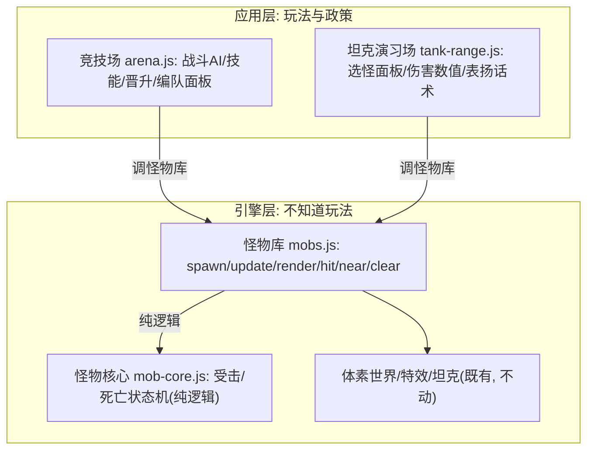

# 共享怪物系统 · 实现设计定稿

> 经用户 @implement 直接定稿:D1~D5 全部按推荐方案(引擎层 / 纯核心+壳双文件 / 游荡入怪物库可关 / 面板各自实现 / 数值表驱动)。
> 需求见 `docs/shared-monsters-plan.md`;实施落点:提交"怪物库抽取"+"坦克演习场接入共享怪物"。

## 与实施的差异(实施时的小调整,均已在代码注释中说明)

- 接口在 7 方法之外附 `list / face / hasSlot`:`list()` 给竞技场只读视图(别名 `mobs` 长期有效),`face()` 是面板按钮的像素头像,`hasSlot()` 供模式写关节姿势前探测槽位。
- `near(x, z, r, y, maxDy)`:比草案多了可选的高度差过滤(爆炸波及要 `|dy|<4`,碾压要 `|dy|<2.5`)。
- 选怪面板做成**菜单配置页 `#menuTank`**(竞技场同款模式):点卡仍直进(进场自动部署默认僵尸×6),Esc 打开选怪页,R 键/触屏 👾 按钮随时重部署——兼顾"孩子最少步"与"可选种类数量"。
- 伤害表 `TANK_VS_MOBS` 含 `blastR/blastDy`(波及半径与高度差,原散在代码里的魔法数入表)。
- 演习场苦力怕**不自爆**(无战斗 AI,纯游荡靶);末影龙按 `flyY = groundY+10` 巡航高度游荡,碾压不到(高度差过滤天然挡掉)。
- 击退/受击的飞行单位边界约束通过 `spawn opts.clamp` 回调注入(竞技场圆形边界),怪物库本体零场地知识。
- **竞技场本地游荡保留**:其无目标游荡与索敌状态机、飞行绕场巡航耦合( staggerT 分支/orbitA),与演习场"无 AI 纯靶"的游荡形状不同;共享版游荡(wanderStep)只服务无战斗场景,不强行统一,待第三个用例出现再评估。
- **地面击退的已知小偏差**:旧竞技场击退走含 rIn-1.2 圆形拦截的 stepMove,新 `Mobs.hit` 用无边界台阶规则,地面怪可被击退进墙沿约 0.7 格平地带(台阶规则仍挡爬墙)。换来 hit 的零场地知识,接受并记录。

## 评审后修正(两轴 code-review 发现)

- `Mobs.face()` 补回搬家时丢失的 `mix` 四象限分支(竞技场"混合编队"按钮图标空白——真 bug)。
- 末影龙在演习场的可玩性:巡航高度降为 groundY+6(原来 +10 平地炮永远够不着),`TANK_VS_MOBS.blastDy` 4→7(只影响飞行单位的高度过滤,打地面怪不变),游荡飞行被震落后缓慢回到巡航高度(原来会一直贴地怪飞)。

## 真机试玩反馈修正(2026-10-18 第二轮)

- **"爆炸范围内有时候没伤害"**:根因是炮弹只撞方块不撞怪物——对着怪开炮,炮弹穿过身体在身后炸,近弹波及 12~25 打不死 30 血的僵尸。三管齐下:
  1. **炮弹障碍谓词**:`TankCore.shellStep` 增可选 `extraSolid(x,y,z)`,`Tank.obstacle(fn)` 注册——怪物身体挡炮弹,碰上即停在接触点引爆(真·直击 40)。与 `protect` 同惯例:"什么挡炮弹"归模式层。
  2. **波及调硬**:splash 25→42、edge 10→12(线性)——落在怪脚边的近弹一炮一个脆怪;direct 判定圈 1.2→1.5。
  3. 击退 0.8→1.2,受击反馈更明显。
- **"训练场不用竞技场那种选两边的菜单"**:撤销 `#menuTank` 赛前配置页,改为**游戏内浮动面板 `#mobPicker`**(👾 触屏按钮 / M 键开关,选怪+数量+部署)。点卡直进、R 重部署不变;Esc 回主菜单(不再有坦克专属配置页)。

---

## 1. 目标架构一张图

一句话:**竞技场和演习场都不再自己养怪物,都向同一个"怪物库"要**;怪物库不知道"阵营""晋级""表扬"这些玩法,只提供"一只活的怪"。

---

## D1 · 怪物库放哪一层?

| 方案 | 说法 | 疑点 |
| --- | --- | --- |
| **A. 引擎层 `js/mobs.js`**(推荐) | 像 Tank(载具):建模、批渲染、血量/受击/死亡是"身体本能",不是玩法政策。数值走 config.js 参数表(引擎读表,惯例如此) | "血量 30"算不算玩法数值?——我认为算配置,像 TANK 表的炮弹半径 |
| B. 应用层 `js/mob-kit.js` | 像 ModeKit 那样的 shell 服务 | ModeKit 管的是 DOM/HUD 壳;怪物是场景里的实体,更接近 Tank/Avatar 的地位 |

**推荐 A**。判据用现有的分层语言:引擎层不知道玩法——"会被打死"是实体属性(坦克也会被撞停),"死了要表扬/算击杀信用"才是玩法,后者留模式层。

---

## D2 · 模块结构:单文件还是"纯核心 + 壳"?

| 方案 | 构成 | 测试缝 |
| --- | --- | --- |
| 单文件 `js/mobs.js` | 建模表+批渲染+行为一体 | 受击逻辑要在有 THREE 的环境测,或再剥 |
| **`js/mob-core.js` + `js/mobs.js`**(推荐) | core:受击扣血/闪白计时/击退位移/死亡动画/贴地爬坡的**纯函数状态机**(零 THREE 依赖);壳:建模表+实例化批渲染+对外的深接口 | core 用 vm context 加载器直测(镜像 `test/tank-core.test.js` 惯例),壳薄到只剩渲染不用测逻辑 |

**推荐双文件**——完全跟随 tank-core/tank 的既有双子结构,测试缝现成。

### 接口草案(壳 `Mobs` 暴露的全部,7 个方法)

| 方法 | 职责 |
| --- | --- |
| `Mobs.types` | 数值表只读视图(血量/速度/身高/碰撞半径,数据来自 config.js) |
| `Mobs.spawn(type, x, z, opts?) → m` | 造一只活怪。opts 可带 `{yaw, hpMult, label:{prefix, color}}`;返回的 m 是普通对象,模式可在上面挂自己的字段(竞技场挂 target/level/kills…) |
| `Mobs.update(dt)` | 通用行为:贴地/爬坡、受击闪白与踉跄计时、倒地沉没、尸体回收 |
| `Mobs.render()` | 实例化批渲染(竞技场现在的 renderMobs 原样搬家);菜单/清场时也要冲刷 |
| `Mobs.hit(m, dmg, kdx, kdz, kpow?)` | 受击:扣血/闪白/击退;血量归零进入死亡流程。返回 `{hp, dead}` 供调用方结算 |
| `Mobs.near(x, z, r, maxDy?) → [m…]` | 圆域查询:爆炸波及、坦克碾压共用这一个查询 |
| `Mobs.clear()` | 清场回收(几何/材质/名牌纹理,竞技场 clearBattle 现在做的那些) |

实例数组归怪物库私有(**不再有全局 `mobs` 数组**——顺手拆掉上次撞名事故的雷);竞技场遍历用 `Mobs.each`/`Mobs.list` 由实现提供(不进接口表也可以,设计评审定)。

**待您拍板**:接口形状认不认可?嫌多嫌少都批注。

---

## 2. 竞技场改造切分清单(同步重构)

**移交怪物库(arena.js 删除,改调 Mobs)**:

- `MOB_TYPES` → config.js(数值表);`MOB_RIG`/`buildRigGeo`/批渲染三件套(`getMobBatch`/`growMobBatch`/`renderMobs`)、`mkBox`/`sharedBoxGeo` 几何缓存 → mobs.js
- `spawnMob` 的建模与名牌部分 → `Mobs.spawn`(竞技场传"红方·/蓝方·"前缀);`disposeMob`/`drawMobLabel` → 怪物库(名牌画法泛化:前缀/颜色/星级由调用方给)
- `damageMob` 的通用部分(扣血/闪白/击退/倒地)→ `Mobs.hit`;`stepMove` 的台阶判定 → mob-core(竞技场边界 `ARENA.rIn` 改为调用方约束)

**留在竞技场(玩法,不动)**:战斗 AI 主体(updateMobs 的索敌/走位/技能)、五种特有技能(箭/石/震地/龙息/毒云)、晋升与击杀信用、阵营平衡、编队面板与记分。
竞技场的"晋级金身"(invulnT)是玩法判断 → 竞技场在调 `Mobs.hit` 前自查,不进怪物库。

**小尾巴**:arena 的升级光柱 `levelUpFx` 还用了一次 `mkBox`,移走后给竞技场留一个五行的本地小工具,或怪物库顺带导出——实现时看哪个干净。

**护航**:现有 97 项测试全绿是硬门槛;竞技场视觉验收"搬家前后一个样"(上次 MobBatch 重构的同一标准)。

---

## 3. 坦克演习场接入设计

**删**:`mkMob`/`rgMobs`/`updateRgMobs`/`spawnWave`/`killMob` 整套土制怪物与波次(约 90 行)。

**换**:

| 环节 | 做法 |
| --- | --- |
| 出怪 | 选怪面板选种类+数量 → `Mobs.spawn` 一次性部署;清场后面板再选再来 |
| 爆炸波及 | `onBoom` 里 `Mobs.near(爆点, 半径)` → 逐只 `Mobs.hit`(伤害值查参数表) |
| 坦克碾压 | 每帧驾驶中查 `Mobs.near(车位, 1.8)` → `Mobs.hit`(碾压伤害) |
| 名牌 | `Mobs.spawn` 传无阵营前缀的 label(名字+血条) |
| 话术 | 打中/消灭的表扬语音与 toast 留模式层(政策不进引擎) |

游荡行为(随机换向/撞墙转向/贴地)见 **D3**。

---

## D3 · 游荡行为进不进怪物库?

- **进(推荐)**:两边都要"没目标时溜达"——演习场全是游荡靶;竞技场索敌失败时也游荡。一份实现,两处受益,这才是"通用行为"的完整体。
- 不进:怪物库只管受击/死亡,游荡留各自模式——演习场留一份、竞技场留一份,重复两处。

**推荐进**,并做成可关的(spawn opts 传 `wander:false` 就静止站着当靶)。

## D4 · 选怪面板:各自实现还是抽共享 UI?

- **各自实现(推荐)**:竞技场面板是"双阵营对战配置"(两队+战力平衡+开战),演习场是"单边训练配置"(一种怪+数量+部署),形状本来就不同。硬抽公共层=浅模块。视觉风格对齐即可(同一套 CSS 习惯)。
- 抽共享:等第三个用例出现再说(一真缝要有两个真实 adapter,现在硬抽是假缝)。

## D5 · 数值首版(参数表,试玩再调)

| 参数 | 建议初值 | 手感预期 |
| --- | --- | --- |
| 直击伤害 | 40 | 僵尸/骷髅/苦力怕一发一个;铁傀儡 3 发;末影龙 8 发(硬仗) |
| 爆炸波及伤害 | 25(随距离衰减到 10) | 边缘蹭血,直击更痛 |
| 碾压伤害 | 40 | 脆怪照旧一发压扁(孩子的最爱保留);硬怪压不动,得开炮 |
| 怪物血量 | 沿用竞技场原值(30~300) | Q1=B 档已经拍板共用属性 |

全部进 `config.js` 新表(如 `TANK_VS_MOBS`),您真机试玩后我们随时改数字。

---

## 4. 命名与引导链(防上次那种卡加载事故)

- 文件:`js/mob-core.js`(纯逻辑,排 `voxel.js` 后)+ `js/mobs.js`(渲染壳,排 `effects.js` 后);`index.html` 加两行 defer。
- 顶层标识符:`MobCore`(纯函数集)与 `Mobs`(深接口)。竞技场现在的顶层 `const mobs` 数组**随改造消失**(数据归怪物库),撞名风险源头直接拆除。
- `test/boot.test.js` 的脚本序镜像同步加两行——新文件落地先跑它,防患于未然。

## 5. 测试策略(TDD 缝,先红后绿)

1. **mob-core 纯核心**:vm context 加载器直测(镜像 tank-core 惯例)——受击扣血、闪白/踉跄计时、击退位移、死亡进入与回收、贴地爬坡(groundTop 用注入 fake)。
2. **模式层**:tank-range 接入用注入 fake(replace-don't-layer,镜像 tank-mode 惯例)——面板部署/波次取消后的清场判定/表扬触发。
3. **竞技场回归**:现有 97 项全绿 + 人工视觉验收(同框截图对比也行)。

## 6. GLOSSARY 词条草案(实施时随代码落地)

> **怪物库(Mobs)**:引擎层的怪物实体模块:五怪建模(骨架表+实例化批渲染)、数值表驱动、血量/受击/死亡/游荡的通用行为。interface:spawn / update / render / hit / near / clear。战斗 AI、阵营、晋升、表扬话术在模式层。竞技场与坦克演习场都是它的调用方。

> *Avoid*:怪物系统(散称)、mob 数组(那是实现)

同时微调"竞技场""坦克演习场"两个词条,各加一句"怪物由怪物库提供"。

---

## 7. 决策点汇总(待您拍板)

| # | 问题 | 我的推荐 |
| --- | --- | --- |
| D1 | 层次:引擎层 or 应用层 | 引擎层 `js/mobs.js` |
| D2 | 结构:单文件 or 纯核心+壳 | `mob-core.js` + `mobs.js` 双文件 |
| D3 | 游荡行为进怪物库吗 | 进,且可关 |
| D4 | 选怪面板共享吗 | 各自实现,风格对齐 |
| D5 | 数值首版 | 直击 40 / 波及 25→10 / 碾压 40,进 config.js |
| — | 接口草案(7 方法) | 认可或批注改 |

拍板后我出实现设计定稿(导出 `docs/shared-monsters-design.md`),再进 ③ TDD 实施。

---

*设计讨论稿 v1 · 2026-10-18 · 基于需求定稿 docs/shared-monsters-plan.md 与提交 4338261*
