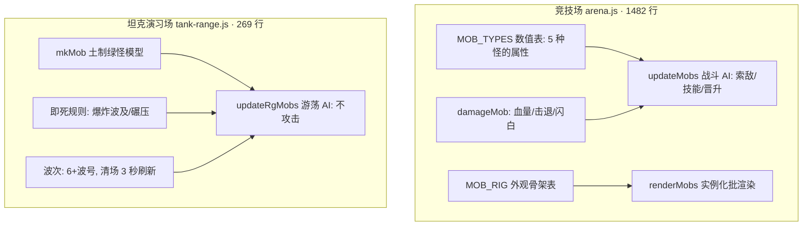

# 共享怪物系统 · 需求定稿

> 经 pinpoint 批注定稿:一轮批注 8 条(理解确认 + 7 问拍板)+ 二轮修正(取消波次)。
> 所有开放问题均已拍板(第 4 节);实现设计见后续 `docs/shared-monsters-design.md`(第 ② 步产出)。

---

## 1. 需求原话与我的理解(请先批注这一节)

您的原话:

> 整个游戏的怪物是共享的,坦克训练场直接使用现成的竞技场怪物素材。

我的初步理解,**可能理解偏了,请逐条确认或纠正**:

- 现状确实是"一个游戏,两套怪物":竞技场里有完整的五怪物体系(僵尸、骷髅、苦力怕、铁傀儡、末影龙),而坦克演习场里那群绿色小怪是当时随手做的土模型,和竞技场的怪物**没有任何关系**。
- 您的期望:演习场里出现的应该**就是竞技场那五种怪物**——至少"长得就是它们",不用另做一套。
- 我没把握的地方:"共享"到什么程度?只是换皮(长得一样),还是连怪物的属性(血量、速度)和受击反应也一并共享?这是下面 **Q1**,也是其他所有问题的根。

**✅ 已确认**:三条理解成立(您的批注:"没错")。第 1 节定稿。

---

## 2. 现状盘点:两套怪物各自是什么

| 维度 | 竞技场怪物 | 坦克演习场怪物 |
| --- | --- | --- |
| 所在文件 | `js/modes/arena.js`(1482 行) | `js/modes/tank-range.js`(269 行) |
| 种类 | 5 种 + 混合编队(僵尸/骷髅/苦力怕/铁傀儡/末影龙) | 1 种(僵尸风绿色小怪,土制) |
| 外观 | 骨架数据表 + 实例化合批渲染(今天刚重构,见第 3 节) | 8 个盒子拼的小人,每只现场新建 |
| 血量 | 有:30~300,受击闪白、击退、踉跄 | **无**:碰到就死 |
| 行为 | 完整战斗 AI:索敌、近战/远程、特有技能、击杀晋升 | 纯游荡:随机换向、贴地爬坡,不攻击任何人 |
| 死法 | 血量归零 → 倒地沉没 | 爆炸波及(约 3 格内)或坦克碾压(1.8 格内)**即死** |
| 名牌 | 有:阵营色名字 + 星级 + 血条 | 无 |
| 出场节奏 | 开战时按编队一次性部署 | 波次:一波比一波多(6+波号),清场 3 秒刷新 |

两套系统互相不知道对方存在,任何一边的怪物改动都不会影响另一边——这就是"不共享"的现状。

---

## 3. 一个刚发生的好消息(它改变了这道题的难度)

今天傍晚刚提交的 `4338261`(竞技场千怪性能优化)把怪物外观从"一坨建模代码"重构成了**纯数据表 + 通用渲染器**:

- 每种怪的外观 = 一份"骨架注册表"(身体部件的尺寸/颜色/关节位置),数据归数据;
- 渲染 = 一个通用批渲染器读表画图,不再和怪物代码搅在一起;
- 重构明确"视觉不变",97 项测试全绿,竞技场玩法零变化。

这意味着"演习场直接使用现成的竞技场怪物素材"从"复制粘贴一份代码"变成了"两边共用同一个素材模块"——**时机正好**。需求怎么定都会因此更顺,但定成什么样仍取决于下面的开放问题。

---

## 4. 开放问题 → 拍板结果(一轮批注 7/7 + 二轮修正 Q7,已定稿)

### Q1 · "共享"共享到什么程度?(根问题)—— ✅ 已拍板:C

| 选项 | 演习场怪物会长成 | 竞技场受影响 |
| --- | --- | --- |
| **A. 只共享外观** | 五种怪的原模原样,配上演习场自己的规则(无血量游荡靶) | 几乎不动 |
| **B. 外观 + 属性** | 长得一样,且血量/速度等数值也用竞技场那套 | 几乎不动 |
| **C. 外观 + 属性 + 通用行为** | 再进一步:受击闪白、被击退、倒地死亡这些"怪物本能"也共享;战斗 AI(技能/晋升)仍归竞技场 | 需要把怪物代码抽成共享模块,竞技场同步改 |

一句话感受:A 是"换皮",C 是"游戏里只有一种怪物,两个场地各自决定让它们干什么"。

**✅ 已拍板:C**——外观 + 属性 + 通用行为:受击闪白、被击退、倒地死亡这些"怪物本能"进共享模块;战斗 AI(索敌/技能/晋升)仍归竞技场。演习场怪物从此"有血有肉",不再是即死纸靶。

### Q2 · 演习场怪物要不要血量与受击反馈?—— ✅ 已拍板:要

现状是"碰到就死"(碾压与爆炸都秒杀)。坦克打怪有三条攻击路径,若上血量,每条都要定规则:

| 攻击路径 | 现状(无血量) | 若有血量要定的事 |
| --- | --- | --- |
| 炮弹直击 | 与波及同权,即死 | 直击是否该比波及更痛? |
| 爆炸波及(约 3 格) | 即死 | 边缘伤害是否递减? |
| 坦克碾压(1.8 格) | 即死 | 还能一发碾压秒杀吗?(现在这是孩子的最爱) |

另一个孩子手感问题:竞技场怪物血量 30~300——僵尸级别"一炮一个"手感正好;但铁傀儡(110)和末影龙(300)若照搬,演习场里要打好几炮,6 岁孩子会不会觉得"磨"?

**✅ 已拍板:要**(您的批注:"要,有些要好几炮才刺激")。方向:脆怪一炮一个、硬怪(铁傀儡/末影龙级别)好几炮才有成就感。上表的三件事(直击 vs 波及伤害、边缘递减、碾压是否仍秒杀——孩子的最爱)具体怎么定,进 config.js 参数表,第 ② 步设计再定数值。

### Q3 · 竞技场要不要顺势动?—— ✅ 已拍板:一起重构

- **最小方案**:新建共享怪物素材模块,演习场改用它;竞技场**一行不动**(素材表先复制或引用)。快、零回归风险,但"共享"打折——改外观要改两处。
- **同步方案**:把怪物素材(及 Q1 选到的深度)抽成共享模块,竞技场与演习场都改为调用方。真正的"整个游戏的怪物是共享的",但竞技场是 1482 行的大文件,动它需要完整的回归测试护航。

**✅ 已拍板:同步方案**(您的批注:"一起重构了")——把怪物素材与通用行为抽成共享模块,竞技场与演习场都改为调用方。竞技场是 1482 行大文件,改造要靠完整回归护航(现有 97 项测试 + 共享模块新增测试)。

### Q4 · 和坦克三期遗留的先后关系—— ✅ 已拍板:三期先不做

坦克三期还欠三件事(见 `docs/tank-plan.md` 第 10 节):炮塔独立旋转、投放到竞技场、坦克血量。

- 共享怪物和"投放竞技场"有呼应:若坦克将来要开进竞技场打怪,怪物系统先共享统一,收益更大。
- 但若孩子现在更馋"炮塔跟着鼠标转",也可以三期优先。

**✅ 已拍板:三期先不做**——本次专注共享怪物系统。三期三件事(炮塔独立旋转/投放竞技场/坦克血量)继续挂账;怪物先共享统一,将来坦克开进竞技场时直接受益。

### Q5 · 演习场出场哪些怪物?怎么出场?—— ✅ 已拍板:像竞技场一样可选种类和数量

- 五种全上,还是先上两三种(比如僵尸+骷髅)?
- 每波一种轮着来,还是混着来?
- 两个特殊怪要想到:
- **苦力怕**:竞技场里会自爆炸地形。演习场若只是"长得像"(Q1 选 A),它不自爆;若共享行为,它会炸出场面坑洼——是好玩的混乱还是灾难?
- **末影龙**:会飞。演习场多丘陵峡谷,飞的龙碾压不到、炮弹难打,是难度亮点还是挫败源?
- 现在的土制绿怪要退役吗?

**✅ 已拍板**(您的批注:"和竞技场一样可以选择种类和数量")——演习场加一个**选怪面板**(竞技场同款交互:选种类 + 调数量),五种怪全上。**面板选好种类和数量 → 一次性部署(无波次,见 Q7 二轮修正),清场后回面板再选再来。**苦力怕自爆、末影龙飞行在共享行为下的具体表现(炸不炸地形/飞多高)到设计阶段定。土制绿怪退役,由共享怪取代(您已同意)。

### Q6 · 要不要名牌和血条?—— ✅ 已拍板:要

竞技场怪物头顶有名牌(阵营色名字 + 星级 + 血条)。演习场现在什么都没有。

- 6 岁孩子看不太懂"蓝方·骷髅★"这种文字名牌;
- 但**纯图形血条**(颜色条,无文字)对"打了几炮才死"有帮助(Q2 选了有血量的话尤其如此);
- 也可以完全不要,靠怪物受击闪白/倒地动画传达状态,配合 TTS 语音播报。

**✅ 已拍板:要**。形式默认沿用竞技场同款(名字 + 血条);演习场没有红蓝阵营,前缀怎么处理、要不要照顾 6 岁孩子做图形化/TTS 补充,设计阶段出方案。

### Q7 · 波次节奏保留吗?—— ✅ 已拍板:取消波次(二轮修正)

现行节奏:一波 6+波号 只,清场后 3 秒刷新,配"新一波怪物来啦!"语音。这个节奏孩子已经玩熟了。

- 换成五种怪后,递增的是"数量"还是也可以是"种类"(越往后出越猛的怪)?
- 清场语音要不要跟着报下波出什么?("骷髅兵来啦!")

**✅ 已拍板:取消波次**(2026-10-18 二轮,您的回话:"不需要波次了,我们做的是训练场而已")——不再自动刷新波次:面板选好种类和数量 → **一次性部署**,清场后回面板再选再来(类似竞技场的开战流程,但只有一方靶子)。"新一波怪物来啦!"等波次语音随之退役。

---

## 5. 边界(不做什么,已确认)

- **不动专注训练营**——它与怪物无关,自有独立预算。
- **不新增游玩模式**——演习场已入儿童时限表,防沉迷口径不变。
- **引擎层不学玩法**——共享模块放哪一层、叫什么,属于第 ② 步代码设计的话题,这里只定需求。

**✅ 已确认同意**(无批注,视为同意)。

---

*需求定稿 · 2026-10-18 · 一轮批注 8 条 + 二轮修正(取消波次)· 基于提交 4338261(测试 97/97 绿)· 下一步:第 ② 步代码设计讨论*
