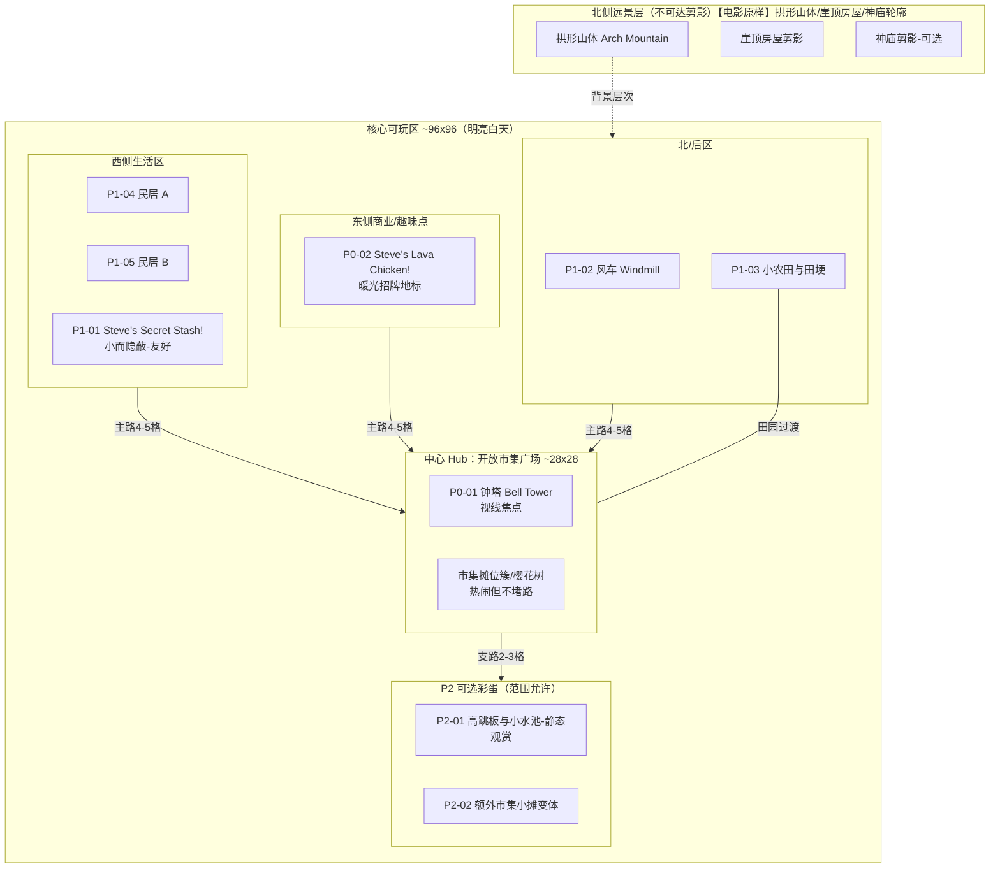

# Midport Village 城镇地图设计（Town Map Design）

> 文档状态：**设计权威（城镇设计收束稿，已对齐 PrefabKit/SceneKit 素材库框架）**  
> 产出日期：2026-11-12  
> 事实底座：[`docs/minecraft-movie-town-research.md`](minecraft-movie-town-research.md)（保留其一手信源引用与证据分级，不在本文重复造源）  
> 建筑/地标视觉细化定稿：[`docs/design/town-buildings-visual-spec.md`](design/town-buildings-visual-spec.md)（材质色板、P0/P1/P2 体量与三视图/立面文字规格的唯一视觉细化权威）  
> 村民/角色视觉细化定稿：[`docs/design/town-villagers-visual-spec.md`](design/town-villagers-visual-spec.md)（角色清单、配色与三视图文字规格的唯一视觉细化权威）  
> **素材件库就绪规格（PrefabKit/SceneKit 映射与变种面）**：[`docs/design/town-prefab-specs.md`](design/town-prefab-specs.md)（建筑/关键场景件→PrefabKit 蓝图名与 v 面，植被→SceneKit 树家族；冲突处以框架契约为准）  
> 关联文档：[`docs/town-villagers-design.md`](town-villagers-design.md) · [`docs/town-assets-requirements.md`](town-assets-requirements.md) · **UI 设计定稿**：[`docs/design/town-ui-entry-hud-spec.md`](design/town-ui-entry-hud-spec.md)、[`docs/design/town-ui-dialog-spec.md`](design/town-ui-dialog-spec.md)

## 1. 目的、范围与口径

- **目的**：在 research 的电影取证基础上，收束 Midport Village 的地图布局、功能分区、建筑清单与体量、氛围与可达性，并给出与现有探险模式/注意力训练玩法的结合锚点，为村民设计与素材制作提供一致输入。
- **范围**：地图与空间设计、建筑/地标的布局与功能归位、环境氛围、玩法结合建议、待 PO 确认点汇总。角色外观细节以 villagers 设计/visual spec 为准；资产规格清单以 [`town-assets-requirements.md`](town-assets-requirements.md) 为准。
- **标注口径（全文统一）**：
  - **【电影原样】**：来自电影/官方联动可确认或强指向的母题、地名与气质锚点（见 research §2、S1-S3）。
  - **【建议为游戏性调整】**：为 6 岁可读性、鼠标点选操作、体素实现成本与“祥和无威胁”基调所做的转译与简化；默认可执行，PO 可覆盖。
  - **【待 PO 确认】**：影响范围/叙事/表现但不阻塞本阶段文档落地的点；本文给出默认值。

## 2. 设计原则与约束对齐

- **对齐 MISSION**：目标用户 6 岁、纯鼠标点选、图标+中文 TTS 倾向、无键盘/指针锁定依赖；反馈哲学**过程性表扬、零惩罚、零倒计时压迫**（`MISSION.md`）。
- **祥和无威胁默认态**：**【建议为游戏性调整】** 固定明亮白天/午后暖阳主态，无战斗、无怪物入侵、无死亡惩罚；电影/联动中的紧张线索仅作远景背景叙事或和平化改写（见 §8）。
- **可读性优先**：主路径宽于支路、避免回环死胡同与迷宫分叉；高辨识地标与色块引导定位；单次探索 3-10 分钟可覆盖核心区。
- **版权口径**：不搬运受版权保护的官方像素/纹理/模型资产；地名/场景母题仅作可识别气质锚点，自建体素资产落地（延续 research 与 visual spec 惯例）。

## 3. 地图布局总览（默认 ~96×96 核心可玩区）

### 3.1 规模与层次（默认）

| 项目 | 默认值 | 口径 | 备注 |
|---|---|---|---|
| 核心可玩区 | **~96×96 方块** | 【建议为游戏性调整】 | research/buildings spec 一致默认；地形缓坡起伏高差建议 ≤12 方块 |
| 主广场 | 约 **28×28** | 【建议为游戏性调整】 | 中心 hub，开放留白、钟塔视线通廊 |
| 主路径宽 | 4-5 方块 | 【建议为游戏性调整】 | 支路/巷道 2-3 方块 |
| 单体建筑占地 | 6×6 ~ 14×12 | 【建议为游戏性调整】 | 按 P0/P1/P2 地标等级（详 §4） |
| 远景剪影区 | 可玩区外延伸 | 【电影原样】母题 + 【建议为游戏性调整】 | **不可达**，仅背景层次 |

### 3.2 俯视布局示意（Mermaid）



### 3.3 俯视块位示意（ASCII，示意相对方位，非精确坐标）

```text
                         N (背向/远景)
   +--------------------------------------------------------------+
   |            ~~~~~ 拱形山体剪影 Arch Mountain ~~~~~             |  不可达
   |                 [崖顶房屋]           [神庙?]                  |
   +--------------------------------------------------------------+
   |   [风车 P1-02]                         [农田 P1-03]          |
   |        \                                   /                 |
   |         \==== 主路 4-5 ===================/                  |
   |                +------------------------+                    |
   |                |   樱花  [摊位簇]       |                    |
   |   [民居A P1-04]--|      ★ 钟塔P0-01 ★   |-- [Lava Chicken   |
   |   [民居B P1-05]  |   开放广场 28x28      |    P0-02]         |
   |   [Stash P1-01]--|   [摊位]    [路标]    |                    |
   |                +------------------------+                    |
   |                       \  支路 2-3  /                         |
   |                    [P2 跳板+小池?] [P2 摊位?]                |
   +--------------------------------------------------------------+
                         S (玩家常见进入/回望方向)
   图例：★=主视觉焦点  ==主路  --支路  [ ]=建筑/地标占位  ?=可选
   核心可玩区目标 ~96x96；回望任意主路应可见钟塔或广场开阔面
```

### 3.4 空间母题与【电影原样】锚点

- **【电影原样】** 地名与身份：**Midport Village**，Overworld 和平友善聚落（research S1-S3）。
- **【电影原样】** 空间母题：拱形山体下的村庄；中心开放市集/广场；风车与钟塔；樱花等温暖点缀；远处崖顶房屋/神庙层次元素（research §2.1, S1 Layout）。
- **【电影原样】** 命名地标：Steve's Lava Chicken!、Steve's Secret Stash!（及可选 Steve's World 叙事留存）作为场景锚点（research S1 Named structures）。
- **【建议为游戏性调整】** 不追求电影镜头级非等比写实；采用体素可读性优先的中世纪-村庄混合风，主 hub 放射连接 4-6 个功能点，动线简化、不迷路。

## 4. 功能分区、建筑清单与体量

> 体量/材质/立面细节以 [`docs/design/town-buildings-visual-spec.md`](design/town-buildings-visual-spec.md) 为准；**素材件落库契约（PrefabKit 蓝图名/脚印/`v` 变种面/材质注入槽，或 SceneKit/场景拼装分类）以 [`docs/design/town-prefab-specs.md`](design/town-prefab-specs.md) 为准**；本节做地图归位与可达性/功能整合。冲突处以框架契约为准（材质 id 注入不焊死、按形命名、几何与落位政策分线）。

### 4.1 分区说明

| 分区 | 位置 | 功能 | 氛围关键词 | 可达性 |
|---|---|---|---|---|
| 中心广场 Hub | 核心居中 | 集合、导览、轻任务锚点、社交热闹感 | 开放、明亮、好找 | **可达**，主路径汇聚 |
| 商业/趣味点（东） | 广场东侧主路端 | 餐饮趣味地标、观察/互动锚点 | 温暖、可爱、招牌醒目 | **可达** |
| 生活区（西） | 广场西侧支路 | 民居氛围、安静祥和、探索角落 | 家的亲切、低刺激 | **可达**，门前短支路 |
| 田园/天际线（北） | 广场北侧 | 农田生活气息、风车远近双读地标 | 田园、舒展 | **可达**（风车/田埂边）；山体不可达 |
| 远景层（最北） | 可玩区外 | 层次与电影母题还原 | 壮阔但不压迫 | **不可达**（剪影/碰撞边界外） |
| 彩蛋区（P2，可选） | 广场南侧/边角 | 趣味观赏、奖励感 | 幽默、安全 | **可达（若启用）**，不做挑战 |

### 4.2 建筑与地标清单（整合 P0/P1/P2）与 PrefabKit/SceneKit 映射

| ID | 名称 | 分区 | 优先级 | 占地/高度(方块) | 核心特征与可达性 | PrefabKit/SceneKit 映射（摘要） | 来源口径 |
|---|---|---:|---:|---|---|---|---|
| P0-01 | 中心广场与钟塔 Plaza & Bell Tower | 中心 Hub | P0 | 广场 28×28；钟塔 6×6，高 14-16 | 竖向主焦点、四面开敞钟室、广场留白通廊；集会/导览锚点。**可达**（广场全开放；钟塔内部是否可进由实现定，默认外观锚点）。 | 钟塔 **需新增** `tower-belfry`（按形命名）；广场铺装属**场景拼装/地表模块**（`SceneKit.fill`/铺装逻辑）→ 详见 [prefab-specs §4.1, §5.2](design/town-prefab-specs.md#41-tower-belfry钟塔需新增) | 钟塔/开放市集【电影原样】；集会锚点用法【建议为游戏性调整】 |
| P0-02 | Steve's Lava Chicken! | 东侧商业 | P0 | 10×8，高 7-8（含招牌） | 大招牌+橙色暖光装饰（儿童化，无真实熔岩/火焰威胁）；趣味互动锚点。**可达**（门前/店面交互区）。 | **需新增** `shop-awning`（暖光意象为装饰块，材质经 `v.ids.glow/sign*` 注入，禁熔岩/火语义）→ [§4.2](design/town-prefab-specs.md#42-shop-awninglava-chicken-店铺需新增) | 命名地标【电影原样】；熔岩意象暖光化【建议为游戏性调整】 |
| P1-01 | Steve's Secret Stash! | 西侧生活边角 | P1 | 6×6，高 5-6 | 小而隐蔽但友好的储藏小屋。**可达**（探索发现点）。 | 地上 **需新增** `stash-hut`；地下储藏语义可**复用现有** `under-room`（作 `cache-cellar` 基底，覆写 `mat/half/cavH/floorDy/shaft/trap/exit/ids`）→ [§4.3, §4.9](design/town-prefab-specs.md#43-stash-hut秘密储藏小屋需新增) | 命名地标【电影原样】；位置简化【建议为游戏性调整】 |
| P1-02 | 风车 Windmill | 北侧田园 | P1 | 6×6，高 12-14 | 天际线地标；默认叶片静态造型。**可达**（基座周边）。 | **需新增** `windmill-tower`（`sailStatic` 默认 true，叶片计入 `footOf`）→ [§4.4](design/town-prefab-specs.md#44-windmill-tower风车需新增) | 【电影原样】；静态优先【建议为游戏性调整】 |
| P1-03 | 小农田与田埂 Farm Plot | 北侧田园 | P1 | 8×12~10×14（成组） | 生活气息与寻物背景；低围栏不阻塞主视线。**可达**（田埂边行走）。 | **场景拼装/地表模块**（`SceneKit.fill` + 围栏/作物点位散布），不入 PrefabKit 行表 → [§5.2](design/town-prefab-specs.md#52-不宜入-prefabkit-行表的件明确分类) | 村庄生活感【建议为游戏性调整，呼应 MC 语义】 |
| P1-04 | 民居 A（单层小屋） | 西侧生活 | P1 | 8×7，高 6 | 亲切居住氛围、模块化复用。**可达**（门前花坛/入口区）。 | **需新增** `cottage-gable` → [§4.5](design/town-prefab-specs.md#45-cottage-gable民居-a需新增) | 村庄建筑群【电影原样】母题；简化【建议为游戏性调整】 |
| P1-05 | 民居 B（双层联排感） | 西侧生活 | P1 | 10×8，高 8-9 | 错落轮廓丰富街区。**可达**。 | **需新增** `house-loft` → [§4.6](design/town-prefab-specs.md#46-house-loft民居-b需新增) | 同上 |
| P2-01 | 高跳板与小水池 High Jump & Tiny Pool | 南侧/边角彩蛋 | P2 | 跳板 6-8 长高 4-5；水池 2×2~3×3 | 幽默比例反差、**静态观赏、无危险高度叙事**。**可达（若启用）**。 | **需新增** `board-pool`（静态水色块，非流体系统）→ [§4.8](design/town-prefab-specs.md#48-board-pool高跳板与小水池彩蛋需新增p2) | 【电影原样】趣味元素；去危险化【建议为游戏性调整】 |
| P2-02 | 额外市集小摊变体 | 广场边缘 | P2 | 3×2~4×3，高 3-4 | 面包/花束/果篮抽象摊位，增强热闹感。**可达**。 | **需新增** `stall-canopy`（`theme/size` 经 `v` 覆写，材质注入）→ [§4.7](design/town-prefab-specs.md#47-stall-canopy市集摊位需新增) | 开放市集【电影原样】 |
| R-01 | 拱形山体 Arch-shaped Mountain | 北侧远景 | 远景必做 | 视觉高出可玩区 24-40 | 聚落背屏剪影。**不可达**。 | **场景拼装/地表模块**（大体量低细节，不入 PrefabKit）→ [§5.2](design/town-prefab-specs.md#52-不宜入-prefabkit-行表的件明确分类) | 【电影原样】 |
| R-02 | 远处崖顶房屋 Distant Cliff Homes | 远景高处 | 远景建议 | 1-2 栋简化轮廓 | 层次剪影。**不可达**。 | **场景拼装**（低细节剪影）→ [§5.2](design/town-prefab-specs.md#52-不宜入-prefabkit-行表的件明确分类) | 【电影原样】 |
| R-03 | 神庙 Temple 剪影 | 远景一角 | 远景可选 | 小体量低细节 | 异域轮廓点缀。**不可达**。 | **场景拼装**（可选极简轮廓）→ [§5.2](design/town-prefab-specs.md#52-不宜入-prefabkit-行表的件明确分类) | 【电影原样】（细节未确认，低细节） |

### 4.3 路网与可读性规则

- **主路**：浅石铺装主色、中石路缘，宽 4-5，连接广场与各 P0/P1 地标；轻微弧线但不迷宫分叉（buildings spec §6.2）。
- **支路**：宽 2-3，通向民居门前与农田边，可混入暖木/碎石纹理暗示。
- **回望原则**：从任意主路回望应能看到钟塔或广场开阔面；交叉口可用灯柱/花盆/路标色块轻提示。
- **视线管理**：摊位沿广场边缘成组布置，中央保留通廊直视钟塔；建筑高度与摊位不遮挡 6 岁玩家对主地标的识别（buildings spec §6.1）。

## 5. 氛围设计：热闹与祥和

### 5.1 氛围目标

| 维度 | 目标 | 设计手段 | 口径 |
|---|---|---|---|
| 热闹 | 有生活气息、有人气、像在办小集市 | 广场摊位与樱花聚集点、村民小簇组站位与错落姿态、农田/风车/店铺的功能可读、柔和暖色点缀（布幔/花束/招牌） | 【电影原样】市集与友善村民气质 + 【建议为游戏性调整】低密度可读热闹 |
| 祥和 | 安全、可预期、无压迫 | 明亮暖阳、无战斗无怪物威胁、低对比轮廓与温暖材质、舒缓行为节奏（≥1s 周期）、无惊吓音画与红色警示 | 【建议为游戏性调整】对齐 MISSION 零惩罚/零压迫 |

### 5.2 昼夜与光照

- **默认主态（推荐）**：**【建议为游戏性调整】** 固定明亮白天/午后暖阳；高亮低阴影，材质色板按 buildings spec §4 暖亮低威胁执行。
- **夜晚可选态**：**【待 PO 确认】** 若保留夜晚，仅柔和暖光点（参考 buildings spec `#FFD89A`），低密度、无闪烁惊吓；**不出现**怪物、警报、阴森暗紫黑主色、火把烟雾或危险光效。
- **禁止观感**：战损、血迹、焦痕、尖刺、铁笼压迫感、真实熔岩流/火焰威胁（Lava Chicken 仅暖橙装饰光意象，见 buildings spec §8）。

### 5.3 声音/节奏（设计建议，供资产与实现阶段）

- **【建议为游戏性调整】** 环境音以轻快柔和为主（风、脚步、轻微市集氛围），不使用警报/战斗强刺激音效；角色反馈配合图标+中文 TTS 友好，节奏舒缓。

### 5.4 植被与树形承接（对齐 SceneKit）

- **【电影原样】** 樱花点缀与田园绿植气质。**【建议为游戏性调整】** 树/植被几何一律挂 **SceneKit 树家族**（`SceneKit.tree` 圆冠 / `pine` / `pineSnowy` / `scrub`），不在地图文档中写散装树体素几何；**落位政策（选点、密度、包门禁/雪根座/不遮挡视线）仍属调用方**。详见 [`docs/design/town-prefab-specs.md` §5.1](design/town-prefab-specs.md#51-植被件挂-scenekit-树家族落位政策属调用方)。

## 6. 与现有探险模式/注意力训练玩法的结合点（设计建议）

> 以下为**设计建议锚点**，用于后续 spec/票据细化；不在本文绑定具体实现机制代码。

### 6.1 适配约束（来自 MISSION/现有模式语境）

- 6 岁、纯鼠标点选、零文字依赖倾向（图标+中文 TTS）、无键盘/指针锁定要求。
- 注意力训练语境：过程性表扬、零惩罚、零倒计时压迫；可借鉴探险/训练营已有“低压、可预期、短回路反馈”的体验方向（不引入战斗/失败惩罚）。

### 6.2 轻任务与“观察-寻找-回应”锚点建议

| 锚点类型 | 场景位置 | 玩法意图（注意力维度友好） | 交互形式（鼠标点选/TTS友好） | 反馈口径 |
|---|---|---|---|---|
| 观察导览 | 广场钟塔/樱花/主路口 | 视觉定向与环境扫视 | 点击高亮地标 → 图标+TTS 简短介绍/鼓励 | 过程性表扬，零惩罚 |
| 寻找物品/角色 | 市集摊位、农田、民居门前 | 选择性注意与视觉搜索 | “帮阿面找面包/帮朵朵找花束”等点选目标 | 找到即正向反馈，可重复尝试无倒计时 |
| 回应与帮助 | Steve's Lava Chicken!、Stash、铁匠/花匠旁 | 简单因果回应与社交互动 | 点击 NPC/道具触发挥手、递物、献花等状态（见 villagers 设计 §7） | 即时友好反馈，不记录失败 |
| 集合/节奏感 | 钟塔/广场 | 规则跟随与时间感（轻量） | 跟随村民到广场“集合”姿态（非强制计时） | 参与即肯定 |
| 探索发现 | Secret Stash、风车、P2 彩蛋 | 持续探索动机与空间记忆 | 发现新地点给轻量图章/语音夸奖（建议） | 无惩罚、可随时离开 |

- **【建议为游戏性调整】** 所有锚点默认“可完成、可跳过、可重来”，不绑定血量/死亡/资源损失；与现有探险模式结合时优先复用“安全漫游 + 点选交互 + 任务提示 UI 位”思路，具体接入点由后续工程 spec 定。
- **节奏建议**：单次小任务 30-90 秒可完成，核心区 3-10 分钟可自由探索完毕，与 research 默认规模一致。

## 7. 【电影原样】与【建议为游戏性调整】对照

| 条目 | 【电影原样】 | 【建议为游戏性调整】（本设计采用） | 依据/理由 |
|---|---|---|---|
| 地名与核心身份 | Midport Village，和平友善聚落，拱形山体下 | 保留地名与母题；核心可玩区 ~96×96 | research S1-S3；低龄可探索性与实现范围可控 |
| 中心空间 | 开放市集/广场，樱花、热闹氛围 | 广场 ~28×28 + 少量摊位，保留钟塔视线通廊与主路径清晰 | 避免拥挤遮挡，服务注意力引导（buildings spec） |
| 标志地标 | 风车与钟塔、Steve's Lava Chicken!、Steve's Secret Stash! | P0/P1 全入首版建议，P2 可选；体素简化、比例统一可读 | 保辨识度同时降低视觉噪声 |
| 建筑风格 | 类村庄但更中世纪细节、非严格游戏比例 | 木石混合+体素阶梯轮廓，细节“少而准” | 体素引擎转译与 6 岁可读性 |
| 边缘层次 | 远处崖顶房屋/神庙等预存在建筑 | 不可达远景剪影，仅保留轮廓与色块 | 还原层次感且不增加可达负担 |
| 氛围与威胁 | 和平基调但电影/联动存在入侵紧张线索 | 固定明亮白天主态，无战斗/入侵/恐怖材质；夜晚仅柔和灯火可选 | 对齐 MISSION“祥和无威胁” |
| 趣味装置 | Steve 的 Lava Chicken；高跳板与小水池 | Lava Chicken 暖橙装饰光意象（无真实熔岩/火焰）；跳板水池 P2 且纯观赏去危险化 | 儿童安全与去威胁表达 |
| 村民活动热闹感 | 村民交易、聚集、铁傀儡守护等 | 环境侧提供广场/摊位/路径承载；NPC 造型行为详见 villagers 设计 | 地图与角色分工清晰 |

## 8. 待 PO 确认点与默认值汇总

| # | 待确认点 | 建议默认值（可直接排期） | 影响范围 | 主要来源 |
|---|---|---|---|---|
| M1 | 可玩区最终规模 | 核心区 **~96×96**，主广场 28×28 | 地图占地、地标间距、资产数量 | research §8#1；buildings spec §10#1 |
| M2 | 首版地标范围 | **P0+P1 全入**，P2 可选后置（P2-02 摊位变体可低成本并入广场） | 资产工作量与首版完成度 | buildings spec §10#2 |
| M3 | 昼夜表现 | **固定明亮白天**；夜晚态暂不制作（若要仅柔和暖光） | 光照、灯火资产、氛围验收 | research §8#3；buildings spec §10#3 |
| M4 | 危险/入侵元素 | **无战斗、无怪物入侵、无死亡惩罚**；电影威胁仅背景或和平化事件 | 基调与机制复杂度 | research §8#3-4 |
| M5 | Steve/主角团出场方式 | **不直接复刻电影真人角色形象**；仅建筑命名与图形意象致敬 | 叙事与资产边界 | research §8#5；buildings spec §10#6 |
| M6 | 风车叶片是否动态 | **默认静态造型** | 实现预期（非地图结构） | buildings spec §10#4 |
| M7 | 远景剪影细化程度 | 拱形山体必做；崖顶房屋 1-2 栋简化；神庙可选极简轮廓 | 背景资产量 | buildings spec §10#5 |
| M8 | 玩法锚点首版落点 | 广场导览 + 2-3 个“观察-寻找-回应”轻任务（Lava Chicken/市集/农田或 Stash） | spec 与交互资产范围 | 本文 §6（设计建议） |

## 9. 引用与对齐说明

- 电影事实、一手信源引用与证据缺口：见 [`docs/minecraft-movie-town-research.md`](minecraft-movie-town-research.md)（S1-S9 及“未在一手信源中确认/推测”口径，本文不新增一手信源）。
- **素材件库就绪规格与 PrefabKit/SceneKit 映射**：见 [`docs/design/town-prefab-specs.md`](design/town-prefab-specs.md)（与 `js/prefab-kit.js`/`js/scene-kit.js` 契约对齐）。
- 建筑视觉/色板/三视图：见 [`docs/design/town-buildings-visual-spec.md`](design/town-buildings-visual-spec.md)。
- 村民与生物视觉：见 [`docs/town-villagers-design.md`](town-villagers-design.md) 与 [`docs/design/town-villagers-visual-spec.md`](design/town-villagers-visual-spec.md)。
- **UI 设计定稿**：[`docs/design/town-ui-entry-hud-spec.md`](design/town-ui-entry-hud-spec.md)、[`docs/design/town-ui-dialog-spec.md`](design/town-ui-dialog-spec.md)（入口卡/HUD/小地图/对话框等边界由 UI 定稿明确）。
- MC 机制与模型语言复用参考：`docs/mc-mob-models-research.md`、`docs/iron-golem-research.md`、`GLOSSARY.md`（术语保持一致）。
