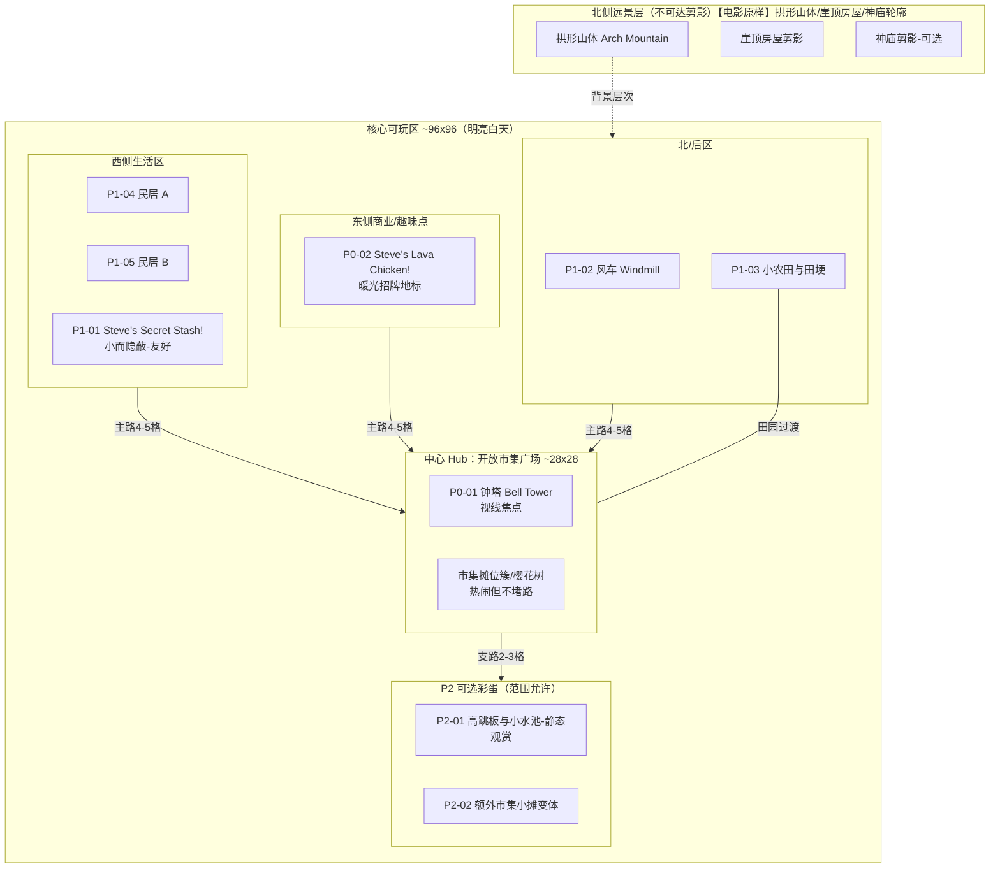

# Midport Village 城镇地图设计（Town Map Design）

> 文档状态：**设计权威（城镇设计收束稿，已对齐 PrefabKit/SceneKit 素材库框架）**  
> 产出日期：2026-11-12  
> 事实底座：[`docs/minecraft-movie-town-research.md`](minecraft-movie-town-research.md)（保留其一手信源引用与证据分级，不在本文重复造源）  
> 建筑/地标视觉细化定稿：[`docs/design/town-buildings-visual-spec.md`](design/town-buildings-visual-spec.md)（材质色板、P0/P1/P2 体量与三视图/立面文字规格的唯一视觉细化权威）  
> 村民/角色视觉细化定稿：[`docs/design/town-villagers-visual-spec.md`](design/town-villagers-visual-spec.md)（角色清单、配色与三视图文字规格的唯一视觉细化权威）  
> **素材件库就绪规格（PrefabKit/SceneKit 映射与变种面）**：[`docs/design/town-prefab-specs.md`](design/town-prefab-specs.md)（建筑/关键场景件→PrefabKit 蓝图名与 v 面，植被→SceneKit 树家族；冲突处以框架契约为准）  
> 关联文档：[`docs/town-villagers-design.md`](town-villagers-design.md) · [`docs/town-assets-requirements.md`](town-assets-requirements.md) · **UI 设计定稿**：[`docs/design/town-ui-entry-hud-spec.md`](design/town-ui-entry-hud-spec.md)、[`docs/design/town-ui-dialog-spec.md`](design/town-ui-dialog-spec.md)  
> **2026-11-13 PO 变更**：进镇方式改为冒险模式 home 图主路尽头的维度过场（**§6.3 机制规格定稿**）；独立模式入口撤除，ADR-0009 停用待新 ADR 取代（salvage 评估归 architect）。

## 1. 目的、范围与口径

- **目的**：在 research 的电影取证基础上，收束 Midport Village 的地图布局、功能分区、建筑清单与体量、氛围与可达性，并给出与现有探险模式/注意力训练玩法的结合锚点，为村民设计与素材制作提供一致输入。
- **范围**：地图与空间设计、建筑/地标的布局与功能归位、环境氛围、玩法结合建议、待 PO 确认点汇总。角色外观细节以 villagers 设计/visual spec 为准；资产规格清单以 [`town-assets-requirements.md`](town-assets-requirements.md) 为准。
- **【2026-11-13 PO 变更】进镇方式**：城镇不再作为独立游玩模式接入（MODE_REGISTRY 卡/模式页/模式壳撤除，ADR-0009 停用待新 ADR 取代）——进镇=冒险模式 home 图主路尽头的维度过场（**§6.3 定稿**）。本文 §1~§5 的地图/分区/氛围规格不受影响，继续作为 town 维度建场的布局权威；§6.2 玩法锚点建议照旧。
- **标注口径（全文统一）**：
  - **【电影原样】**：来自电影/官方联动可确认或强指向的母题、地名与气质锚点（见 research §2、S1-S3）。
  - **【建议为游戏性调整】**：为 6 岁可读性、鼠标点选操作、体素实现成本与“祥和无威胁”基调所做的转译与简化；默认可执行，PO 可覆盖。
  - **【待 PO 确认】**：影响范围/叙事/表现但不阻塞本阶段文档落地的点；本文给出默认值。

## 2. 设计原则与约束对齐

- **对齐 MISSION**：目标用户 6 岁、纯鼠标点选、图标+中文 TTS 倾向、无键盘/指针锁定依赖；反馈哲学**过程性表扬、零惩罚、零倒计时压迫**（`MISSION.md`）。
- **祥和无威胁默认态**：**【建议为游戏性调整】** 固定明亮白天/午后暖阳主态，无战斗、无怪物入侵、无死亡惩罚；电影/联动中的紧张线索仅作远景背景叙事或和平化改写（见 §8）。
- **可读性优先**：主路径宽于支路、避免回环死胡同与迷宫分叉；高辨识地标与色块引导定位；单次探索 3-10 分钟可覆盖核心区。
- **版权口径**：不搬运受版权保护的官方像素/纹理/模型资产；地名/场景母题仅作可识别气质锚点，自建体素资产落地（延续 research 与 visual spec 惯例）。

## 3. 地图布局总览（默认 ~96×96 核心可玩区）

### 3.1 规模与层次（默认）

| 项目 | 默认值 | 口径 | 备注 |
|---|---|---|---|
| 核心可玩区 | **~96×96 方块** | 【建议为游戏性调整】 | research/buildings spec 一致默认；地形缓坡起伏高差建议 ≤12 方块 |
| 主广场 | 约 **28×28** | 【建议为游戏性调整】 | 中心 hub，开放留白、钟塔视线通廊 |
| 主路径宽 | 4-5 方块 | 【建议为游戏性调整】 | 支路/巷道 2-3 方块 |
| 单体建筑占地 | 6×6 ~ 14×12 | 【建议为游戏性调整】 | 按 P0/P1/P2 地标等级（详 §4） |
| 远景剪影区 | 可玩区外延伸 | 【电影原样】母题 + 【建议为游戏性调整】 | **不可达**，仅背景层次 |

### 3.2 俯视布局示意（Mermaid）



### 3.3 俯视块位示意（ASCII，示意相对方位，非精确坐标）

```text
                         N (背向/远景)
   +--------------------------------------------------------------+
   |            ~~~~~ 拱形山体剪影 Arch Mountain ~~~~~             |  不可达
   |                 [崖顶房屋]           [神庙?]                  |
   +--------------------------------------------------------------+
   |   [风车 P1-02]                         [农田 P1-03]          |
   |        \                                   /                 |
   |         \==== 主路 4-5 ===================/                  |
   |                +------------------------+                    |
   |                |   樱花  [摊位簇]       |                    |
   |   [民居A P1-04]--|      ★ 钟塔P0-01 ★   |-- [Lava Chicken   |
   |   [民居B P1-05]  |   开放广场 28x28      |    P0-02]         |
   |   [Stash P1-01]--|   [摊位]    [路标]    |                    |
   |                +------------------------+                    |
   |                       \  支路 2-3  /                         |
   |                    [P2 跳板+小池?] [P2 摊位?]                |
   +--------------------------------------------------------------+
                         S (玩家常见进入/回望方向)
   图例：★=主视觉焦点  ==主路  --支路  [ ]=建筑/地标占位  ?=可选
   核心可玩区目标 ~96x96；回望任意主路应可见钟塔或广场开阔面
```

### 3.4 空间母题与【电影原样】锚点

- **【电影原样】** 地名与身份：**Midport Village**，Overworld 和平友善聚落（research S1-S3）。
- **【电影原样】** 空间母题：拱形山体下的村庄；中心开放市集/广场；风车与钟塔；樱花等温暖点缀；远处崖顶房屋/神庙层次元素（research §2.1, S1 Layout）。
- **【电影原样】** 命名地标：Steve's Lava Chicken!、Steve's Secret Stash!（及可选 Steve's World 叙事留存）作为场景锚点（research S1 Named structures）。
- **【建议为游戏性调整】** 不追求电影镜头级非等比写实；采用体素可读性优先的中世纪-村庄混合风，主 hub 放射连接 4-6 个功能点，动线简化、不迷路。

## 4. 功能分区、建筑清单与体量

> 体量/材质/立面细节以 [`docs/design/town-buildings-visual-spec.md`](design/town-buildings-visual-spec.md) 为准；**素材件落库契约（PrefabKit 蓝图名/脚印/`v` 变种面/材质注入槽，或 SceneKit/场景拼装分类）以 [`docs/design/town-prefab-specs.md`](design/town-prefab-specs.md) 为准**；本节做地图归位与可达性/功能整合。冲突处以框架契约为准（材质 id 注入不焊死、按形命名、几何与落位政策分线）。

### 4.1 分区说明

| 分区 | 位置 | 功能 | 氛围关键词 | 可达性 |
|---|---|---|---|---|
| 中心广场 Hub | 核心居中 | 集合、导览、轻任务锚点、社交热闹感 | 开放、明亮、好找 | **可达**，主路径汇聚 |
| 商业/趣味点（东） | 广场东侧主路端 | 餐饮趣味地标、观察/互动锚点 | 温暖、可爱、招牌醒目 | **可达** |
| 生活区（西） | 广场西侧支路 | 民居氛围、安静祥和、探索角落 | 家的亲切、低刺激 | **可达**，门前短支路 |
| 田园/天际线（北） | 广场北侧 | 农田生活气息、风车远近双读地标 | 田园、舒展 | **可达**（风车/田埂边）；山体不可达 |
| 远景层（最北） | 可玩区外 | 层次与电影母题还原 | 壮阔但不压迫 | **不可达**（剪影/碰撞边界外） |
| 彩蛋区（P2，可选） | 广场南侧/边角 | 趣味观赏、奖励感 | 幽默、安全 | **可达（若启用）**，不做挑战 |

### 4.2 建筑与地标清单（整合 P0/P1/P2）与 PrefabKit/SceneKit 映射

| ID | 名称 | 分区 | 优先级 | 占地/高度(方块) | 核心特征与可达性 | PrefabKit/SceneKit 映射（摘要） | 来源口径 |
|---|---|---:|---:|---|---|---|---|
| P0-01 | 中心广场与钟塔 Plaza & Bell Tower | 中心 Hub | P0 | 广场 28×28；钟塔 6×6，高 14-16 | 竖向主焦点、四面开敞钟室、广场留白通廊；集会/导览锚点。**可达**（广场全开放；钟塔内部是否可进由实现定，默认外观锚点）。 | 钟塔 **需新增** `tower-belfry`（按形命名）；广场铺装属**场景拼装/地表模块**（`SceneKit.fill`/铺装逻辑）→ 详见 [prefab-specs §4.1, §5.2](design/town-prefab-specs.md#41-tower-belfry钟塔需新增) | 钟塔/开放市集【电影原样】；集会锚点用法【建议为游戏性调整】 |
| P0-02 | Steve's Lava Chicken! | 东侧商业 | P0 | 10×8，高 7-8（含招牌） | 大招牌+橙色暖光装饰（儿童化，无真实熔岩/火焰威胁）；趣味互动锚点。**可达**（门前/店面交互区）。 | **需新增** `shop-awning`（暖光意象为装饰块，材质经 `v.ids.glow/sign*` 注入，禁熔岩/火语义）→ [§4.2](design/town-prefab-specs.md#42-shop-awninglava-chicken-店铺需新增) | 命名地标【电影原样】；熔岩意象暖光化【建议为游戏性调整】 |
| P1-01 | Steve's Secret Stash! | 西侧生活边角 | P1 | 6×6，高 5-6 | 小而隐蔽但友好的储藏小屋。**可达**（探索发现点）。 | 地上 **需新增** `stash-hut`；地下储藏语义可**复用现有** `under-room`（作 `cache-cellar` 基底，覆写 `mat/half/cavH/floorDy/shaft/trap/exit/ids`）→ [§4.3, §4.9](design/town-prefab-specs.md#43-stash-hut秘密储藏小屋需新增) | 命名地标【电影原样】；位置简化【建议为游戏性调整】 |
| P1-02 | 风车 Windmill | 北侧田园 | P1 | 6×6，高 12-14 | 天际线地标；默认叶片静态造型。**可达**（基座周边）。 | **需新增** `windmill-tower`（`sailStatic` 默认 true，叶片计入 `footOf`）→ [§4.4](design/town-prefab-specs.md#44-windmill-tower风车需新增) | 【电影原样】；静态优先【建议为游戏性调整】 |
| P1-03 | 小农田与田埂 Farm Plot | 北侧田园 | P1 | 8×12~10×14（成组） | 生活气息与寻物背景；低围栏不阻塞主视线。**可达**（田埂边行走）。 | **场景拼装/地表模块**（`SceneKit.fill` + 围栏/作物点位散布），不入 PrefabKit 行表 → [§5.2](design/town-prefab-specs.md#52-不宜入-prefabkit-行表的件明确分类) | 村庄生活感【建议为游戏性调整，呼应 MC 语义】 |
| P1-04 | 民居 A（单层小屋） | 西侧生活 | P1 | 8×7，高 6 | 亲切居住氛围、模块化复用。**可达**（门前花坛/入口区）。 | **需新增** `cottage-gable` → [§4.5](design/town-prefab-specs.md#45-cottage-gable民居-a需新增) | 村庄建筑群【电影原样】母题；简化【建议为游戏性调整】 |
| P1-05 | 民居 B（双层联排感） | 西侧生活 | P1 | 10×8，高 8-9 | 错落轮廓丰富街区。**可达**。 | **需新增** `house-loft` → [§4.6](design/town-prefab-specs.md#46-house-loft民居-b需新增) | 同上 |
| P2-01 | 高跳板与小水池 High Jump & Tiny Pool | 南侧/边角彩蛋 | P2 | 跳板 6-8 长高 4-5；水池 2×2~3×3 | 幽默比例反差、**静态观赏、无危险高度叙事**。**可达（若启用）**。 | **需新增** `board-pool`（静态水色块，非流体系统）→ [§4.8](design/town-prefab-specs.md#48-board-pool高跳板与小水池彩蛋需新增p2) | 【电影原样】趣味元素；去危险化【建议为游戏性调整】 |
| P2-02 | 额外市集小摊变体 | 广场边缘 | P2 | 3×2~4×3，高 3-4 | 面包/花束/果篮抽象摊位，增强热闹感。**可达**。 | **需新增** `stall-canopy`（`theme/size` 经 `v` 覆写，材质注入）→ [§4.7](design/town-prefab-specs.md#47-stall-canopy市集摊位需新增) | 开放市集【电影原样】 |
| R-01 | 拱形山体 Arch-shaped Mountain | 北侧远景 | 远景必做 | 视觉高出可玩区 24-40 | 聚落背屏剪影。**不可达**。 | **场景拼装/地表模块**（大体量低细节，不入 PrefabKit）→ [§5.2](design/town-prefab-specs.md#52-不宜入-prefabkit-行表的件明确分类) | 【电影原样】 |
| R-02 | 远处崖顶房屋 Distant Cliff Homes | 远景高处 | 远景建议 | 1-2 栋简化轮廓 | 层次剪影。**不可达**。 | **场景拼装**（低细节剪影）→ [§5.2](design/town-prefab-specs.md#52-不宜入-prefabkit-行表的件明确分类) | 【电影原样】 |
| R-03 | 神庙 Temple 剪影 | 远景一角 | 远景可选 | 小体量低细节 | 异域轮廓点缀。**不可达**。 | **场景拼装**（可选极简轮廓）→ [§5.2](design/town-prefab-specs.md#52-不宜入-prefabkit-行表的件明确分类) | 【电影原样】（细节未确认，低细节） |

### 4.3 路网与可读性规则

- **主路**：浅石铺装主色、中石路缘，宽 4-5，连接广场与各 P0/P1 地标；轻微弧线但不迷宫分叉（buildings spec §6.2）。
- **支路**：宽 2-3，通向民居门前与农田边，可混入暖木/碎石纹理暗示。
- **回望原则**：从任意主路回望应能看到钟塔或广场开阔面；交叉口可用灯柱/花盆/路标色块轻提示。
- **视线管理**：摊位沿广场边缘成组布置，中央保留通廊直视钟塔；建筑高度与摊位不遮挡 6 岁玩家对主地标的识别（buildings spec §6.1）。

## 5. 氛围设计：热闹与祥和

### 5.1 氛围目标

| 维度 | 目标 | 设计手段 | 口径 |
|---|---|---|---|
| 热闹 | 有生活气息、有人气、像在办小集市 | 广场摊位与樱花聚集点、村民小簇组站位与错落姿态、农田/风车/店铺的功能可读、柔和暖色点缀（布幔/花束/招牌） | 【电影原样】市集与友善村民气质 + 【建议为游戏性调整】低密度可读热闹 |
| 祥和 | 安全、可预期、无压迫 | 明亮暖阳、无战斗无怪物威胁、低对比轮廓与温暖材质、舒缓行为节奏（≥1s 周期）、无惊吓音画与红色警示 | 【建议为游戏性调整】对齐 MISSION 零惩罚/零压迫 |

### 5.2 昼夜与光照

- **默认主态（推荐）**：**【建议为游戏性调整】** 固定明亮白天/午后暖阳；高亮低阴影，材质色板按 buildings spec §4 暖亮低威胁执行。（**2026-11-13 PO 变更注记**：固定明亮白天已由机制承接——town 维度行 `dayCycle:false`（冻结 dayTime）+ 暖亮天穹四参；日月/云随 `dayCycle:false` 隐藏系引擎口径，见 §6.3.3/§6.3.4。）
- **夜晚可选态**：**【待 PO 确认】** 若保留夜晚，仅柔和暖光点（参考 buildings spec `#FFD89A`），低密度、无闪烁惊吓；**不出现**怪物、警报、阴森暗紫黑主色、火把烟雾或危险光效。
- **禁止观感**：战损、血迹、焦痕、尖刺、铁笼压迫感、真实熔岩流/火焰威胁（Lava Chicken 仅暖橙装饰光意象，见 buildings spec §8）。

### 5.3 声音/节奏（设计建议，供资产与实现阶段）

- **【建议为游戏性调整】** 环境音以轻快柔和为主（风、脚步、轻微市集氛围），不使用警报/战斗强刺激音效；角色反馈配合图标+中文 TTS 友好，节奏舒缓。

### 5.4 植被与树形承接（对齐 SceneKit）

- **【电影原样】** 樱花点缀与田园绿植气质。**【建议为游戏性调整】** 树/植被几何一律挂 **SceneKit 树家族**（`SceneKit.tree` 圆冠 / `pine` / `pineSnowy` / `scrub`），不在地图文档中写散装树体素几何；**落位政策（选点、密度、包门禁/雪根座/不遮挡视线）仍属调用方**。详见 [`docs/design/town-prefab-specs.md` §5.1](design/town-prefab-specs.md#51-植被件挂-scenekit-树家族落位政策属调用方)。

## 6. 与现有探险模式/注意力训练玩法的结合点（设计建议）

> 以下为**设计建议锚点**，用于后续 spec/票据细化；不在本文绑定具体实现机制代码。
> **例外：§6.3 为 2026-11-13 PO 变更后的进镇机制规格定稿（PO 现场拍板），非建议。**

### 6.1 适配约束（来自 MISSION/现有模式语境）

- 6 岁、纯鼠标点选、零文字依赖倾向（图标+中文 TTS）、无键盘/指针锁定要求。
- 注意力训练语境：过程性表扬、零惩罚、零倒计时压迫；可借鉴探险/训练营已有“低压、可预期、短回路反馈”的体验方向（不引入战斗/失败惩罚）。

### 6.2 轻任务与“观察-寻找-回应”锚点建议

| 锚点类型 | 场景位置 | 玩法意图（注意力维度友好） | 交互形式（鼠标点选/TTS友好） | 反馈口径 |
|---|---|---|---|---|
| 观察导览 | 广场钟塔/樱花/主路口 | 视觉定向与环境扫视 | 点击高亮地标 → 图标+TTS 简短介绍/鼓励 | 过程性表扬，零惩罚 |
| 寻找物品/角色 | 市集摊位、农田、民居门前 | 选择性注意与视觉搜索 | “帮阿面找面包/帮朵朵找花束”等点选目标 | 找到即正向反馈，可重复尝试无倒计时 |
| 回应与帮助 | Steve's Lava Chicken!、Stash、铁匠/花匠旁 | 简单因果回应与社交互动 | 点击 NPC/道具触发挥手、递物、献花等状态（见 villagers 设计 §7） | 即时友好反馈，不记录失败 |
| 集合/节奏感 | 钟塔/广场 | 规则跟随与时间感（轻量） | 跟随村民到广场“集合”姿态（非强制计时） | 参与即肯定 |
| 探索发现 | Secret Stash、风车、P2 彩蛋 | 持续探索动机与空间记忆 | 发现新地点给轻量图章/语音夸奖（建议） | 无惩罚、可随时离开 |

- **【建议为游戏性调整】** 所有锚点默认“可完成、可跳过、可重来”，不绑定血量/死亡/资源损失；与现有探险模式结合时优先复用“安全漫游 + 点选交互 + 任务提示 UI 位”思路，具体接入点由后续工程 spec 定。
- **节奏建议**：单次小任务 30-90 秒可完成，核心区 3-10 分钟可自由探索完毕，与 research 默认规模一致。

### 6.3 入口缝：主路尽头→维度过场（**2026-11-13 PO 变更定稿**）

> 本章是进镇方式的**机制规格**（PO 2026-11-13 现场拍板，取代旧独立模式入口），
> 与 §6.1/§6.2 的「设计建议」性质不同——本章条目默认可施工。事实底座与全部坐标/
> file:line 引用见 `.scratch/town-seam-change/research-map-facts.md`（researcher 核图
> 2026-11-13）。设计纪律：**不发明新机制**——新缝全部由现成件拼装（「边缘传送」
> 「触发线」「白闪变体」「维度规格（ADV_DIMS）」四词条 + 城镇既有装配件）。
> 分区边界：本章只含机制/几何/触发判定/维度注册/回程/氛围受控；视觉/色彩/音效/
> TTS 话术/图标/过场时序体感归 ui-designer（`docs/design/town-entry-transition-visual-spec.md`，
> 并行产出中，见 §9 指针）。

#### 6.3.0 拍板与口径

- **PO 原话**（urgent note `.scratch/handoffs/2026-11-13-urgent-po-change-detach-town-entry.md`）：
  「村庄我看到了，但是我希望村庄是冒险模式里的，他应该是目前小镇那条路过去的地方。
  去掉单独的村庄入口，把小镇接入冒险模式。」
- **拍板 ① 进入体验=维度过场式**：冒险地图主路走到尽头，白闪过场切进小镇场景——
  复用现成边缘传送/白闪变体机制（GLOSSARY「边缘传送」「白闪变体」词条）；小镇氛围
  受控（怪刷不进来，见 §6.3.4）。
- **拍板 ② 落点=现有冒险地图主路的尽头**：入口缝安在主路终点（home 图东带主径，
  「PO 所说的那条路」在仓库中的唯一对应物，research §〇/§1.1）。
- **儿童时限语义自动保持**：旧小镇卡 `gated:true`（js/mode-registry.js:32）共享儿童
  时限；进镇改走探险模式内维度相位后，时限随探险模式共享（GLOSSARY「儿童时限」——
  下界已是探险内部相位不单列，town 同口径），无独立时限面、无新账本。

#### 6.3.1 触发线（home 侧·去程）

- **几何口径（可直接施工）**：east 分支落 `advEdgeTransitDirAt`（js/adventure-core.js:832-841，
  现状「east 恒 null」处）——`x ≥ 157 且 z ∈ [74, 75]`。x157=木栅栏线（主径轴线与栅栏
  交点段），z74~75=主径轴线（与广场 ADV_GATE_PLAZA z74~88、东带主径 x152~156 z74~75、
  东带剪影钟楼 z74 同轴，research §1.2/§1.3）。判据形状=**轴向带式触发线**：既有三向
  是全缘行（z<1 / z≥WORLD_D−1 / x<1），本向是主径带——「走到路尽头才触发」，偏离
  主径的栅栏段不触发。east 带居图中部远离三向角区，检序（北→南→西取先）插入位
  无冲突，实施细节。触发线只管几何不管权限的分离纪律不变（GLOSSARY「触发线」词条）。
- **门口开间（东带收编①）**：主径与栅栏相交段（z74~75 两格）辟为**门口开间**——
  开间内不落栅栏桩/横杆（桩位让至开间两侧邻格），主径自此穿栅栏而过，与告示牌/
  剪影钟楼同轴（z74 轴线对齐是已核实事实，research §1.3）。现栅栏形制（桩 z%3==0
  每 3 格一根，z75 正落桩位）与开间让位属建场几何增量，非新机制；开间内无栅栏件，
  不可挖保护清单（advEdgeProtectedAt 东向恒保护）对其余段照旧。
- **告示牌收编（东带收编②）**：告示牌（x156 立式双柱、牌面朝西=迎着走来的孩子，
  js/adventure-core.js:1462-1471）**保留形制与位置**，语义从「小镇建造中」改为
  「小镇由此去」（迎宾指路）；拼块形制的文字/图形表现归视觉规格（ui-designer 域）。
- **隔离带与剪影收编（东带收编③）**：x158~159 隔离带+「小镇建造中」剪影（房屋×4+
  钟楼+圆冠树+灯点，js/adventure-core.js:1489-1519）**维持远景层次不动**——「建造中」
  叙事随告示牌语义一并退役；剪影保留为 home 侧「镇在东边」的远景预告，钟楼与主径
  同轴成为进镇动线的天然引导。
- **翻越彩蛋（东带收编④）**：维持现状（带内垫塔翻栅栏落隔离带、看完可翻回来，
  east-spec 彩蛋口径）——与入口互不串扰：入口=门口开间带式触发（z74~75），彩蛋=
  开间外翻越（z 出带不触发，落点 x158~159 不在触发带）。孩子翻过栅栏仍落剪影带
  近观，「真入口在主路尽头的大门」两层体验并存，零机制改动。
- **开放政策（默认值，见 §8 M9）**：east **恒开放**（`advEdgeOpenDir` east 短路开放，
  js/adventure-core.js:824-830；现状「east 查表得 undefined→false 恒锁」的派生面
  相应收口）——承接旧小镇卡「随时可去」的可用性语义；孩子沿主径走了近百格才到
  门口，锁门口=惩罚走路。无需任务解锁键（q16 解锁链不挂 east，近前引导区 east
  维持恒 null，引导话术层零改动）。

#### 6.3.2 过场（白闪链复用 + 到达面扩展）

- **复用面（零新机制）**：触发命中即 `advVeilFire({to:'town', kind:'edge'})`
  （js/modes/adventure.js:2794-2795 现成发令缝，home 图专属门禁
  `advDim==='overworld' && advMap==='home'` 原样覆盖门口）——白闪变体整链现成：
  暖白径向渐变（css/style.css:1115-1124）、0.4s×2 双段、越线瞬间传送无站桩、
  0.8s 冷却盖过转场窗防连触、满格瞬间 portal_travel 音（机制参数以 GLOSSARY
  「白闪变体」「边缘传送」词条逐字口径为权威；色彩/时长体感等观感细调归视觉
  规格）。满格瞬间同步切换（advVeilTick 满格沿执行到达，js/modes/adventure.js:
  2699-2714）——无加载感是既有体验契约，不是加载屏（GLOSSARY 同款纪律）。
- **到达面扩展（本章唯一机制增量，架构需求）**：现网 `advVeilArrive` 的
  kind='edge' 到达只认 ADV_MAPS 图行（`ADV_MAPS.find(to)` → advSetMap，
  js/modes/adventure.js:2686-2693）；新缝要求 **to 命中 ADV_DIMS 维度行时走
  `advSetDim`**——分流口径：「to ∈ ADV_MAPS 行 → advSetMap（现状不动）；
  to ∈ ADV_DIMS 行 → advSetDim（新增分支；den 分流 js/modes/adventure.js:2665-2669
  是同文件先例）」。实现归工程线；本章只定到达语义：进镇到达=`advSetDim('town')`
  （换桶/建场/天穹/落点全走切界装配现成链，js/modes/adventure.js:2311-2378）。
- **回程落点配套（同一增量的必需件）**：`ADV_EDGE_DIR_MAP` 加 `east:'town'` 键
  （js/adventure-maps-core.js:508-511 现无 east 键）+ `ADV_HOME_EDGE_GATES` 加
  east 锚（js/adventure-maps-core.js:609-615 现三向锚、east 无）——回程
  `advHomeArriveGate('town')` 来向反查依赖此键，缺它回落南锚=错误落点
  （GLOSSARY「传送门阵」兜底口径），故两项是**必需件**非可选（几何见 §6.3.5）。
- **到达播报**：句式槽位复用 kind='edge' 现成分流（map·edge「到○○啦！」/
  「回到家啦！」，js/modes/adventure.js:2695-2697）——去程「到小镇啦！」、回程
  沿用「回到家啦！」；TTS/toast 话术与图标终稿归 ui-designer（话术域），机制只
  保证槽位存在。到达记账（visit_town 发现型惯例）可选，归工程线裁量；任务链
  不挂 town（引导链 v2 十五步不动）。

#### 6.3.3 town 维度行规格（按维度注册表施工单）

按 `docs/dimension-registry-design.md` §6 新维度施工单落（① 加行 ② 炉键前缀
③ 入口门认领——本章走白闪非站桩，③ 由 §6.3.2 到达面扩展代替）：

- **ADV_DIMS 新增 town 行**（行字段契约=设计稿 §2 逐字段）：

  | 字段 | 规格 | 口径 |
  |---|---|---|
  | id | `'town'` | 桶键/炉键/BGM 判定（≠'overworld'） |
  | build | 闭包=现有城镇装配件链：`townAssemblyOps(townBuildSteps())` 逐 op 经 `townConsumeOp` 执行（现 `townBuild()` 本体，js/modes/town.js:114-120） | 建场直写不记账（维度建场互锁红线，nether/den 同款）；装配件 salvage 落点（迁 dims-core 维度段 / 留原文件闭包消费）由 architect 裁 |
  | sky | 暖亮白天四参（color/fogNear/fogFar/sunI 具体值随实施按 buildings visual spec §4 暖亮低阴影色板定，视觉参数域） | 「固定明亮白天」的观感由天穹四参承担（见下 dayCycle 行引擎语义） |
  | mood | `'calm'`（沿用旧模式注册表行 mood 键，js/mode-registry.js:32） | AudioRegistry 域；若现库无 calm 曲目，补曲归音频资产线（残留已登记） |
  | dayCycle | `false` | **固定明亮白天**=dayTime 冻结（本文 §5.2/M3 拍板口径）。引擎语义注意：`dayCycle:false`=时间冻结+天体/云隐藏+基底亮光（world.js applyDaylight tick0 白天观感+uSkyFloor 满档，js/world.js:174-207），nether/den 的「恒夜」观感来自它们行上的暗 sky 参——**不是 dayCycle 字段本身**；town 暖亮 sky 参 + dayCycle:false 即恒白天，零机制扩展 |
  | spawn | `{x:79, y:25, z:112, yaw:0}`——派生自 TOWN_MAP.anchors spawn（js/town-map-core.js:47，y=groundY+1 站立面，face:'north'→yaw 0 按 townSpawnIntent/townYawOfFace 派生口径） | 落点+朝向对齐本文 §3 布局与 townSpawnIntent 语言：南主路上、**面北望广场、回望钟塔走廊**；加载期从结构常量派生（行不做坐标权威） |
  | hud | `{banner:'🏘️ 小镇 · Midport Village', showMobs:false}` | showMobs:false 隐怪物行（无怪口径的观感面，nether 先例 D10）；横幅文案终稿归 ui-designer |
  | assets | `null` | 副本素材预留缝不启用（GLOSSARY「副本素材」占坑纪律，勿提前填实） |

- **ADV_TOWN 结构常量（新增）**：承载 town 维度坐标系与 spawn 派生面，供行字段
  加载期派生（ADV_NETHER/ADV_DEN 先例口径）。**单份权威纪律**：town 的坐标唯一
  权威仍是 TOWN_MAP（GLOSSARY「城镇地图核心」——布局唯一权威），ADV_TOWN 只做
  派生引用（core/groundY 引 TOWN_MAP.core、spawn 引 TOWN_MAP.anchors），**不抄
  第二份坐标**。
- **坐标系换算语义**：home 图与 town 维度是**两套独立坐标系**——home 全图 160×160
  （含四向过渡带）；town 世界同为 160×160 但核心区 96×96 居中、四缘 32 格远景/
  过渡带（js/town-map-core.js:26-29）。同尺寸是纯数值巧合，**无任何格位映射关系**；
  维度切换=整场景 loadScene 重建，坐标语义随场景整体更换（先例：home↔den 同为
  整场景切换）。任何「home 格 ↔ 镇内格」换算/延续设计都是不存在的伪问题。
- **炉键前缀**：ADV_FURN_PREFIX 加 `town` 键（守门测试锁行 id ⊆ 键集，设计稿 §6/
  D6 单份权威纪律）；镇内无熔炉内容物，键位占空即可。
- **三条全局判据自动跟随（零新分支）**：pos 进档（`advDim!=='overworld'→null`——
  town 期间 pos 不进档，关页重进回主世界；镇内无常驻状态，无 denPos 类续局需求）/
  死亡语义（单分支切回主世界回家，镇内无伤害源，语义不会被触发）／分桶键
  （ADV_SCENE_KEYS 派生自动纳入 town——livestock 桶/showroomSceneKeys/decode 兜底
  同源跟随，设计稿 D7 先例；town 桶恒空不播种）。

#### 6.3.4 氛围受控（怪刷不进来=零新分支）

PO 要求「小镇氛围受控（怪刷不进来）」。口径：**维度门禁自动豁免，全部主世界怪
系统在 town 维度天然停跑**——

- update 主循环 `advDim === 'overworld'` 门禁包住巢穴节律/夜怪节拍/涌出（挂缺省
  夜怪铺法尾部）/牧场/繁育全链（js/modes/adventure.js:4650-4663，门禁注释明文
  「人在下界/副本时停掉主世界专属子系统」）；den 波次门禁 `advDim==='den'`
  （js/modes/adventure.js:4665）与 town 无关。`advSetDim('town')` 切界链自带
  `advSceneLeave → advEntitiesClear()` 实体五池清（js/modes/adventure.js:2281-2283，
  实体不跨场），town build 无任何怪播种 → **镇内恒无怪**。
- 施工自查项（架构需求一句话）：工程线施工时逐池复核判据是**维度判据**而非
  advMap 判据（现网实证均为维度门禁；若发现例外以维度判据收口）。
- 昼夜配合：dayCycle:false 冻结 dayTime → 镇内无入夜时刻；dayTime 是全局单钟，
  镇内时间冻结不推进主世界昼夜（回 home 恢复昼夜照转，js/modes/adventure.js:2376）。
- HUD 观感面：`hud.showMobs:false` 隐怪物行（§6.3.3 行规格），与「无怪」互为表里
  （机制无怪=因，行参隐行=观感果）。

#### 6.3.5 回程机制（**裁定：双向边缘白闪**）

两候选——(a) 双向边缘白闪 / (b) 镇口回程门（nether/den 门件口径）。**裁定 (a)**，
理由四条：

1. **PO 拍板语言对称**：「维度过场式」进出同语言——白闪进、白闪出，孩子学到的
   规则只有一条：「走到路口尽头就能去那边，再走到那边的路口就能回来」。
2. **观感语义纪律**：白闪变体的观感分流是拍板语义——「紫=地图门语义、白=大地
   让开语义」（GLOSSARY「白闪变体」词条）。镇口是祥和叙事的门面，门件会把紫调
   「地图门/危险相位」语言带进镇口；白闪「大地让开」与小镇气质同调。
3. **零新件 + 行结构纪律**：回程触发线+白闪发令与去程完全同构（同一对现成件复用
   两次）；门件方案需要 advPortalFrame 几何+门包围盒查表+站桩仪式或即时语义——
   且 gates 字段是 ADV_MAPS 行数据（门查表 advGateAt 读当前图行），维度行没有
   gates 字段，给 town 挂门需破「维度是相位不是生态图」的行结构纪律
   （GLOSSARY「维度规格」_Avoid_ 先例）。
4. **6 岁体验**：无站桩（站在镇口等 2 秒是反向摩擦）、无需找门（沿主路往回走
   就是回家路）、与既有三向边缘传送同款心智模型。

**两侧几何（与去程镜像的带式口径）**：

- **town 侧触发线**：`z ≥ 132（任意 x）`（南向镇口带式触发线）——z132=核心区南界
  （z127）外 5 格缓冲：南彩蛋带（z94~127，P2 可选带）整段在线北，零误触面；镇外
  过渡带（z128~159）无内容物，z132 线以南越线即回。判据形状=轴向带式（与 §6.3.1
  home 侧同款）；挂壳层 town 维度分支（「不进表」清单惯例的 town 专属新分支，
  设计稿 §5 惯例，早退链=冷却/白闪中同款纪律）。缓冲格数（5 格）是防误触参数，
  实施可微调、判据形状不变。
- **回 home 落点**：主路尽头门口内侧——`ADV_HOME_EDGE_GATES` 加 **east 锚**
  （js/adventure-maps-core.js:609-615；落点口径复用现成到达语义「门口内侧 2.5 格、
  面朝图内、所落格可站立、锚位不落触发线口袋」，GLOSSARY「传送门阵」回家落点/
  「回程门挪边」先例；约 (154.5, 75) 面朝西，精确值由实施探针实测取值——三向
  现锚皆探针实测实底净空同款）。到达播报沿用「回到家啦！」现成句（§6.3.2）。
- **镇口件（可选蓝图增量，非机制必需）**：town 侧南主路终端（z130 一带）可镜像
  home 东带门口件（栅栏开间+告示牌「回到家园」语义，现成件复用）作回程视觉地标；
  是否入 TOWN_MAP 九段归 architect 裁（TOWN_MAP 是布局唯一权威，增量走蓝图数据）。
  机制面不依赖此件（触发线判据已足）；回程视觉引导归 ui-designer 视觉规格。

#### 6.3.6 旧拍板取代记录（**2026-11-13 PO 变更**）

| # | 旧拍板 | 原位置 | 处置 |
|---|---|---|---|
| 1 | 「east 恒无传送语义（东向是栅栏小镇收尾）」+ _Avoid_「东向加传送」 | js/adventure-maps-core.js:511 · js/adventure-core.js:836 · GLOSSARY「边缘传送」词条 | **被取代**：east 获得主路尽头带式触发线（§6.3.1）；GLOSSARY 该词条表述待实现落地时随新缝一并改写（本文只登记，不提前改词条防名实不符—— TownMode 词条已有变更注记） |
| 2 | 「小镇本体 out of scope（未来独立努力；本次只做东向观感收尾）」 | docs/world-edge-map.md:56（拍板 4） | **被取代**：小镇本体经本缝接入冒险模式；该文档已加取代注记（2026-11-13） |
| 3 | ADR-0009 城镇独立模式（MODE_REGISTRY 卡+js/modes/town.js 模式缝；决策 1「不向 ADV_DIMS 新增城镇维度行」） | docs/adr/0009-town-standalone-mode.md | **停用待取代**：新 ADR（town 维度行+到达面扩展+撤卡三件套）由 architect 出；旧缝工件不回滚，salvage 归 architect（T-MAP-01..04 蓝图与 core 工件保留，urgent note 明文） |

## 7. 【电影原样】与【建议为游戏性调整】对照

| 条目 | 【电影原样】 | 【建议为游戏性调整】（本设计采用） | 依据/理由 |
|---|---|---|---|
| 地名与核心身份 | Midport Village，和平友善聚落，拱形山体下 | 保留地名与母题；核心可玩区 ~96×96 | research S1-S3；低龄可探索性与实现范围可控 |
| 中心空间 | 开放市集/广场，樱花、热闹氛围 | 广场 ~28×28 + 少量摊位，保留钟塔视线通廊与主路径清晰 | 避免拥挤遮挡，服务注意力引导（buildings spec） |
| 标志地标 | 风车与钟塔、Steve's Lava Chicken!、Steve's Secret Stash! | P0/P1 全入首版建议，P2 可选；体素简化、比例统一可读 | 保辨识度同时降低视觉噪声 |
| 建筑风格 | 类村庄但更中世纪细节、非严格游戏比例 | 木石混合+体素阶梯轮廓，细节“少而准” | 体素引擎转译与 6 岁可读性 |
| 边缘层次 | 远处崖顶房屋/神庙等预存在建筑 | 不可达远景剪影，仅保留轮廓与色块 | 还原层次感且不增加可达负担 |
| 氛围与威胁 | 和平基调但电影/联动存在入侵紧张线索 | 固定明亮白天主态，无战斗/入侵/恐怖材质；夜晚仅柔和灯火可选 | 对齐 MISSION“祥和无威胁” |
| 趣味装置 | Steve 的 Lava Chicken；高跳板与小水池 | Lava Chicken 暖橙装饰光意象（无真实熔岩/火焰）；跳板水池 P2 且纯观赏去危险化 | 儿童安全与去威胁表达 |
| 村民活动热闹感 | 村民交易、聚集、铁傀儡守护等 | 环境侧提供广场/摊位/路径承载；NPC 造型行为详见 villagers 设计 | 地图与角色分工清晰 |

## 8. 待 PO 确认点与默认值汇总

| # | 待确认点 | 建议默认值（可直接排期） | 影响范围 | 主要来源 |
|---|---|---|---|---|
| M1 | 可玩区最终规模 | 核心区 **~96×96**，主广场 28×28 | 地图占地、地标间距、资产数量 | research §8#1；buildings spec §10#1 |
| M2 | 首版地标范围 | **P0+P1 全入**，P2 可选后置（P2-02 摊位变体可低成本并入广场） | 资产工作量与首版完成度 | buildings spec §10#2 |
| M3 | 昼夜表现 | **固定明亮白天**；夜晚态暂不制作（若要仅柔和暖光） | 光照、灯火资产、氛围验收 | research §8#3；buildings spec §10#3 |
| M4 | 危险/入侵元素 | **无战斗、无怪物入侵、无死亡惩罚**；电影威胁仅背景或和平化事件 | 基调与机制复杂度 | research §8#3-4 |
| M5 | Steve/主角团出场方式 | **不直接复刻电影真人角色形象**；仅建筑命名与图形意象致敬 | 叙事与资产边界 | research §8#5；buildings spec §10#6 |
| M6 | 风车叶片是否动态 | **默认静态造型** | 实现预期（非地图结构） | buildings spec §10#4 |
| M7 | 远景剪影细化程度 | 拱形山体必做；崖顶房屋 1-2 栋简化；神庙可选极简轮廓 | 背景资产量 | buildings spec §10#5 |
| M8 | 玩法锚点首版落点 | 广场导览 + 2-3 个“观察-寻找-回应”轻任务（Lava Chicken/市集/农田或 Stash） | spec 与交互资产范围 | 本文 §6（设计建议） |
| M9 | east 入口开放政策（2026-11-13 PO 变更新增） | **恒开放**（无需任务解锁键；承接旧小镇卡「随时可去」；近百格主路走到门口不该被锁） | 入口触发/引导话术层 | 本文 §6.3.1（默认值，PO 可覆盖） |

## 9. 引用与对齐说明

- 电影事实、一手信源引用与证据缺口：见 [`docs/minecraft-movie-town-research.md`](minecraft-movie-town-research.md)（S1-S9 及“未在一手信源中确认/推测”口径，本文不新增一手信源）。
- **素材件库就绪规格与 PrefabKit/SceneKit 映射**：见 [`docs/design/town-prefab-specs.md`](design/town-prefab-specs.md)（与 `js/prefab-kit.js`/`js/scene-kit.js` 契约对齐）。
- 建筑视觉/色板/三视图：见 [`docs/design/town-buildings-visual-spec.md`](design/town-buildings-visual-spec.md)。
- 村民与生物视觉：见 [`docs/town-villagers-design.md`](town-villagers-design.md) 与 [`docs/design/town-villagers-visual-spec.md`](design/town-villagers-visual-spec.md)。
- **UI 设计定稿**：[`docs/design/town-ui-entry-hud-spec.md`](design/town-ui-entry-hud-spec.md)、[`docs/design/town-ui-dialog-spec.md`](design/town-ui-dialog-spec.md)（入口卡/HUD/小地图/对话框等边界由 UI 定稿明确）。
- **入口缝机制规格（2026-11-13 PO 变更定稿）**：本文 §6.3；事实底座 `.scratch/town-seam-change/research-map-facts.md`（researcher 核图 2026-11-13，坐标/file:line 引用唯一来源）。
- **维度注册表契约**：[`docs/dimension-registry-design.md`](dimension-registry-design.md)（ADV_DIMS 行字段契约 §2／「不进表」清单 §5／新维度施工单 §6——town 行按施工单落）。
- **边缘传送机制权威**：[`GLOSSARY.md`](../GLOSSARY.md)「边缘传送」「触发线」「白闪变体」「维度规格（ADV_DIMS）」「回程门挪边」词条（机制参数以词条逐字口径为权威）+ [`docs/world-edge-map.md`](world-edge-map.md)（T8 拍板记录）。
- **入口过场/路径引导视觉规格（ui-designer 域，本文不写视觉参数）**：`docs/design/town-entry-transition-visual-spec.md`（ui-designer 并行产出中，文件名契约已定）；旧入口卡定稿 town-ui-entry-hud-spec.md §3 与 town-ui-entry-tokens.md 的引用面随独立入口撤除待重定义，归 ui-designer。
- **旧缝 ADR**：[`docs/adr/0009-town-standalone-mode.md`](adr/0009-town-standalone-mode.md)（2026-11-13 PO 变更停用，待新 ADR 取代）。
- MC 机制与模型语言复用参考：`docs/mc-mob-models-research.md`、`docs/iron-golem-research.md`、`GLOSSARY.md`（术语保持一致）。
